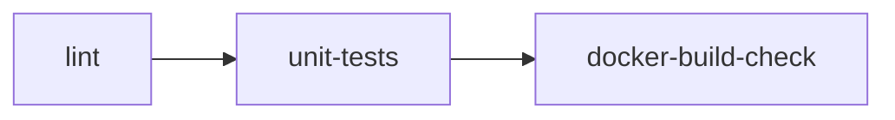

# GitHub Workflows Guide

This folder contains the active CI workflow for the repository. Continuous
Deployment is intentionally not part of this thesis pipeline because there is
no live deployment target; model promotion is review-gated in Stage 9.

## Files

- [.github/workflows/ci.yml](.github/workflows/ci.yml): pull-request and push quality checks.

## CI Workflow Summary

### Trigger

- Pull requests to main.
- Pushes to main and develop.

### Jobs



### Purpose

- Validate style and static quality.
- Run the unit-test suite.
- Verify the inference image builds without errors.

## Release Image (manual)

Tagged release images for the mentor / reproducer flow are built and pushed
manually rather than through a workflow:

```bash
docker build -t ghcr.io/<owner>/har-inference:<tag> -f docker/Dockerfile.inference .
docker push ghcr.io/<owner>/har-inference:<tag>
```

This keeps the repository explicit about what is automated (CI quality gates)
and what is a deliberate human step (release packaging, model promotion).

## Thesis Mapping

| Thesis topic | Workflow evidence |
| --- | --- |
| Continuous integration | [.github/workflows/ci.yml](.github/workflows/ci.yml) |
| Release engineering | manual `docker build && docker push` (no workflow) |
| Reproducibility guardrails | deterministic CI checks in [.github/workflows/ci.yml](.github/workflows/ci.yml) |
| Governance | model promotion is Stage 9, gated on Stage 7 trigger evaluation; not CI/CD |
