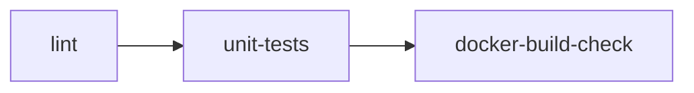
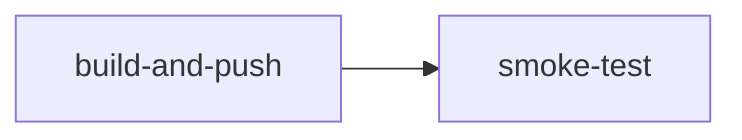
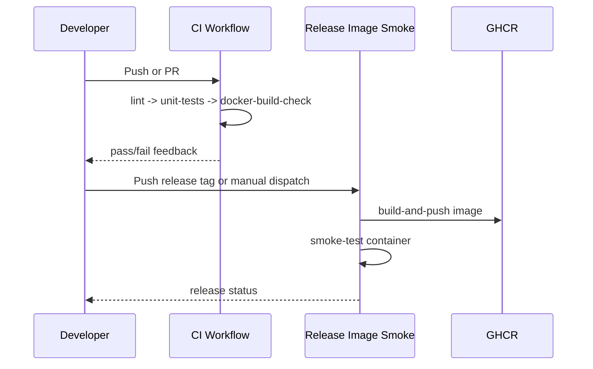

# GitHub Workflows Guide

This folder contains the active CI workflow and the optional release-image smoke
workflow for the repository. The release workflow builds and validates an
inference container image; it is not a production continuous-deployment system.

## Files

- [.github/workflows/ci.yml](.github/workflows/ci.yml): pull-request and push quality checks.
- [.github/workflows/cd.yml](.github/workflows/cd.yml): optional release image build/push and smoke validation.

## CI Workflow Summary

### Trigger

- Pull requests to main.
- Pushes to main and develop.

### Jobs

### Purpose

- Validate style and static quality.
- Run fast unit test suite.
- Verify inference image builds.

## Release Image Smoke Workflow Summary

### Trigger

- Tag push matching v*.*.*.
- Manual workflow dispatch with optional image tag.

### Jobs

### Purpose

- Build and push GHCR image.
- Start container and verify health endpoint.
- Provide release-packaging evidence, not automated production rollout.

## End-to-End Release Flow

## Thesis Mapping

| Thesis topic | Workflow evidence |
| --- | --- |
| Continuous integration | [.github/workflows/ci.yml](.github/workflows/ci.yml) |
| Release engineering | optional image build in [.github/workflows/cd.yml](.github/workflows/cd.yml) |
| Deployment validation | local container smoke-test job in [.github/workflows/cd.yml](.github/workflows/cd.yml) |
| Reproducibility guardrails | deterministic CI checks in [.github/workflows/ci.yml](.github/workflows/ci.yml) |

## Maintenance Rule

Whenever workflow logic changes, also update:

- [internal/reference/tech/ci_cd.md](internal/reference/tech/ci_cd.md)
- [internal/workflow/README.md](internal/workflow/README.md)
