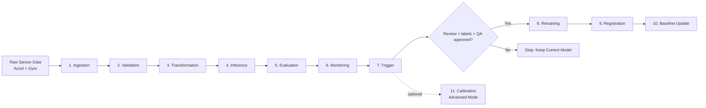
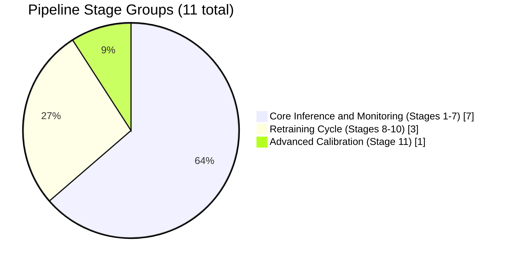

# HAR MLOps Pipeline for Wearable Anxiety Recognition

This repository contains an offline-first MLOps pipeline for anxiety-related human activity recognition (HAR) from wearable accelerometer and gyroscope data.

Primary goals:

- reproducible end-to-end pipeline execution
- explicit stage-by-stage workflow for thesis defense
- monitoring and review-gated trigger decisions
- artifact and evidence tracking for research reproducibility

## Project Workflow Summary

The pipeline entrypoint is [run_pipeline.py](run_pipeline.py), which orchestrates the following stages:

1. ingestion
2. validation
3. transformation
4. inference
5. evaluation
6. monitoring
7. trigger
8. retraining (optional)
9. registration (optional)
10. baseline_update (optional)
11. calibration (optional advanced mode)

## Visual Overview

### Pipeline Flow (End-to-End)



### Stage Composition Chart



## Project Setup and Structure

### Step 1: Create Environment

Option A (recommended, conda):

```powershell
conda create -n thesis-mlops python=3.11 -y
conda activate thesis-mlops
python -m pip install --upgrade pip
python -m pip install -r config/requirements.txt
```

Option B (editable install):

```powershell
python -m pip install --upgrade pip
python -m pip install -e .
python -m pip install -e .[dev]
```

After editable install, you can run the CLI command:

```powershell
har-pipeline
```

### Step 2: Verify Required Artifacts

Expected core files include:

- [models/runtime_contract/model_d1_final_20260528/finetuned_1DCNNBILSTM_HAR_model.keras](models/runtime_contract/model_d1_final_20260528/finetuned_1DCNNBILSTM_HAR_model.keras)
- [models/runtime_contract/model_d1_final_20260528/garmin_train_scaler.json](models/runtime_contract/model_d1_final_20260528/garmin_train_scaler.json)
- [models/runtime_contract/model_d1_final_20260528/garmin_train_scaled_baseline.json](models/runtime_contract/model_d1_final_20260528/garmin_train_scaled_baseline.json)
- one accel/gyro pair in [data/raw](data/raw)

If DVC-tracked assets are missing:

```powershell
dvc pull
```

### DVC Clarification

DVC is used in this repository for data/model artifact versioning and reproducibility support.
Pipeline orchestration is handled by [run_pipeline.py](run_pipeline.py), not by `dvc repro`.
A full DVC stage graph is not configured in the defended thesis version, so `dvc repro` is not configured for the full Stage 1-7 pipeline in this thesis version.
This is acceptable because the defended pipeline is executed through the Python stage orchestrator, while DVC supports artifact traceability.

### Defended Model Lineage

The default runtime now uses the final clean-contract Model D1 package:
[models/runtime_contract/model_d1_final_20260528](models/runtime_contract/model_d1_final_20260528).
The older mentor/vendor pretrained model remains historical and forensic
evidence only, because its strong legacy metrics depend on a different scaler
and tensor-layout contract.

### Model Promotion Policy

Hard rule for this repository:
- Default model for pipeline/API/Docker is the final clean-contract Model D1 package.
- Drift/monitoring alerts alone do not justify promotion.
- Retraining/fine-tuning can run only when labeled data is available for evaluation.
- Promotion away from Model D1 is allowed only if labeled comparison proves a candidate is better under the same clean proof-of-concept contract.
- If the candidate requires a hidden scaler/layout contract, keep it as forensic evidence only.

### Defended Inference Contract

The final proof-of-concept inference contract uses physical IMU units followed by the
packaged Garmin train-only StandardScaler:

- accelerometer: converted from milli-g to m/s^2 when needed
- gyroscope: retained in deg/s
- sampling rate: 50 Hz
- window size: 200 samples
- stride: 100 samples
- model input shape: `(N, 200, 6)`
- model output shape: 11 classes
- normalization: Garmin train-only z-score scaler from the Model D1 package
- deployment/unlabeled input is never used to fit the scaler
- gravity removal and calibration: disabled

The current Stage 6 runtime baseline is
[models/runtime_contract/model_d1_final_20260528/garmin_train_scaled_baseline.json](models/runtime_contract/model_d1_final_20260528/garmin_train_scaled_baseline.json).
Older raw or normalized baselines remain useful for legacy/A-B diagnostics, but
they are not the default drift reference.

### Monitoring Evidence Scope

Prometheus/Grafana are treated as optional future-work infrastructure; the defended implementation uses offline-first pipeline monitoring artifacts and trigger reports. Monitoring evidence for the thesis comes from pipeline-generated JSON/CSV artifacts, trigger-decision reports, logs, MLflow/DVC evidence, and saved run artifacts.

### Step 3: Run the Main Pipeline (Stages 1-7)

```powershell
python run_pipeline.py
```

### Step 4: Reproduce Thesis Main Result Path

Run an explicit stage sequence on a known data session:

```powershell
python run_pipeline.py --stages ingestion validation transformation inference evaluation monitoring trigger --accel-file data/raw/2025-08-19-08-58-40_accelerometer.csv --gyro-file data/raw/2025-08-19-08-58-40_gyroscope.csv
```

Detailed reproducibility instructions: [REPRODUCE.md](REPRODUCE.md)

### Step 5: Verify Outputs

You should see:

- run summaries in [logs/pipeline](logs/pipeline)
- stage artifacts in [artifacts](artifacts)
- tracking runs in [mlruns](mlruns)

## Common Pipeline Commands

Run only selected stages:

```powershell
python run_pipeline.py --stages inference evaluation monitoring trigger
```

Enable retraining path (trigger-gated stages 8-10):

```powershell
python run_pipeline.py --retrain --labels data/raw/labels.csv
```

Note: retraining/register/baseline-update stages execute only after Stage 7
governance and the required review, label, and QA conditions are satisfied.
Unlabeled session drift, collapse, or low confidence opens review work; it
does not justify immediate automatic retraining. AdaBN, TENT, and pseudo-label
adaptation hooks are archived research context, not active runtime modes.

Stage 8 retraining fine-tunes the current deployed Model D1 on labeled data
(two-phase fine-tune, train-only augmentation, balanced class weights,
user-holdout validation, reusing the saved train-only scaler) rather than
training from scratch. The candidate therefore keeps the Model D1 architecture
and is compared against the current model in Stage 9 (`is_better_than_current`,
with `auto_deploy=False`) before any promotion.

Run advanced calibration stage:

```powershell
python run_pipeline.py --advanced
```

Use a custom input file:

```powershell
python run_pipeline.py --input-csv data/raw/my_recording.csv
```

## Optional Services

### Docker Compose Services

```powershell
docker-compose up -d
docker-compose logs -f
docker-compose down
```

Container definitions and service notes are in [docker-compose.yml](docker-compose.yml).

### FastAPI Inference Service (Local)

```powershell
python -m uvicorn src.api.app:app --host 127.0.0.1 --port 8000 --reload
```

Useful local endpoints:

- `GET /docs`: interactive FastAPI documentation.
- `GET /api/health`: model/service health check.
- `GET /api/model/info`: active model metadata.
- `POST /api/upload`: upload raw sensor data for inference.

## Testing and Sanity Checks

Quick smoke tests:

```powershell
pytest -q --maxfail=1
```

Non-slow subset used in reproducibility checks:

```powershell
python -m pytest tests/ -m "not slow and not integration" -q --tb=short
```

Import/runtime sanity:

```powershell
python -m compileall src run_pipeline.py
```

## Repository Map

- [run_pipeline.py](run_pipeline.py): single entrypoint orchestrating pipeline stages
- [src](src): core implementation (pipeline, components, API, utilities)
- [config](config): config and dependency manifests
- [tests](tests): test suite
- [docs](docs): technical and thesis-oriented documentation
- [thesis](thesis): thesis sources and related materials
- [internal](internal): defense-preparation and working support materials
