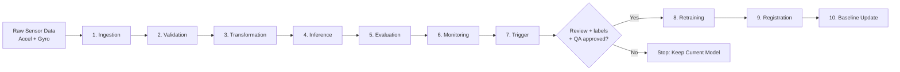

# HAR MLOps Pipeline — Wearable Anxiety Recognition

Offline-first MLOps pipeline for human activity recognition (HAR) from wrist-worn IMU data (accelerometer + gyroscope). Built as a Master's thesis project at the University of Siegen.

---

## Quick Start

### 1. Clone and set up environment

```powershell
git clone <repo-url>
cd MasterArbeit_MLops
conda create -n thesis-mlops python=3.11 -y
conda activate thesis-mlops
pip install -r config/requirements.txt
```

> Use `config/requirements.txt` for fresh installs. `config/requirements-lock.txt` is environment-specific and not guaranteed portable.

### 2. Restore model and data artifacts

```powershell
dvc pull
```

If DVC remote is unavailable, unzip the release artifact bundle over the repo root (contains model, example data, and defended evidence run).

### 3. Run the pipeline (Stages 1–7)

```powershell
python run_pipeline.py
```

Or on a specific session:

```powershell
python run_pipeline.py --stages ingestion validation transformation inference evaluation monitoring trigger --accel-file data/raw/2025-08-19-08-58-40_accelerometer.csv --gyro-file data/raw/2025-08-19-08-58-40_gyroscope.csv
```

See [REPRODUCE.md](REPRODUCE.md) for step-by-step reproduction instructions.

---

## Pipeline Stages



Stages 1–7 run automatically. Stages 8–10 require human review, labeled data, and explicit approval — no automatic model replacement.

---

## Runtime Contract (Model D1)

The defended model package is at `models/runtime_contract/model_d1_final_20260528/`.

| Parameter | Value |
|---|---|
| Input shape | `(N, 200, 6)` |
| Sampling rate | 50 Hz |
| Window size | 200 samples, stride 100 |
| Classes | 11 activity classes |
| Scaler | Garmin train-only z-score (`garmin_train_scaler.json`) |
| Baseline | Normalized D1 (`garmin_train_scaled_baseline.json`) |
| Accelerometer units | m/s² |
| Gyroscope units | deg/s |

---

## Common Commands

```powershell
# Run selected stages only
python run_pipeline.py --stages inference evaluation monitoring trigger

# Run retraining path (requires labeled data and trigger approval)
python run_pipeline.py --retrain --labels data/raw/labels.csv

# Start FastAPI inference service
python -m uvicorn src.api.app:app --host 127.0.0.1 --port 8000 --reload

# Run tests
pytest -q --maxfail=1

# Docker
docker-compose up -d
```

FastAPI endpoints:
- `GET /docs` — interactive API docs
- `GET /api/health` — health check
- `POST /api/upload` — upload sensor data for inference

---

## Repository Structure

| Path | Description |
|---|---|
| `run_pipeline.py` | Main pipeline entrypoint |
| `src/` | Pipeline components, API, utilities |
| `config/` | Configuration and dependencies |
| `models/runtime_contract/` | Defended D1 model package |
| `data/raw/` | Raw sensor input files |
| `artifacts/` | Per-run stage outputs |
| `logs/` | Pipeline result logs |
| `tests/` | Test suite |
| `thesis/` | Thesis PDF and source |
