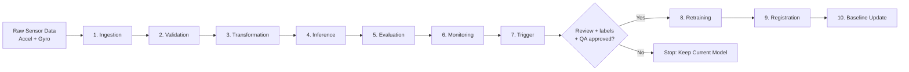

# HAR MLOps Pipeline — Wearable IMU-Based Activity Recognition

## Project Summary

Imagine wearing a smartwatch that can recognize movements such as tapping your fingers, scratching, or biting your nails. This project uses wrist movement data to predict these activities. The challenge is that people move differently, so a model that works well with familiar data may struggle with someone new.

I built a system that prepares sensor readings, predicts activities, and watches for unusual results. For example, it can flag a prediction for review when the result seems uncertain. I learned that a good AI project needs careful testing and monitoring, not only a trained model. This is a research prototype, not a medical diagnosis tool.

---

## Technical Documentation

Offline-first MLOps pipeline for wearable IMU-based human activity recognition (HAR), developed in a mental-health-adjacent monitoring context as a Master's thesis at the University of Siegen.

> **Scope:** Research prototype — not a clinical or diagnostic system. The pipeline focuses on reproducible inference, monitoring, drift evidence, and retraining governance for wearable activity signals.

## Thesis Status

| | |
|---|---|
| Submission date | 30 June 2026 |
| Program | M.Sc. Mechatronics, University of Siegen |
| Scope | Offline-first MLOps pipeline for wearable IMU-based HAR |
| Thesis material | Model contract, source code, evaluation notes and reproduction steps are documented in this repository. |

---

## Quick Start

### 1. Clone and set up environment

```powershell
git clone https://github.com/ShalinVachheta017/wearable-har-mlops-pipeline.git
cd wearable-har-mlops-pipeline
conda create -n thesis-mlops python=3.11 -y
conda activate thesis-mlops
pip install -r config/requirements.txt
```

> Use `config/requirements.txt` for fresh installs. `config/requirements-lock.txt` is environment-specific and not guaranteed portable.

### 2. Restore model and data artifacts

```powershell
dvc pull
```

If DVC remote is unavailable, unzip the release artifact bundle over the repo root (contains model, example data, and defended evidence run).

### 3. Run the pipeline (Stages 1–7)

```powershell
python run_pipeline.py
```

Or on a specific session:

```powershell
python run_pipeline.py --stages ingestion validation transformation inference evaluation monitoring trigger --accel-file data/raw/2025-08-19-08-58-40_accelerometer.csv --gyro-file data/raw/2025-08-19-08-58-40_gyroscope.csv
```

See [REPRODUCE.md](REPRODUCE.md) for step-by-step reproduction instructions.

---

## Pipeline Stages



Stages 1–7 run automatically. Stages 8–10 require human review, labeled data, and explicit approval — no automatic model replacement.

---

## Runtime Contract (Model D1)

The defended model package is at `models/runtime_contract/model_d1_final_20260528/`.

| Parameter | Value |
|---|---|
| Input shape | `(N, 200, 6)` |
| Sampling rate | 50 Hz |
| Window size | 200 samples, stride 100 |
| Classes | 11 activity classes |
| Scaler | Garmin train-only z-score (`garmin_train_scaler.json`) |
| Baseline | Normalized D1 (`garmin_train_scaled_baseline.json`) |
| Accelerometer units | m/s² |
| Gyroscope units | deg/s |

---

## Evaluation — what the model can and cannot do

The model recognizes **11 activities** from six wrist-sensor channels. Results depend strongly on whether the people in the test data were also represented during training.

| Evaluation | Accuracy | Macro F1 | What it means |
|---|---:|---:|---|
| Five-fold cross-validation, within the training distribution | **93.61%** | **0.952** | Strong performance when evaluation resembles the training data |
| Leave-one-user-out, users 1–6 | **44.42% mean** | **0.397 mean** | Much harder when testing on a person excluded from training |
| External labeled User 7 session | **36.96%** | **0.350** | A separate unseen-user test with 989 windows; mean prediction confidence was **0.858** |

These are **different evaluation settings**, not interchangeable estimates of deployment accuracy. High confidence does not mean a prediction is correct. See [model artifacts and evaluation evidence](models/README.md) for the defended Model D1 package and the external User 7 probe.

### Monitoring and controlled retraining

The pipeline monitors prediction confidence, uncertain windows, activity changes, dominant predictions, and changes in sensor-data distributions. Its output is evidence for **review**, not a medical conclusion. Stages 1–7 ingest data, validate it, transform it, predict activities, evaluate outputs, monitor risks, and decide whether review is needed. Stages 8–10 (retraining, registration and baseline update) require labeled data and human approval. No model is automatically replaced.

### Limitations

- The labeled cohort is small. Performance dropped considerably for people not represented in training.
- Sensor position, wearing style, recording conditions and one-device data limit generalization.
- Monitoring thresholds are engineering choices, not clinically validated safety guarantees.
- This is an **offline-first research prototype**. It does not diagnose, treat or clinically monitor mental health.
- A successful local/Docker run is not proof of safe or accurate performance for arbitrary users.

### Reproduction notes

Use the [step-by-step reproduction guide](REPRODUCE.md). Models and some data are DVC-managed, so a clone by itself may not contain the weights or a runnable sensor session. Restoring the exact runtime contract and checking the six-channel scaler, label order and units are essential.

---

## Common Commands

```powershell
# Run selected stages only
python run_pipeline.py --stages inference evaluation monitoring trigger

# Run retraining path (requires labeled data and trigger approval)
python run_pipeline.py --retrain --labels data/raw/labels.csv

# Start FastAPI inference service
python -m uvicorn src.api.app:app --host 127.0.0.1 --port 8000 --reload

# Run tests
pytest -q --maxfail=1

# Docker
docker-compose up -d
```

FastAPI endpoints:
- `GET /docs` — interactive API docs
- `GET /api/health` — health check
- `POST /api/upload` — upload sensor data for inference

---

## Repository Structure

| Path | Description |
|---|---|
| `run_pipeline.py` | Main pipeline entrypoint |
| `src/` | Pipeline components, API, utilities |
| `config/` | Configuration and dependencies |
| `models/runtime_contract/` | Defended D1 model package |
| `data/raw/` | Raw sensor input files |
| `artifacts/` | Per-run stage outputs |
| `logs/` | Pipeline result logs |
| `tests/` | Test suite |
| `thesis/` | Thesis PDF and source |
