# Thesis Journey and Evidence Reconstruction up to 2026-04-18

Generated on `2026-04-18` from repository evidence in `MasterArbeit_MLops`.

This document is a self-contained reconstruction of the thesis journey from the earliest repo activity through the current writing and code state. It is grounded in repository artifacts: Git history, tags, Markdown notes, thesis files, configs, reports, notebooks, scripts, and the current workspace. Where the repo does not contain a direct statement, the text uses `[inferred]` or `[unknown]` explicitly.

This document is an internal evidence-led reconstruction of the thesis journey and current readiness state. It is not itself a thesis chapter; it is a source document for final manuscript writing, supervision, and defense preparation.

## 1. Purpose, Scope, and Evidence Method

### 1.1 Purpose

The purpose of this file is to capture the full thesis journey in one place so that a reader who never opens the repo can still understand:

1. what the thesis is actually about,
2. how the technical system evolved,
3. what experiments were run,
4. what failed,
5. what was fixed,
6. what is still open,
7. and how close the thesis is to submission readiness.

This is not a marketing summary. It is meant to be examiner-proof: explicit about open gaps, inconsistent evidence, and places where the repo is ahead of the writing.

### 1.2 Evidence Scanned

The reconstruction is based on these repository evidence classes:

| Evidence class | What was scanned |
| --- | --- |
| Git history | `git log --all`, tags, branches, merge commits, commit counts |
| Core docs | `README.md`, `REPRODUCE.md`, thesis planning docs, audits, worklogs |
| Thesis source | `thesis/main.tex`, chapter `.tex` files, `thesis/references.bib`, `thesis/writing/`, `thesis/notes/` |
| Internal notes | `internal/notes/`, `internal/workflow/`, `internal/reference/`, `internal/writing/` |
| Config and runtime | `config/*.yaml`, `pyproject.toml`, `docker-compose.yml`, `run_pipeline.py`, pipeline source |
| Reports and logs | `reports/`, `logs/`, `outputs/ablation/`, synthetic comparison artifacts |
| Notebooks | notebook markdown cells and README-level guidance |
| Current workspace | current dirty-tree status, current test run, current branch state |

Directories intentionally treated as non-authoritative for this report:

| Directory type | Handling |
| --- | --- |
| `node_modules/` | skipped |
| `.venv/`, `__pycache__/`, build caches | skipped |
| large model binaries | referenced by existence and path, not parsed |

### 1.3 Confidence Markers

| Marker | Meaning |
| --- | --- |
| documented | directly supported by a repo file, commit, log, or output |
| `[inferred]` | likely conclusion from multiple artifacts, but not stated verbatim |
| `[unknown]` | the repo does not contain enough evidence to settle the point |

### 1.4 Quick Snapshot

| Item | Audited best-grounded statement as of `2026-04-18` |
| --- | --- |
| Official thesis title | `Developing a MLOps Pipeline for Continuous Mental Health Monitoring using Wearable Sensor Data` |
| Repository commit count scanned | `94` commits across all refs |
| Key tags | `v0.9.1`, `v1.0.0`, `v1.0.0-thesis`, `v1.0.1`, `v1.0.2`, `v1.0.3` |
| Thesis domain | offline-first wearable HAR for anxiety-related behaviors |
| Sensor/device context | Garmin wrist IMU, accelerometer + gyroscope, `50 Hz` |
| Participants / classes | `6` participants, `11` classes |
| Baseline model | `1D-CNN-BiLSTM`, about `499k` parameters |
| Thesis contribution | governed lifecycle and MLOps pipeline, not a novel classifier |
| Current runtime view | `11` stages exposed in `run_pipeline.py` |
| Thesis presentation view | `7` core stages + `3` conditional stages |
| Historical design view | `14` stages existed in design notes and older docs |

Evidence anchors: `docs/thesis/thesis_masterplan_v2_FINAL.md`, `README.md`, `run_pipeline.py`, `src/pipeline/production_pipeline.py`, `WORKLOG.md`, `thesis/writing/proposed_thinking_for_chapters.md`.

### 1.5 Document Layers

This memo deliberately mixes three useful but different layers. They should not be treated as the same kind of text when material is later moved into the thesis manuscript.

| Layer | What it contains | Best use |
| --- | --- | --- |
| Layer A: Thesis facts | problem framing, scope, architecture, experiments, findings, limitations | source material for thesis body chapters |
| Layer B: Development history | timeline, bugs, fixes, scope shifts, repo evolution | supervision, appendix support, defense preparation |
| Layer C: Internal readiness | completion estimates, time/risk planning, next actions | project management and execution only |

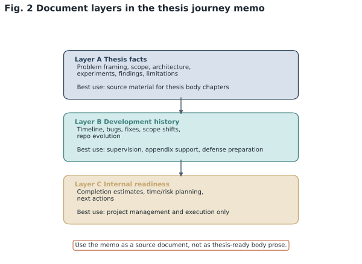

*Figure 2. Document layers in the thesis journey memo. Conceptual view of the memo's three layers: thesis facts, development history, and internal readiness. This figure clarifies that the support document mixes different text types and should not be pasted directly into thesis body prose.*

## 2. What the Thesis Actually Is

### 2.1 Problem Statement

The repo consistently converges on one core problem: how to build a practical, auditable, offline-first MLOps pipeline for wearable human activity recognition in a mental-health-adjacent setting where labeled production data is scarce, domain shift is real, and retraining cannot be allowed to happen blindly.

The specific activity-recognition target is anxiety-displaying or body-focused repetitive behaviors measured from wrist IMU data. The repo repeatedly frames the scientific baseline around earlier anxiety-activity work, especially ADAM-sense-style recognition of behaviors such as nail biting, hair pulling, scratching, and tapping [Khan2021]. The thesis then moves one layer up: not "can a classifier classify?", but "how do we operate such a classifier safely under changing data conditions?"

### 2.2 Actual Contribution

The evidence-led framing in `thesis/writing/proposed_thinking_for_chapters.md` is that the contribution is a governed lifecycle around a 1D-CNN-BiLSTM baseline, not a new model family. That governed lifecycle includes:

1. ingestion,
2. validation,
3. train-serve-consistent preprocessing,
4. inference,
5. evaluation where labels exist,
6. post-inference monitoring,
7. trigger-gated retraining,
8. registration and baseline management,
9. optional calibration and adaptation experiments.

This is aligned with MLOps concerns described in software engineering and MLOps literature [Amershi2019], while the wearable-HAR and transfer-learning framing follows [Lara2013], [Lyons2021], [Akbari2020], [Wang2024], and [Dhekane2024].

### 2.3 In Scope vs Out of Scope

| In scope | Out of scope or intentionally reduced |
| --- | --- |
| offline-first pipeline execution | full cloud deployment |
| single-machine reproducibility | Kubernetes / cluster orchestration |
| HAR classifier governance | clinically validated prognosis modeling |
| label-free monitoring signals | fully automated trustworthy self-improving system |
| conditional retraining branch | unrestricted auto-deploy of every new model |
| thesis-ready engineering evidence | SOTA model benchmarking against transformers |
| wrist-based Garmin batch and file upload workflow | end-to-end streaming Garmin Connect production system |

The prognosis layer is especially important. Early notes still discuss a second prognosis model, but later mentor-facing notes clearly recommend treating prognosis as designed but not implemented, with the HAR pipeline as the main contribution. That scope reduction is not a weakness; it is one of the main reasons the thesis became finishable.

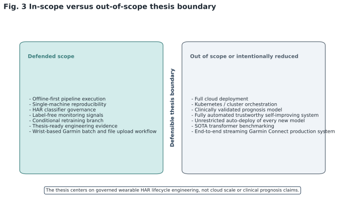

*Figure 3. In-scope versus out-of-scope thesis boundary. Scope map contrasting the defended thesis boundary with explicitly excluded or reduced ambitions. It highlights the thesis as an offline-first, single-machine, governed HAR lifecycle rather than a full cloud or clinical deployment.*

Evidence anchors: `internal/notes/solution_notes.md`, `thesis/notes/solution_notes.md`, `docs/thesis/thesis_masterplan_v2_FINAL.md`, `internal/notes/qna_explanations.md`.

### 2.4 Research Positioning

The repo implicitly positions the thesis at the intersection of:

1. wearable HAR,
2. mental-health-related activity recognition,
3. train-serve consistency under domain shift,
4. applied MLOps maturity around monitoring, gating, and reproducibility.

That is a narrower and stronger claim than "continuous mental health monitoring" in the broad clinical sense. The repo evidence does not support a claim that the thesis already predicts clinical states or anxiety severity directly. It does support a claim that the thesis implements the operational substrate around a behavior-recognition model that could feed later mental-health workflows.

A safer thesis-body wording is therefore:

> an offline-first wearable behavior-recognition system with MLOps governance for a mental-health-related use case

That phrasing is more precise than implying a clinically validated end-to-end monitoring system.

### 2.5 Core Thesis Claims Supported by Repository Evidence

The strongest thesis-facing claims supported by the repository are these:

| Core claim | Why it is defensible | Main evidence anchors |
| --- | --- | --- |
| An offline-first MLOps pipeline for wearable HAR can be implemented with explicit governance rather than unrestricted automation. | The repo separates observation stages from mutation stages and makes retraining conditional. | `run_pipeline.py`, `src/pipeline/production_pipeline.py`, `docs/TRIGGER_POLICY_EXPLANATION.md` |
| Train-serve inconsistency in wearable preprocessing materially changes downstream behavior. | Unit mismatch and gravity-removal choices produced measurable differences and required explicit control. | `config/pipeline_config.yaml`, `outputs/ablation/ablation_summary.csv`, `WORKLOG.md` |
| Monitoring and trigger-policy design meaningfully affect operational safety and false-alarm tradeoffs. | `two_of_three` policy materially improves precision relative to single-signal triggering. | `reports/TRIGGER_POLICY_EVAL.csv`, `docs/thesis/THRESHOLD_TRIGGER_JUSTIFICATION.md` |
| Same-input comparisons show that model choice, not only input distribution, can drive prediction collapse. | The old model repeatedly collapsed on the same raw pair while the retrained model did not. | `reports/before_vs_after_model_change/before_vs_after_model_change_ALL_IN_ONE.md` |
| Negative-result experiments are necessary because plausible preprocessing or governance changes can fail or even degrade behavior. | Config C worsened collapse and the 26-session unit-fix + abstain wave did not improve confidence. | `outputs/ablation/ablation_summary.csv`, `thesis/chapters/before_vs_after_26datasets.md` |
| The thesis contribution is governed lifecycle engineering around a baseline model, not a claim of model novelty or clinical deployment completeness. | The strongest repo notes and chapter plans explicitly frame the contribution that way. | `thesis/writing/proposed_thinking_for_chapters.md`, `docs/thesis/thesis_masterplan_v2_FINAL.md` |

## 3. Repo State in the Audited Workspace on 2026-04-18

### 3.1 Branch, Tag, and Workspace Snapshot

| Item | State on 2026-04-18 |
| --- | --- |
| Current checked-out branch | `epic/apr-foundation-baseline` at commit `ef84f69` (`readme update`) |
| `main` branch | `ae23c2b` (`data comparison with the synthetic data is done`) |
| Merge commits seen | `2026-04-16` synthetic-data branch merge, `2026-03-06` repo-cleanup PR merge |
| Key thesis tag | `v1.0.0-thesis` on `2026-03-06` |
| Worktree state | dirty; multiple modified files and untracked thesis/support files |

Important implication: the thesis story does not live only in committed history. Part of the current state exists only in the live workspace and notes.

### 3.2 Current Runtime Shape vs Historical Design Shape

One of the most important repo truths is that the stage count changed over time and the docs are not perfectly synchronized.

| View | Stage count | Meaning |
| --- | --- | --- |
| Historical engineering design | `14` | older full pipeline with extra research/advanced stages |
| Thesis presentation target | `10` | `7` core non-mutating stages + `3` conditional retraining stages |
| Current CLI/runtime | `11` | stages 1-10 plus `calibration` still exposed |

This is not merely cosmetic. It affects the writing. A thesis chapter that still presents all 14 stages as equally canonical will overclaim current scope. A thesis chapter that hides the conditional retraining branch will understate the MLOps contribution. The cleanest current interpretation is:

1. stages 1-7 are the operational core,
2. stages 8-10 are the governed mutation branch,
3. stage 11 calibration is optional and thesis-relevant but not core runtime,
4. stages 12-14 are historical/advanced and should not be sold as final thesis scope.

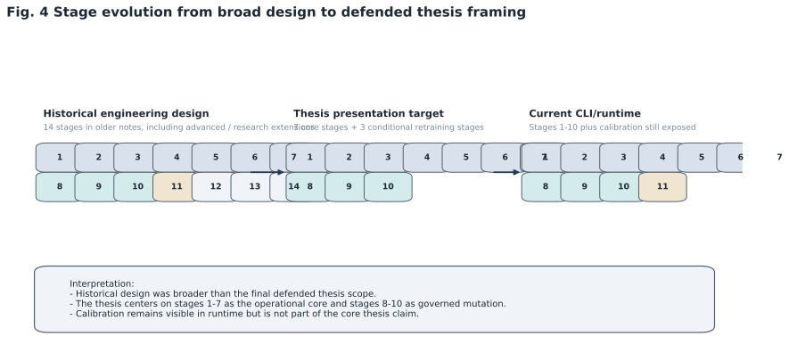

*Figure 4. Stage evolution from broad design to defended thesis framing. Comparison of the historical 14-stage design, the thesis presentation target of seven core plus three conditional stages, and the current 11-stage runtime that still exposes calibration. The figure shows how the project moved from broad ambition to a tighter and more defensible thesis scope.*

Evidence anchors: `run_pipeline.py`, `src/pipeline/production_pipeline.py`, `docs/thesis/thesis_masterplan_v2_FINAL.md`, `WORKLOG.md`, `thesis/writing/proposed_thinking_for_chapters.md`.

### 3.3 Current Thesis Writing Index

`thesis/main.tex` currently builds an 8-chapter structure:

| Chapter no. | File | Current role |
| --- | --- | --- |
| 1 | `thesis/chapters/ch1_introduction.tex` | intro, but currently thin |
| 2 | `thesis/chapters/ch2_background_related_work.tex` | background + related work merged |
| 3 | `thesis/chapters/ch3_offline_mlops_architecture.tex` | architecture |
| 4 | `thesis/chapters/ch4_data_model_development.tex` | most mature chapter |
| 5 | `thesis/chapters/ch5_pipeline_implementation.tex` | implementation |
| 6 | `thesis/chapters/ch6_monitoring_drift_retraining.tex` | monitoring / drift / retraining |
| 7 | `thesis/chapters/ch7_experiments_evaluation.tex` | experiments |
| 8 | `thesis/chapters/ch8_discussion_conclusion.tex` | discussion + conclusion merged |

Current repo planning notes argue convincingly that the thesis should move to a 9-chapter or 10-heading structure with clearer separation between:

1. background,
2. related work,
3. discussion,
4. conclusion,
5. monitoring/trigger policy,
6. experiment families.

That recommendation is not abstract. It comes from the evidence density in the repo: the pipeline and experiments are more mature than the current chapter map.

Evidence anchors: `thesis/main.tex`, `thesis/writing/proposed_thinking_for_chapters.md`, `docs/thesis/THESIS_WRITING_READINESS.md`, `thesis/CHAPTER_PROCESS_INDEX.md`.

### 3.4 Literature and Paper Inventory State

The repo contains a large literature inventory, but the formal thesis bibliography is still underdeveloped.

| Literature asset | Current state |
| --- | --- |
| `thesis/references.bib` | only a small starter bibliography, currently 7 visible core entries |
| chapter bucket manifest | exists: `internal/workflow/literature/chapter_buckets.md` |
| broader paper inventory | about `372` PDF files counted in current planning notes (`9` core, `28` sorted, `335` triage) |
| writing readiness | structure ahead of citations; bibliography behind available literature |

This means the thesis is not blocked by lack of papers. It is blocked by paper integration.

Evidence anchors: `thesis/references.bib`, `internal/workflow/literature/chapter_buckets.md`, `thesis/writing/index_and_paper_chapter_plan_2026-04-18.md`, `docs/thesis/THESIS_WRITING_READINESS.md`.

### 3.5 Test State: Documented Green States vs the Audited Workspace

There is a real discrepancy between the repo's documented green state and the current shell run.

| Evidence source | Result |
| --- | --- |
| `WORKLOG.md` on `2026-04-18` | `167 passed, 2 skipped, 0 failed` after review fixes |
| Earlier hardening milestone in worklog | `225/225` passing on `2026-02-14` |
| Audited shell run on `2026-04-18` in the workspace used for this memo | `112 passed, 13 failed, 42 errors, 2 skipped` |

Current failure conditions observed from the shell:

1. Python is `3.13.5`, while the project now declares `>=3.10` and historically ran in a thesis-specific environment closer to `3.11`.
2. There are Windows temp / cache permission errors.
3. The workspace is dirty and contains uncommitted changes.

Evidence-led summary:

> The repo documents a green thesis environment on 2026-04-18, but the separately audited workspace used for this memo no longer reproduces that state cleanly under the present interpreter and permissions setup.

That is a risk, not a contradiction to hide.

## 4. Chronological Reconstruction

### 4.1 Timeline Overview

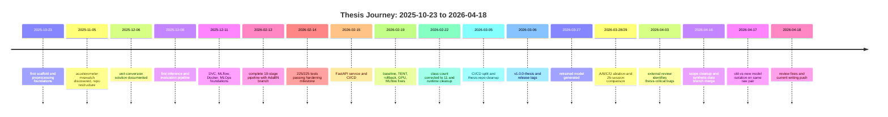

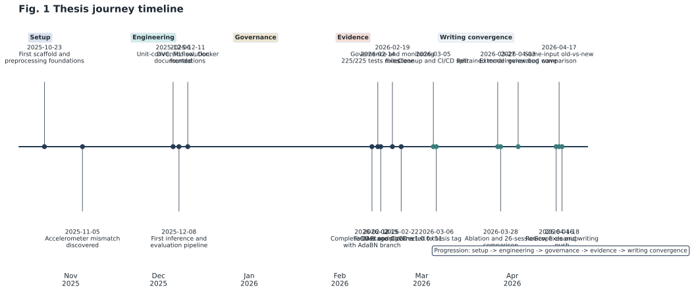

*Figure 1. Journey timeline from scaffold to writing convergence. Timeline of the thesis journey from the first repository scaffold on 2025-10-23 to the writing push on 2026-04-18. The milestones show the shift from setup and sensor debugging toward governance hardening, retraining evidence, and final writing convergence.*

### 4.2 Phase 0: Pre-Repo Scoping and Supervisor Framing `[inferred]`

**When:** before `2025-10-23` `[inferred]`

**What was likely established**

The repo suggests that the initial thesis topic was broader than the final implementation and included a mental-health monitoring ambition with a later prognosis component. The official title and later mentor notes imply that the supervisor wanted a production-oriented framing from the beginning, but the exact day of that framing does not appear in the repo.

**Why it mattered**

This early framing explains two later phenomena:

1. why the repo originally carried a larger 14-stage design with more future-facing modules, and
2. why later notes spend time shrinking the prognosis ambition into future work.

**How it was framed**

The best evidence comes from later planning documents rather than the first commits: official title fixed by supervisor, Garmin wearable context, offline-first scope, and MLOps governance as the contribution layer.

**What was unresolved**

1. exact supervisor meeting dates `[unknown]`,
2. exact moment the prognosis layer was downgraded `[unknown date, documented later]`,
3. exact first architecture decision date for 1D-CNN-BiLSTM `[unknown]`.

Evidence anchors: `docs/thesis/thesis_masterplan_v2_FINAL.md`, `internal/notes/solution_notes.md`, `internal/notes/qna_explanations.md`.

### 4.3 Phase 1: Repo Inception and Early Sensor Pipeline Foundations

**When:** `2025-10-23` to `2025-11-05`

**What was done**

The earliest commits show project scaffolding, data preprocessing, sensor-pipeline creation, and model-training groundwork. This was the phase where the thesis moved from topic to codebase.

Concrete signs of this phase:

1. first scaffolding and initial file structure,
2. preprocessing pipeline beginnings,
3. sensor data pipeline setup,
4. training pipeline creation,
5. movement classification work.

**Why it was done**

Before any MLOps story could exist, the repo needed a working path from raw sensor files to model-ready data. The project could not start at monitoring or retraining; it had to first build the ingest-transform-train base.

**How it was done**

The codebase direction from the start was file-centric and Python-centric:

1. Python scripts and source modules,
2. notebook-assisted data understanding,
3. local-first processing,
4. explicit sensor fusion and preprocessing logic.

**What went wrong**

Very early, the project ran into data reality instead of toy-data convenience. By `2025-11-05`, commit messages and later worklogs show the first major realization: production accelerometer data did not line up cleanly with model expectations.

**How it was solved**

Not solved immediately. This phase mostly exposed the problem and forced the repo to become more data-engineering-heavy than a purely model-centric thesis.

**Decisions taken**

1. the thesis would own the full preprocessing path rather than assume clean inputs,
2. raw accelerometer and gyroscope handling would be explicit,
3. the repo structure would keep code, data preparation, and documentation together.

Evidence anchors: git commits from `2025-10-23` to `2025-11-05`, `WORKLOG.md`, `notebooks/README.md`.

### 4.4 Phase 2: Data Integrity, Unit Mismatch, and First Real Debugging Cycle

**When:** `2025-11-05` to `2025-12-08`

**What was done**

This was the first real engineering phase rather than mere setup. The key repository problem became: why does production sensor data behave differently from training-time expectations?

Major outputs:

1. accelerometer-data mismatch investigation,
2. unit-conversion logic,
3. production preprocessing notebook,
4. first inference and evaluation path.

**Why it was done**

Without unit consistency, every downstream result is compromised. The repo repeatedly returns to this issue because Garmin-style accelerometer values can arrive in milliG while the training pipeline expects m/s².

**How it was done**

The repo used a mixture of:

1. notebook inspection,
2. config-based preprocessing,
3. direct comparisons between production and labeled/training data,
4. deterministic windowing and normalization pipelines.

**What went wrong**

The repo discovered a classic train-serve mismatch:

1. raw wearable units differed from model expectations,
2. column naming and input formatting were inconsistent,
3. silently wrong inference was possible even when code did not crash.

**How it was solved**

The fix path was disciplined:

1. explicit unit conversion was added,
2. preprocessing notebooks documented the step order,
3. inference and evaluation were moved toward reproducible pipeline stages.

**What was decided**

This phase explains one of the thesis's strongest later messages: train-serve consistency is not optional. It is a central engineering requirement.

Evidence anchors: `WORKLOG.md`, `notebooks/production_preprocessing.ipynb`, `config/pipeline_config.yaml`, git commits around `2025-12-06` and `2025-12-08`.

### 4.5 Phase 3: First MLOps Foundation Layer

**When:** `2025-12-11` to `2025-12-12`

**What was done**

The repo added the first recognizable MLOps infrastructure:

1. DVC,
2. MLflow,
3. Docker / Docker Compose,
4. repo reorganization toward production structure.

**Why it was done**

The thesis was clearly not intended to remain a notebook-only study. By December, the repository started to formalize experiment tracking, model storage, and environment reproducibility.

**How it was done**

The chosen stack was practical and local:

1. MLflow for experiments and registry,
2. DVC for large artifacts,
3. Docker for reproducible services,
4. GitHub Actions later for CI/CD.

**What went wrong**

At this point the repo had more structure than proof. The presence of MLOps tools did not yet mean the full pipeline or thesis evidence existed. This phase laid plumbing, not final scientific claims.

**How it was solved later**

The repo continued to harden the tooling in February and March. December was the infrastructure commitment point, not the finished system.

**Decisions taken**

1. self-hosted/open tooling over SaaS dependence,
2. reproducibility over cleverness,
3. single-machine scope rather than premature distributed orchestration.

Evidence anchors: git commits on `2025-12-11`, `.dvc/`, `config/mlflow_config.yaml`, `docker/`, `docker-compose.yml`.

### 4.6 Phase 4: Full Pipeline Assembly and Service Exposure

**When:** `2026-02-12` to `2026-02-16`

**What was done**

This is the first phase where the repo begins to look like the thesis it now claims to be.

Major milestones:

1. complete 10-stage pipeline with AdaBN branch,
2. major testing milestone (`225/225` in worklog),
3. advanced pipeline features,
4. FastAPI inference service,
5. CI/CD implementation.

**Why it was done**

By this point the thesis had moved from "we can train and infer" to "we can operationalize." The repo needed artifact handoff between stages, health checks, and a serving layer.

**How it was done**

The `ProductionPipeline` abstraction, `run_pipeline.py`, Docker images, and FastAPI entrypoints became the operational backbone.

**What went wrong**

This phase also planted later complexity debt:

1. advanced stages grew faster than the final thesis scope,
2. Prometheus/Grafana/Alertmanager style infrastructure appeared in design docs,
3. the line between core thesis contribution and optional observability demo was not yet cleanly separated.

**How it was solved later**

Later notes reframe this complexity into a thesis-friendly structure: seven core stages, three conditional retraining stages, and optional research extensions.

**Decisions taken**

1. stage-based orchestration instead of loose scripts,
2. API layer with FastAPI,
3. test-first hardening to make operational claims defensible.

Evidence anchors: `WORKLOG.md`, git commits from `2026-02-12` to `2026-02-16`, `run_pipeline.py`, `src/pipeline/production_pipeline.py`, `src/api/app.py`.

### 4.7 Phase 5: Hardening, Governance, and Scope Correction

**When:** `2026-02-19` to `2026-02-23`

**What was done**

This phase is full of operational corrections rather than feature marketing:

1. normalized baseline and monitoring fixes,
2. TENT and pseudo-label rollback handling,
3. GPU diagnostics,
4. MLflow handling improvements,
5. stage 11 calibration,
6. Docker and API path repairs,
7. class-count correction to 11,
8. threshold naming cleanup.

**Why it was done**

The thesis was becoming more exposed to consistency checks. Claims about number of classes, model size, thresholds, and deployment paths had to be aligned with code.

**How it was done**

Through a mix of:

1. config cleanup,
2. tests,
3. runtime fixes,
4. documentation correction,
5. model and baseline governance changes.

**What went wrong**

Several important issues surfaced:

1. class taxonomy had drifted,
2. threshold naming was inconsistent,
3. deployment path assumptions were fragile,
4. advanced adaptation logic was outpacing fully proven evidence.

**How it was solved**

By tightening the contract between config, runtime, and documentation. This phase is the bridge between "ambitious repo" and "defensible repo."

**What was decided**

1. 11 classes are the canonical label space,
2. monitoring and trigger semantics must be explicit,
3. optional adaptation features must remain optional in the thesis narrative.

Evidence anchors: `WORKLOG.md`, `docs/THESIS_CONSISTENCY_NOTES.md`, `docs/TRIGGER_POLICY_EXPLANATION.md`, git commits around `2026-02-19` and `2026-02-22`.

### 4.8 Phase 6: Thesis Freeze Point, Release Tags, and Repo Cleanup

**When:** `2026-03-05` to `2026-03-06`

**What was done**

This was the first explicit thesis packaging phase.

Major outputs:

1. CI/CD split finalized,
2. Docker inference/CD fixes,
3. repo cleanup merge,
4. release tags including `v1.0.0-thesis`,
5. evidence and writing scaffolding strengthened.

**Why it was done**

The project needed a stable cut of the system that could serve as a thesis anchor. A tag is not the thesis itself, but it is a strong line in the sand.

**How it was done**

Through repo hygiene, workflow separation, and release-oriented fixes. The merge on `2026-03-06` is especially important because it shows a conscious push from building to consolidating.

**What went wrong**

Even at this freeze point, later audits show that several issues still remained:

1. rollback path mismatch,
2. over-optimistic documentation in some places,
3. writing behind implementation,
4. evidence uneven across sections.

**How it was solved later**

The answer was not one fix; it was a series of audits, experiment bundles, and scope cuts through April.

**What was decided**

1. the thesis needed a tagged baseline,
2. the writing would be evidence-led,
3. code maturity alone was not enough; narrative maturity became the next bottleneck.

Evidence anchors: git tags, merge commit `dcdf2f0`, `WORKLOG.md`, `internal/workflow/april_15_completion_audit_and_execution_plan.md`.

### 4.9 Phase 7: Retraining Evidence, A/B/C/D Ablation, and Negative Results

**When:** approximately `2026-03-27` to `2026-03-29`

**What was done**

This is one of the most thesis-critical evidence waves:

1. a retrained model `har_model_20260327_223917.keras` exists,
2. the A/B/C/D preprocessing ablation was run across `100` configuration-session combinations,
3. the 26-session unit-fix + abstain comparison was run,
4. results were exported into thesis-facing tables and summaries.

**Why it was done**

The repo needed to answer two questions:

1. which preprocessing changes actually help under production-like data?
2. are conservative monitoring and abstain changes true improvements or just different routing behavior?

**How it was done**

With dedicated experiment scripts:

1. `scripts/run_ablation_experiment.py`,
2. `scripts/windowing_ablation.py`,
3. batch pipeline runs over raw session pairs.

**What went wrong**

The most important negative result came from honesty, not success:

The 26-session unit-fix + abstain change did **not** improve mean confidence. It mainly increased `REVIEW` routing. That means it is governance evidence, not a clear performance improvement.

**How it was solved**

It was not "solved" by pretending it worked. The repo preserves it as a negative-result ablation, which is exactly what an examiner should want.

**What was decided**

1. Config labels A/B/C/D were formalized,
2. Config D emerged as the best class-diversity configuration,
3. gravity removal alone (Config C) was actively harmful in this setup,
4. negative results would stay in the thesis instead of being buried.

Evidence anchors: `outputs/ablation/ablation_results.csv`, `outputs/ablation/ablation_summary.csv`, `thesis/chapters/before_vs_after_26datasets.md`, `thesis/tables/before_vs_after_26datasets.csv`.

### 4.10 Phase 8: Synthetic-vs-Actual Validation and External Review Shock

**When:** `2026-04-01` to `2026-04-03`

**What was done**

The project compared actual labeled data and synthetic datasets through the pipeline and then underwent an external-style code/thesis review.

Key outputs:

1. `actual_vs_synthetic_20260403` artifacts,
2. synthetic comparison logs,
3. `bug_april.md` with concrete BUG/FIX/GAP items.

**Why it was done**

The thesis needed to know whether synthetic data behaves like real data and whether the monitoring system can distinguish healthy vs degraded conditions.

**How it was done**

By running labeled actual data and synthetic variants through the same stages 1-7 pipeline and comparing:

1. accuracy,
2. macro F1,
3. confidence,
4. uncertainty,
5. dominant class behavior,
6. drift scores,
7. trigger outputs.

**What went wrong**

This phase uncovered thesis-critical flaws:

1. `reused_existing` field missing,
2. Stage 1 labels not reaching Stage 5 evaluation correctly,
3. duplicate constants,
4. hand-tapping dominance still under-explained,
5. real-data drift around `1.0434` under-documented,
6. fragile cleanup control flow.

**How it was solved**

Some items were fixed immediately in April; others turned into explicit open gaps. This review phase is one of the repo's strongest signs of maturity because it documents critique precisely instead of only logging successes.

**What was decided**

1. external review findings should be captured as numbered bug/fix records,
2. thesis-critical evidence had to be regenerated after fixes,
3. the model-collapse question required a direct same-input comparison.

Evidence anchors: `internal/notes/bug_april.md`, `thesis/notes/bug_april.md`, `logs/synthetic_runs/actual_vs_synthetic_20260403.md`.

### 4.11 Phase 9: Scope Cleanup, Same-Input Model Comparison, and Final April Push

**When:** `2026-04-16` to `2026-04-18`

**What was done**

This is the most important final convergence phase before writing:

1. stages 12-14 were removed from current runtime scope,
2. the 26 raw sessions plus 2 synthetic datasets were batch-rerun,
3. old-vs-new model behavior was isolated on the same raw pair,
4. synthetic comparison was updated with the correct retrained model,
5. a long list of review fixes was applied,
6. the worklog captured a thesis-oriented audit trail.

**Why it was done**

The repo finally needed a clean answer to a central puzzle:

Was the observed hand-tapping collapse caused by data priors, preprocessing, or the specific deployed model?

**How it was done**

Through same-input controlled reruns:

1. old historical pretrained-model reference,
2. new retrained-model run on the same raw files,
3. controlled rerun of the old model again on the same raw files.

**What went wrong**

The answer was uncomfortable but clean: the old pretrained model itself was the collapse driver on that session, not merely input-class priors. The old model repeated `85.6%` hand-tapping dominance; the new retrained model spread predictions across all `11` classes with top class only `29.0%`.

**How it was solved**

By documenting the comparison carefully and treating retraining-stage validation as first-class thesis evidence rather than as an anecdote.

**What was decided**

1. the old-vs-new comparison is thesis-critical positive evidence,
2. stages 12-14 should not dominate the thesis story,
3. the work now shifts from experimentation to writing, evidence placement, and gap closure.

Evidence anchors: `reports/before_vs_after_model_change/before_vs_after_model_change_ALL_IN_ONE.md`, `reports/before_vs_after_model_change/reports/model_change_improvement_chain.md`, `WORKLOG.md`, `internal/notes/bug_april.md`.

## 5. Architecture and Design Decisions

### 5.1 Why Offline-First

The repo repeatedly documents an offline-first architecture for three grounded reasons:

1. thesis-scale practicality,
2. reproducibility without cloud dependence,
3. suitability for local or air-gapped research workflows.

This is not an anti-cloud ideology. It is a scope choice. The repo argues that a master's-thesis proof of concept should demonstrate reliable local orchestration before claiming distributed production patterns. That makes sense for the available infrastructure and the actual contribution.

Evidence anchors: `README.md`, `docs/thesis/thesis_masterplan_v2_FINAL.md`, `docs/thesis/DEFENSE_PLAN.md`.

### 5.2 Why 1D-CNN-BiLSTM Instead of Chasing Novel Models

The rationale is consistent across chapter drafts, notes, and defense prep:

1. The fixed model input is a four-second six-channel IMU tensor with shape `(200, 6)`.
2. The convolutional blocks capture local temporal movement patterns: short peaks, oscillations, impulses, and direction changes in accelerometer and gyroscope channels [Lyons2021].
3. The BiLSTM layers model temporal dependencies across the completed four-second window, which is appropriate for offline window classification rather than strict sample-level real-time inference [Khan2021].
4. The dense head maps the learned representation to 11 activity classes.
5. The softmax output is operationally important because later monitoring uses the probability vector for confidence summaries, uncertainty interpretation, dominant-class analysis, and trigger evaluation.
6. The thesis contribution is operational MLOps, train-serve consistency, monitoring, and governed retraining, not model novelty.
7. Transformers are acknowledged as relevant but intentionally not made the thesis center because they would shift effort toward model benchmarking instead of governance, and they generally require more data and compute for a fair comparison `[documented in defense_qa]`.

This is a strong thesis decision. It narrows the claim to something defensible.

The safest Chapter 4 wording is:

> The purpose is not to introduce a novel classifier, but to justify why a 1D-CNN-BiLSTM model is an appropriate and reproducible baseline for six-channel wearable IMU windows. From an MLOps perspective, the architecture matters because it defines the stable input and output contract consumed by later pipeline stages.

Evidence anchors: `thesis/chapters/ch4_data_model_development.tex`, `models/pretrained/model_info.json`, `internal/writing/defense_qa.md`, `src/train.py`, `internal/workflow/DECISION_REGISTER.csv`.

### 5.3 Why ADAM-sense Framing and Pretraining Direction

The repo consistently uses ADAM-sense as the conceptual anchor for anxiety-related activity recognition [Khan2021]. The practical role of ADAM-sense in this thesis is twofold:

1. it justifies the label taxonomy and problem choice,
2. it provides the transfer-learning or pretraining context around the deployed baseline.

The exact lineage of every pretrained weight tensor is not fully narrated in one single source file, so the safest wording is:

> The thesis baseline is framed as a 1D-CNN-BiLSTM model in the ADAM-sense problem family and later fine-tuned/adapted in the repo's own pipeline context; the repo clearly treats ADAM-sense as the reference dataset/paper baseline, even where the precise weight-training chronology is distributed across notes and training code. `[inferred]`

What is fully documented is that the final thesis should compare against ADAM-sense-style anxiety activity recognition, not against generic HAR only.

Evidence anchors: `docs/thesis/thesis_masterplan_v2_FINAL.md`, `thesis/chapters/ch4_data_model_development.tex`, `thesis/writing/proposed_thinking_for_chapters.md`, `src/train.py`.

### 5.4 Why TensorFlow/Keras, Not PyTorch

The explicit repo rationale is practical:

1. consistency with the supervisor's existing codebase and deployment tooling,
2. direct `.keras` model save/load path,
3. already-integrated training and serving stack,
4. no need to replatform the whole project just to use a different framework.

This is not a claim that TensorFlow is universally better. It is a consistency decision.

Evidence anchors: `thesis/reference/why_by_tech.md`, `src/train.py`, `src/api/app.py`, `pyproject.toml`.

### 5.5 Why Stage-Based Orchestration

The stage-based pipeline exists because the thesis is about lifecycle governance, not just inference. A single monolithic script would make it harder to:

1. preserve artifacts between stages,
2. test stage boundaries,
3. insert monitoring and trigger logic,
4. keep mutation stages conditional,
5. explain the system in thesis form.

The cleanest thesis framing is:

1. stages 1-7 observe and assess,
2. stages 8-10 mutate under governance,
3. calibration is optional,
4. advanced research stages are non-essential extensions.

This decomposition is one of the thesis's strongest engineering contributions because it makes model mutation a governed action rather than an invisible side effect.

Evidence anchors: `run_pipeline.py`, `src/pipeline/production_pipeline.py`, `docs/thesis/thesis_masterplan_v2_FINAL.md`, `docs/TRIGGER_POLICY_EXPLANATION.md`.

### 5.6 Why 7 Core + 3 Conditional Is Better Than a Flat 10 or 14

The repo's own writing notes answer this directly: the conditional nature of retraining is the interesting design choice. Inference, evaluation, and monitoring can run repeatedly without changing the deployed model. Retraining, registration, and baseline update should happen only when governance conditions are met.

That leads to this thesis-friendly picture:

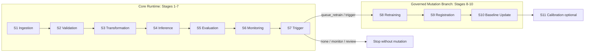

This diagram is better than the older "14 stages all at once" story because it matches the actual thesis contribution: governance around when not to retrain is as important as retraining itself.

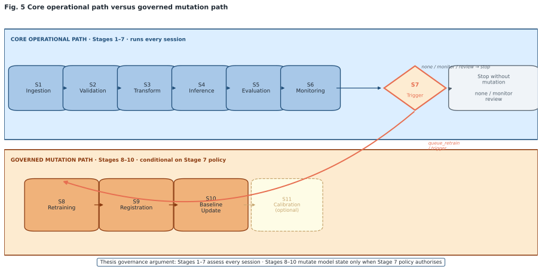

*Figure 5. Core runtime versus governed mutation branch. Stage-based architecture showing the seven-stage operational core and the conditional retraining branch for stages 8-10, with calibration shown separately as optional. The visual makes explicit that model mutation is governed rather than automatic.*

### 5.7 Why FastAPI

The repo justification is straightforward and credible:

1. it provides a simple local REST interface,
2. automatic docs and validation are convenient,
3. it supports a health endpoint and upload workflow,
4. it integrates naturally with metrics export.

The thesis does not need a heavyweight serving framework. It needs a reproducible, inspectable service boundary. FastAPI fits that need.

Evidence anchors: `README.md`, `src/api/app.py`, `thesis/reference/why_by_tech.md`, `thesis/reference/tech/fastapi.md`.

### 5.8 Why No Kubernetes

This is one of the healthiest negative decisions in the repo. The repo repeatedly says Kubernetes is out of scope because:

1. the system is single-machine,
2. the thesis does not claim horizontal scaling,
3. no cluster is needed to prove the pipeline logic,
4. forcing Kubernetes in would increase operational surface area without strengthening the core thesis argument.

This should remain a future-work item, not a missing checkbox.

Evidence anchors: `docs/thesis/thesis_masterplan_v2_FINAL.md`, `internal/notes/solution_notes.md`, `internal/notes/product_review.md`, `thesis/reference/why_by_tech.md`.

### 5.9 Why Prometheus/Grafana Were Reduced in Importance

Historically, the repo designed a broader monitoring stack with Prometheus, Alertmanager, and Grafana. The current thesis position should be more conservative:

1. monitoring JSON artifacts and pipeline reports are core evidence,
2. Prometheus/Grafana are historical/optional/future-work infrastructure, not defended current implementation evidence,
3. the current simplified runtime no longer depends on full monitoring-stack deployment,
4. some docs still overstate Prometheus/Grafana as if they were live core runtime.

The honest thesis wording is:

> Prometheus/Grafana are treated as optional future-work infrastructure; the defended implementation uses offline-first pipeline monitoring artifacts and trigger reports.

Evidence anchors: current `docker-compose.yml`, `internal/notes/solution_notes.md`, `internal/notes/qna_explanations.md`, `docs/thesis/deep-research-report.md`.

## 6. Data Pipeline and Model Foundations

### 6.1 Dataset Summary

The strongest current dataset statement in the thesis files is:

| Property | Value |
| --- | --- |
| device context | Garmin wrist-worn IMU |
| channels | `Ax, Ay, Az, Gx, Gy, Gz` |
| sampling rate | `50 Hz` |
| participants | `6` |
| raw samples | `385,326` |
| classes | `11` |

The 11 classes are:

1. ear_rubbing,
2. forehead_rubbing,
3. hair_pulling,
4. hand_scratching,
5. hand_tapping,
6. knuckles_cracking,
7. nail_biting,
8. nape_rubbing,
9. sitting,
10. smoking,
11. standing.

The repo also distinguishes between:

1. labeled controlled/lab-style data used for training and formal evaluation,
2. free-living or production-style Garmin session data,
3. synthetic datasets used to stress the monitoring/evaluation story.

Evidence anchors: `thesis/chapters/ch4_data_model_development.tex`, `README.md`, `logs/synthetic_runs/actual_vs_synthetic_20260403.md`.

### 6.2 Preprocessing Path

The baseline preprocessing path is:

1. validate sensor schema and ranges,
2. merge or accept fused accelerometer/gyroscope input,
3. convert accelerometer units from milliG to m/s²,
4. normalize with the training-time scaler,
5. resample/align to `50 Hz`,
6. create windows of `200` samples with `50%` overlap,
7. save `production_X.npy` for downstream stages.

This path exists because the model expects tensors of shape `(N, 200, 6)` and production data must match the training-time representation.

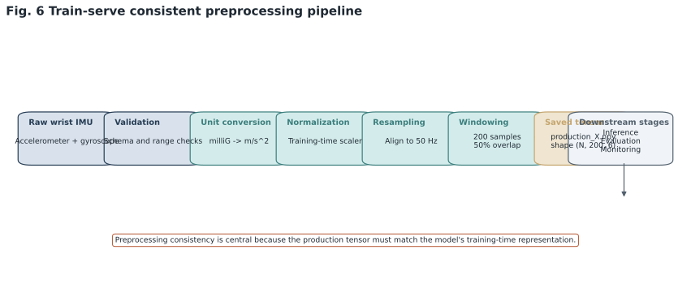

*Figure 6. Train-serve consistent preprocessing pipeline. Compact data-flow view from raw wrist IMU files through validation, unit conversion, normalization, resampling, and windowing to the saved `production_X.npy` tensor. The figure explains why preprocessing consistency is a thesis-level engineering concern rather than an implementation detail.*

### 6.3 Why Gravity Removal Became a Thesis-Critical Issue

The repo's current canonical config definitions are:

| Config | Gravity removal | Calibration | Interpretation |
| --- | --- | --- | --- |
| A | `False` | `False` | baseline |
| B | `False` | `True` | calibration only |
| C | `True` | `False` | gravity only |
| D | `True` | `True` | gravity + calibration |

The most important thesis lesson from this matrix is not just "D won." It is:

1. train-serve mismatch matters,
2. gravity removal absent in the original training regime can become harmful if added naively,
3. calibration helps only in the context of the full transform choice,
4. controlled ablations are necessary because signal-cleaning intuition can be wrong.

Config C is the warning sign. It made the collapse worse.

Evidence anchors: `docs/THESIS_CONSISTENCY_NOTES.md`, `outputs/ablation/ablation_summary.csv`.

### 6.4 Windowing Choice

The windowing ablation file documents six combinations:

| window | overlap | accuracy | macro F1 |
| --- | --- | --- | --- |
| 128 | 0.25 | 0.6733 | 0.6705 |
| 128 | 0.50 | 0.6658 | 0.6607 |
| 200 | 0.25 | 0.6764 | 0.6762 |
| 200 | 0.50 | 0.6879 | 0.6852 |
| 256 | 0.25 | 0.6775 | 0.6700 |
| 256 | 0.50 | 0.7354 | 0.7305 |

The repo still keeps `200` with `50%` overlap as the canonical thesis setting even though `256 / 0.50` is numerically stronger in this ablation. That decision is defended as a reproducibility and reference-paper alignment choice rather than raw metric maximization.

This is acceptable if written honestly:

1. `256` performed better in the lightweight ablation,
2. `200` was retained for consistency with the established baseline and end-to-end pipeline design,
3. this is a deliberate tradeoff, not an oversight.

Evidence anchors: `reports/ABLATION_WINDOWING.csv`, `internal/writing/defense_qa.md`, `thesis/reference/why_book.md`.

### 6.5 Model Training Basis

The baseline model is a `1D-CNN-BiLSTM` with about `499,131` parameters. Evidence across training code and notes indicates:

1. the current canonical training implementation uses grouped cross-validation with user IDs as groups,
2. MLflow tracked runs,
3. the model family exists in `src/train.py`,
4. the deployed baseline is matched by the `v1` architecture in training code,
5. scaler fitting is performed on training data/folds rather than on the full dataset.

Important limitation:

The strongest limitation is not ordinary window-level stratified CV, because the current code supports grouped user folds. The safer limitation is that the labeled corpus contains only six participants, so even grouped folds cannot support a broad claim of subject-independent deployment robustness. The model-development story is operationally promising, but it remains bounded by the small labeled participant pool.

Evidence anchors: `src/train.py`, `models/pretrained/model_info.json`, `internal/notes/product_review.md`, `thesis/chapters/ch4_data_model_development.tex`.

## 7. Experiment Ledger

### 7.1 Experiment Families Captured

| Experiment family | Unit count captured | Main artifact |
| --- | --- | --- |
| Preprocessing ablation A/B/C/D across sessions | `100` runs | `outputs/ablation/ablation_results.csv` |
| Windowing ablation | `6` settings | `reports/ABLATION_WINDOWING.csv` |
| Trigger policy evaluation | `5` policy variants | `reports/TRIGGER_POLICY_EVAL.csv` |
| Unit-fix + abstain 26-session comparison | `26` compared sessions | `thesis/tables/before_vs_after_26datasets.csv` |
| Same-input old-vs-new model comparison | `3` key runs | `reports/unlabeled_rawpair_old_vs_new_20260417.*` |
| Actual vs synthetic comparison | `3` datasets | `internal/synthetic_comparison_20260416_FINAL.md` |

Total discrete experiment entries captured in this document: `143`.

### 7.2 Preprocessing Ablation A/B/C/D

The summary file makes the conclusion unusually clear:

| Metric | A | B | C | D |
| --- | --- | --- | --- | --- |
| mean unique classes predicted | `7.08` | `7.88` | `5.32` | `9.72` |
| mean hand_tapping share | `78.37%` | `73.22%` | `96.72%` | `50.14%` |
| reduction vs A | baseline | `5.16 pp` | `-18.34 pp` | `28.23 pp` |

Interpretation:

1. Config D is the strongest class-diversity configuration.
2. Config C is the strongest warning against naive gravity removal.
3. Calibration alone helps some, but not nearly enough.
4. The problem is not solved by one isolated preprocessing toggle.

This is excellent thesis material because it connects engineering detail to system behavior.

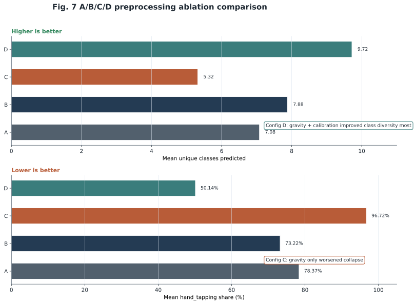

*Figure 7. A/B/C/D preprocessing ablation comparison. Two aligned bar charts comparing the four preprocessing configurations on mean unique classes predicted and mean hand_tapping share. Config D gives the strongest class diversity, while Config C shows that gravity removal alone worsened collapse in this setup.*

### 7.3 Trigger Policy Evaluation

The trigger-policy CSV is one of the cleanest evidence tables in the repo.

| Policy | total triggers | TP | FP | FN | precision | episode recall | tradeoff F1 | false alarm rate |
| --- | --- | --- | --- | --- | --- | --- | --- | --- |
| single_signal | 251 | 211 | 40 | 1 | 0.8406 | 1.0 | 0.9134 | 0.1389 |
| two_of_three | 164 | 162 | 2 | 50 | 0.9878 | 1.0 | 0.9939 | 0.0069 |
| two_of_three_cooldown6h | 42 | 40 | 2 | 172 | 0.9524 | 1.0 | 0.9756 | 0.0069 |
| two_of_three_cooldown12h | 24 | 22 | 2 | 190 | 0.9167 | 1.0 | 0.9565 | 0.0069 |
| two_of_three_cooldown24h | 14 | 14 | 0 | 198 | 1.0 | 0.875 | 0.9333 | 0.0 |

Interpretation:

1. `two_of_three` gives the best tradeoff in the available evidence.
2. `single_signal` is too noisy.
3. aggressive cooldown reduces false alarms but eventually costs recall.
4. the governance story is therefore evidence-based, not arbitrary.

This is exactly the sort of table that differentiates an MLOps thesis from a pure classifier thesis.

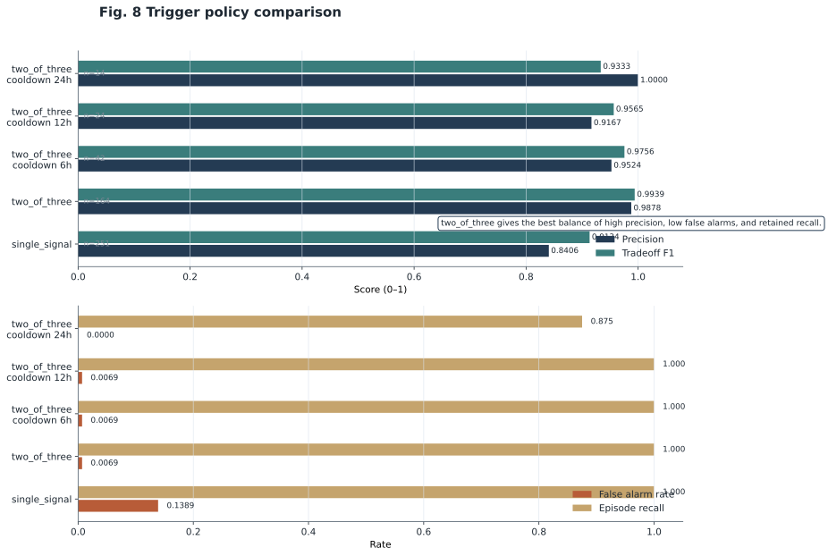

*Figure 8. Trigger policy comparison. Coordinated policy comparison using precision, tradeoff F1, false alarm rate, and episode recall from the memo's trigger-policy table. The figure shows why `two_of_three` is the strongest available balance among the tested policies.*

Evidence anchors: `reports/TRIGGER_POLICY_EVAL.csv`, `docs/TRIGGER_POLICY_EXPLANATION.md`, `docs/thesis/THRESHOLD_TRIGGER_JUSTIFICATION.md`.

### 7.4 Actual vs Synthetic Comparison

Using the corrected retrained model, the final synthetic comparison says:

| Dataset | windows | accuracy | macro F1 | mean confidence | uncertain rate | dominant class | drift |
| --- | --- | --- | --- | --- | --- | --- | --- |
| Actual labeled | 3852 | `98.9%` | `98.9%` | `98.6%` | `0.2%` | nail_biting `10.0%` | `0.0000` |
| Synth Codex | 3852 | `70.4%` | `71.1%` | `86.8%` | `6.5%` | smoking `12.7%` | `0.0010` |
| Synth Other | 3852 | `34.6%` | `31.7%` | `77.7%` | `14.5%` | nape_rubbing `52.8%` | `0.0090` |

Interpretation:

1. the pipeline works very well on the labeled actual evaluation set,
2. synthetic data quality varies sharply,
3. uncertainty and drift rise as dataset realism falls,
4. the monitoring stack is directionally meaningful even where labels are absent.

Important caveat:

The repo separately documents a real production/free-living drift maximum around `1.0434`. That is not the same as the labeled projected "actual" set above. The thesis must keep those stories separate.

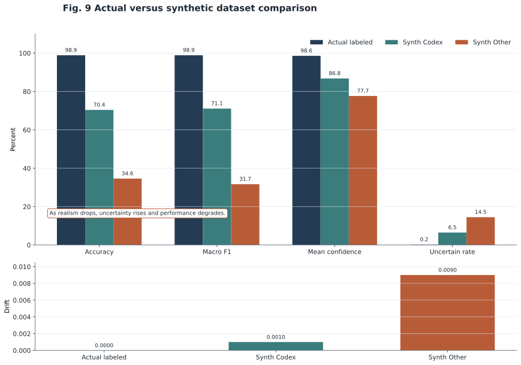

*Figure 9. Actual versus synthetic dataset comparison. Comparison of actual labeled data with two synthetic datasets across accuracy, macro F1, mean confidence, uncertain rate, and drift. The pattern shows that degraded realism is associated with worse performance and higher uncertainty.*

Evidence anchors: `internal/synthetic_comparison_20260416_FINAL.md`, `logs/synthetic_runs/actual_vs_synthetic_20260403.md`, `thesis/writing/proposed_thinking_for_chapters.md`.

### 7.5 Same-Input Old-vs-New Model Comparison

This is arguably the cleanest single positive result in the repo.

| Run type | model | mean confidence | uncertain rate | top class | top-class share | classes fired |
| --- | --- | --- | --- | --- | --- | --- |
| historical old reference | pretrained | `0.876` | `4.4%` | hand_tapping | `85.6%` | `9` |
| new run on same raw pair | retrained `har_model_20260327_223917.keras` | `0.7897` | `15.0%` | hand_scratching | `29.0%` | `11` |
| controlled old-model rerun | pretrained | matches old behavior | matches old behavior | hand_tapping | `85.6%` | `9` |

Interpretation:

1. the old model was overconfident and semantically collapsed on this input,
2. the new model is less overconfident and much more class-diverse,
3. the change is attributable to model choice, not a one-off input peculiarity.

This should be a centerpiece figure/table in the final thesis.

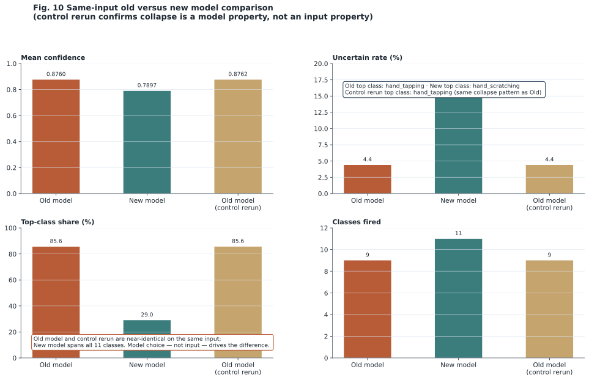

*Figure 10. Same-input old versus new model comparison. Flagship same-input comparison between the historical pretrained model and the retrained model on the same raw pair. The old model is more overconfident and collapses into a dominant class, whereas the retrained model is less overconfident and behaviorally broader.*

Evidence anchors: `reports/before_vs_after_model_change/before_vs_after_model_change_ALL_IN_ONE.md`, `reports/before_vs_after_model_change/reports/model_change_improvement_chain.md`.

### 7.6 Unit-Fix + Abstain 26-Session Negative Result

The repo explicitly preserves this as a negative result:

| Summary metric | Baseline | Modified |
| --- | --- | --- |
| sessions compared | `26` | `26` |
| successful sessions | `25` | `25` |
| mean confidence | `0.8578` | `0.8578` |
| dominance >=95% | `3` | `3` |
| mean dominant share delta | `-13.83 pp` | from baseline |
| mean review share delta | `+63.55 pp` | from baseline |

Interpretation:

1. dominance dropped,
2. but the drop mostly came from review routing,
3. confidence did not improve,
4. therefore this is not a clean "better predictions" story.

That honesty strengthens the thesis, especially if used to argue that governance changes must not be confused with model-quality gains.

Evidence anchors: `thesis/chapters/before_vs_after_26datasets.md`, `thesis/tables/before_vs_after_26datasets.csv`.

### 7.7 What Is Still Missing Experimentally

The repo itself identifies the biggest remaining evidence gaps:

1. subject-wise or GroupKFold evaluation is not present in the final thesis evidence path,
2. AdaBN instability is documented qualitatively but still needs a cleaner quantitative trace,
3. free-living Garmin drift around `1.04` needs at least one more direct write-up/example,
4. Garmin Venu 3 collection protocol is not yet formalized in thesis text,
5. some threshold values remain heuristic even if the trigger-policy family is well supported.

These are not fatal, but they are real.

## 8. Challenges and Resolutions Log

| Challenge | Symptom | Root cause | Resolution | Lesson learned |
| --- | --- | --- | --- | --- |
| Unit mismatch between training and production data | nonsensical or unstable predictions despite apparently valid inputs | Garmin accelerometer data could arrive in milliG while pipeline assumptions were in m/s² | explicit unit-conversion step and preprocessing documentation | silent unit mismatch is a thesis-level threat, not a minor bug |
| Gravity removal absent during original training | preprocessing "improvement" worsened class collapse | inference preprocessing diverged from the model's training distribution | formalized A/B/C/D matrix and kept baseline gravity removal disabled | signal-cleaning intuition can be wrong under train-serve mismatch |
| Hand-tapping dominance on production sessions | one class dominated entire sessions with high confidence | old deployed/pretrained model was collapsed on specific production-style inputs | same-input old-vs-new comparison proved model choice was the driver | confidence alone is not a safety signal |
| Stage 6 / Stage 7 threshold inconsistency | monitoring, trigger, and alerts could disagree | duplicated thresholds across code and alert configs | threshold audits and consistency tests | observability must share one source of truth |
| Stage 1 labels not wired to Stage 5 evaluation | evaluation artifacts did not reflect true labels correctly | orchestration contract bug | fixed in April review pass | thesis evidence pipelines need contract tests, not just runtime success |
| `reused_existing` artifact field missing | incomplete artifact lineage | summary/contract gap | field restored/fixed | audit fields matter for reproducibility claims |
| Duplicate constants and argument-order issues | maintenance risk and confusing CLI behavior | small but real code duplication and startup-flow disorder | constants consolidated, `parse_args()` moved earlier | tiny correctness fixes still matter when the repo is evidence |
| AdaBN instability on free-living data | adaptation attempt did not become a reliable thesis win | BN-stat updates on small or unstable target batches were not robust enough | kept as optional/negative-result story instead of overclaiming | not every adaptation method transfers cleanly to wearable free-living data |
| Rollback/deployment path mismatch | deployed path and rollback target disagreed | API/runtime used `fine_tuned_model_1dcnnbilstm.keras` while rollback wrote `current_model.keras` | flagged in audit; partially cleaned later, but remains an important historical issue | registry and serving paths must be identical or deployment claims weaken |
| Synthetic-vs-real schema mismatch | raw labeled file could not run directly | source columns needed projection/remapping | projected/mapped comparison file used | evaluation convenience files must be distinguished from raw truth files |
| Test environment drift | current workspace no longer reproduces documented green suite | Python/version drift, permissions, dirty tree | not yet fully re-stabilized in the current shell | "tests passed once" is weaker than pinned-environment reproducibility |
| Scope bloat from stages 12-14 | thesis narrative risked becoming incoherent | advanced research modules outgrew evidence maturity | current notes recommend removing them from core thesis scope | finishing the thesis requires subtraction as much as addition |

Evidence anchors: `WORKLOG.md`, `internal/notes/bug_april.md`, `internal/workflow/april_15_completion_audit_and_execution_plan.md`, `docs/thesis/THRESHOLD_TRIGGER_JUSTIFICATION.md`, `reports/repo_audit/PREDICTION_DOMINANCE_ROOT_CAUSE.md`.

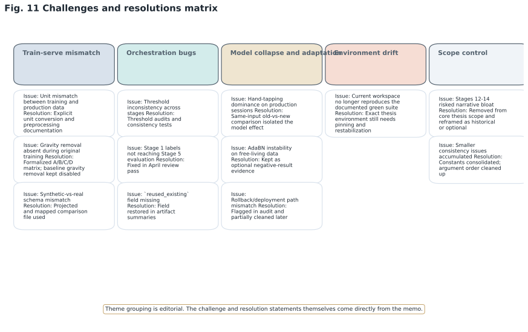

*Figure 11. Challenges and resolutions matrix. Compact engineering map grouping the challenge log into train-serve mismatch, orchestration bugs, model collapse and adaptation, environment drift, and scope control. The figure underscores that the thesis preserves negative evidence and correction work rather than presenting only final positive claims.*

## 9. Supervisor Inputs, Scope Evolution, and Writing Trajectory

### 9.1 Supervisor and Mentor Influence

| Input or direction | Evidence | Consequence |
| --- | --- | --- |
| official title fixed by supervisor Ugonna Oleh | `docs/thesis/thesis_masterplan_v2_FINAL.md` | thesis topic anchored around MLOps + continuous mental-health monitoring wording |
| prognosis should be designed, not fully implemented | `internal/notes/solution_notes.md` | main technical focus shifted to HAR + monitoring + adaptation |
| Prometheus/Grafana can be designed but need not be fully deployed | `internal/notes/solution_notes.md`, `internal/notes/qna_explanations.md` | observability stack reduced from mandatory runtime claim to optional support layer |
| freeze code before final submission and tag a thesis baseline | `internal/notes/solution_notes.md` | motivated release tagging and cleanup around March |
| Garmin data collection plan expected as deliverable | `docs/thesis/thesis_masterplan_v2_FINAL.md` | still an open writing/planning task |

The repo does not provide full dated meeting minutes for each supervisor conversation, so some sequencing remains `[inferred]`. But the effect of the advice is visible in the code and writing direction.

### 9.2 Scope Change: Prognosis Removed From Core Thesis

This is one of the most important scope evolutions in the repo.

Early or side notes still imagine a HAR-to-prognosis handoff. Later mentor-facing notes explicitly say:

1. treat prognosis as future work or interface specification,
2. keep HAR + monitoring + adaptation as the main implemented contribution,
3. only define the placeholder interface if needed.

This change freed substantial thesis time and likely prevented a split-focus thesis with two half-finished systems.

### 9.3 Scope Change: Garmin Real-World Data Became More Important

The repo steadily shifts emphasis from only controlled labeled data toward the problem of free-living Garmin data:

1. domain shift became central,
2. production-session collapse became central,
3. retraining and monitoring became central,
4. Garmin Venu 3 collection protocol became an explicit missing documentation item.

This shift made the thesis stronger scientifically because it connected the MLOps story to a real deployment problem rather than a purely lab-clean setup.

### 9.4 Writing Evolution

The writing story is unusually explicit in the repo.

Early state:

1. code and architecture grew quickly,
2. thesis chapters lagged,
3. bibliography stayed too thin,
4. chapters 2-8 were described in audits as placeholder-length or structurally weak.

Current state:

1. chapter 4 is relatively mature,
2. the pipeline and experiment evidence are strong enough to write from,
3. chapter structure still needs rationalization,
4. the repo now contains enough planning notes to finish the thesis without major new architecture work.

The main blocker is no longer missing code. It is synthesis.

Evidence anchors: `docs/thesis/THESIS_WRITING_READINESS.md`, `internal/workflow/april_15_completion_audit_and_execution_plan.md`, `thesis/writing/proposed_thinking_for_chapters.md`.

## 10. Tooling and Infrastructure

### 10.1 Core Stack

| Layer | Tooling used |
| --- | --- |
| language/runtime | Python, historically `3.9+`, now project metadata `>=3.10` |
| model framework | TensorFlow / Keras |
| experiment tracking | MLflow |
| large artifact versioning | DVC |
| packaging / serving | Docker, Docker Compose, FastAPI |
| testing | pytest |
| CI/CD | GitHub Actions |
| plotting / analysis | matplotlib, pandas, notebooks |

### 10.2 Working Style and Environment

The repo and notes show a pragmatic development style:

1. VS Code as the main working environment,
2. notebook support for exploratory analysis,
3. local Docker services,
4. offline-first preference,
5. AI-assisted development explicitly acknowledged in planning notes and user workflow context.

### 10.3 Hardware

The cleanest documented hardware claim is:

1. `32 GB RAM`,
2. RTX GPU,
3. about `8 GB` GPU-memory planning assumptions for relevant settings.

Exact GPU model is `[unknown]` from the repo evidence currently scanned.

Evidence anchors: `docs/thesis/thesis_masterplan_v2_FINAL.md`, `thesis/reference/why_by_stage.md`, `internal/notes/solution_notes.md`.

### 10.4 Infrastructure Reality Check

The strongest honest infrastructure statement is:

1. the repo is production-oriented,
2. but real production means "single-machine, file-upload, governed batch/runtime workflow,"
3. not a horizontally scaled clinical deployment,
4. not a secure multi-tenant healthcare platform.

That is exactly the right level for a master's thesis proof of concept.

Evidence anchors: `internal/notes/product_review.md`, `README.md`, current `docker-compose.yml`.

## 11. Internal Readiness Layer as of 2026-04-18

This section is intentionally planning-facing rather than thesis-body-facing. It captures the readiness state of the audited workspace and writing effort at the time of this memo. These percentages and time estimates are useful for supervision and execution, but they should be compressed or relocated if any of them are later quoted in the thesis itself.

### 11.1 Practical Internal Completion Estimate by Thesis Component

| Component | Internal estimate on `2026-04-18` | Reasoning |
| --- | --- | --- |
| code / pipeline | `88%` | core stages, serving path, monitoring, trigger logic, ablations, and artifact flow exist; remaining work is mostly consistency cleanup, not greenfield coding |
| experiments / evidence | `76%` | major experiment families are done, but subject-wise evaluation, better AdaBN quantification, and one or two write-up-quality free-living examples are still missing |
| writing | `42%` | thesis compiles and chapter skeleton exists, but structure is uneven, bibliography is sparse, and several chapters still trail the code evidence badly |
| data collection / protocol documentation | `58%` | six-participant dataset and production sessions exist, but Garmin Venu 3 collection protocol and follow-up plan are still under-documented |
| defense preparation | `18%` | defense plan exists, but slides, figure pack, and mock Q&A are not yet assembled into a final defense package |

As of `2026-04-18`, a practical internal completion estimate is **`70%`**.

Rationale: the engineering and evidence core is mostly there, but the thesis is not submission-ready until the writing catches up to the code and the strongest evidence is surfaced in chapter form.

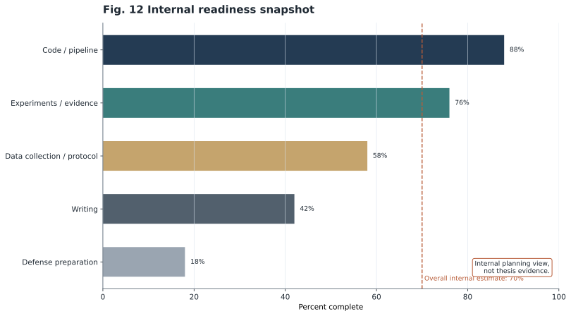

*Figure 12. Internal readiness snapshot. Internal progress view across code, experiments, writing, documentation, and defense preparation using the memo's readiness estimates. This is an internal planning view, not thesis evidence.*

### 11.2 What Is Done and Locked In

These items are effectively thesis-stable:

1. the overall problem framing: offline-first wearable HAR MLOps,
2. the 1D-CNN-BiLSTM baseline model family,
3. the 11-class label space,
4. the 7-core + 3-conditional thesis framing,
5. the A/B/C/D preprocessing ablation evidence,
6. the trigger-policy evaluation evidence,
7. the same-input old-vs-new model comparison,
8. the negative-result unit-fix + abstain comparison,
9. the existence of a tagged thesis baseline (`v1.0.0-thesis`),
10. the argument that stages 12-14 should not dominate final scope.

### 11.3 What Is Open

These items are still open enough to affect thesis quality:

1. translate the evidence into final chapter prose and figures,
2. document Garmin Venu 3 collection protocol explicitly,
3. decide whether to include one more real free-living drift example,
4. write the AdaBN limitation as a quantified negative result instead of a vague note,
5. resolve current environment reproducibility drift or pin the exact thesis environment more clearly,
6. expand bibliography from the paper inventory already in the repo,
7. separate discussion and conclusion cleanly in the chapter structure.

### 11.4 Internal Remaining-Time Estimate

Assuming the current reduced scope holds and those weeks remain reallocated to the current thesis, the remaining work looks like this:

| Task | Estimated focused time |
| --- | --- |
| chapter restructuring and writing plan lock | `0.5 week` |
| write or rewrite Chapters 1, 2, 3 using existing notes | `1.5 weeks` |
| convert Chapters 5, 6, 7 into evidence-backed final prose | `2.0 weeks` |
| discussion, limitations, conclusion, and future work | `1.0 week` |
| figure/table production and bibliography integration | `1.0 week` |
| reproducibility cleanup and final consistency audit | `0.5 week` |
| defense deck and mock questions | `1.0 week` |

As of `2026-04-18`, the internal remaining focused effort estimate is **`7.5 weeks`**.

This is feasible inside a six-month reallocation window created by dropping full prognosis implementation, but only if writing becomes the main job immediately.

### 11.5 Internal Risk Register

| Risk | Why it matters | Current level | Mitigation |
| --- | --- | --- | --- |
| writing lags code | strongest evidence may never appear clearly in the thesis text | high | freeze structure now and write directly from artifact tables |
| environment drift | examiner or future self may fail to reproduce claimed green state | high | pin exact thesis env and record one final clean test run |
| subject-wise evaluation criticism | window-level CV may be judged optimistic | high | disclose limitation directly and, if time permits, add one subject-wise analysis |
| AdaBN limitation pushback | adaptation claim may look weaker than architecture claim | medium | present AdaBN as negative-result evidence, not as a promised win |
| Garmin protocol under-documentation | free-living claims can look under-specified | medium | add a short but concrete protocol section in thesis writing |
| supervisor re-scoping late | late structural changes would cost writing time | medium | keep chapter map stable unless supervisor explicitly overrides |
| overclaiming Prometheus/Grafana or 14-stage scope | could create avoidable examiner attack surface | medium | present current runtime honestly and mark advanced pieces as optional/historical |
| dirty workspace vs tagged baseline confusion | readers may not know which state is authoritative | medium | distinguish tagged baseline, historical reports, and current workspace state explicitly |

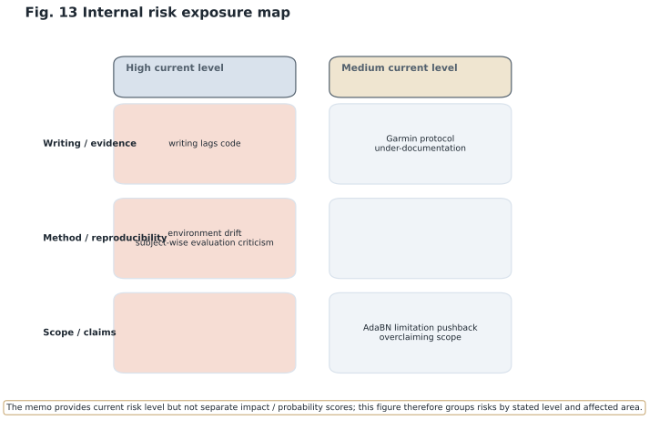

*Figure 13. Internal risk exposure map. Risk map based on the memo's internal risk register, grouping risks by stated current level and affected area. The memo does not provide separate numeric impact and probability scores, so the figure stays at the level explicitly supported by the source text.*

### 11.6 Immediate Next Actions

1. Lock the thesis chapter structure to a final 9-chapter shape and map each finished artifact to one target section.
2. Write the experiments chapter directly from the existing evidence pack: A/B/C/D table, trigger-policy table, old-vs-new model table, and synthetic-vs-actual table.
3. Produce one final reproducibility note: exact environment, final green test command if achievable, and exact commands for the main pipeline and ablation scripts.

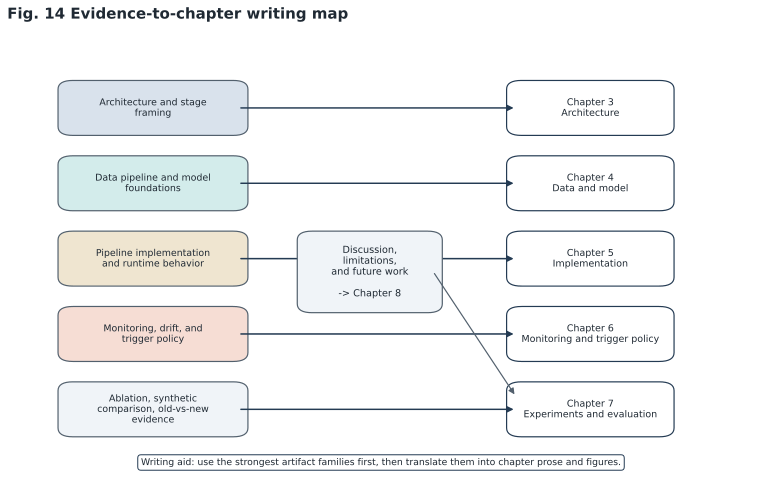

*Figure 14. Evidence-to-chapter writing map. Writing-execution diagram linking the strongest evidence families to their target thesis chapters. The map turns the memo into a practical drafting aid by showing where architecture, experiments, monitoring, and limitations should land in the manuscript.*

## 12. Appendices

### Appendix A. Repo Map

| Path | Purpose |
| --- | --- |
| `README.md` | top-level project description and main commands |
| `REPRODUCE.md` | canonical reproduction command for the thesis evidence path |
| `WORKLOG.md` | reconstructed chronological engineering log; one of the most important repo files |
| `config/` | YAML configs for pipeline, MLflow, and runtime behavior |
| `data/` | raw, synthetic, and processed data artifacts |
| `docker/` | Dockerfiles for inference and training |
| `docs/` | thesis notes, audits, design explanations, consistency docs |
| `internal/` | notes, literature management, workflow audits, evidence ledgers |
| `logs/` | pipeline logs and synthetic comparison logs |
| `models/` | pretrained, retrained, registry, and baseline artifacts |
| `notebooks/` | exploratory analysis and preprocessing notebooks |
| `outputs/ablation/` | A/B/C/D ablation outputs and summaries |
| `reports/` | generated analysis reports, model-comparison bundles, charts |
| `scripts/` | experiment runners and utility entrypoints |
| `src/` | production pipeline, components, serving, training, monitoring code |
| `tests/` | pytest test suite |
| `thesis/` | LaTeX thesis source, chapter files, notes, writing plans, references |
| `_archive/` | older/superseded material retained for traceability |

### Appendix B. Key File Index

| File | Purpose |
| --- | --- |
| `run_pipeline.py` | canonical CLI entrypoint for stage-based execution |
| `src/pipeline/production_pipeline.py` | central orchestration logic and stage registry |
| `src/train.py` | model definition and training loop |
| `src/api/app.py` | local FastAPI service with health and upload endpoints |
| `config/pipeline_config.yaml` | preprocessing and runtime defaults |
| `config/pipeline_overrides.yaml` | monitoring / trigger / runtime override config |
| `config/mlflow_config.yaml` | experiment tracking and model-registry config |
| `docker-compose.yml` | current service composition snapshot |
| `scripts/run_ablation_experiment.py` | A/B/C/D preprocessing ablation runner |
| `scripts/windowing_ablation.py` | window-size/overlap ablation runner |
| `scripts/run_batch_raw_and_synthetic.py` | batch rerun for raw sessions plus synthetic datasets |
| `reports/TRIGGER_POLICY_EVAL.csv` | quantitative trigger-policy comparison |
| `outputs/ablation/ablation_summary.csv` | summary of A/B/C/D results |
| `thesis/tables/before_vs_after_26datasets.csv` | 26-session unit-fix + abstain comparison table |
| `reports/before_vs_after_model_change/before_vs_after_model_change_ALL_IN_ONE.md` | all-in-one bundle for the old-vs-new model story |
| `docs/thesis/thesis_masterplan_v2_FINAL.md` | most complete thesis-structure and scope note |
| `docs/thesis/THESIS_EVIDENCE.md` | maps evidence artifacts into thesis chapter use |
| `docs/thesis/THESIS_WRITING_READINESS.md` | explicit writing-status assessment |
| `thesis/main.tex` | master thesis entry file |
| `thesis/chapters/ch4_data_model_development.tex` | currently most mature thesis chapter |
| `thesis/writing/proposed_thinking_for_chapters.md` | strongest current chapter and evidence strategy note |

### Appendix C. Glossary

| Term | Plain-English meaning |
| --- | --- |
| HAR | Human Activity Recognition; predicting activities from sensor windows |
| domain shift | when serving-time data behaves differently from training-time data |
| train-serve consistency | using the same assumptions and transformations in inference that the model saw in training |
| governed retraining | retraining only after explicit signals and policy gates, not automatically on every new batch |
| AdaBN | Adaptive Batch Normalization; updates BN statistics on target data |
| TENT | test-time entropy minimization; adapts parameters using unlabeled target data |
| drift | statistical change between reference data and current data |
| distribution dominance | one predicted class taking over a session suspiciously strongly |
| abstain / review routing | sending uncertain or suspicious cases to a `REVIEW` class/path instead of trusting the normal class prediction |
| baseline update | refreshing the monitoring reference after an accepted model/data cycle |
| MLOps maturity Level 1-2 | a practical maturity framing where training and serving are structured and reproducible, but full autonomous production loops are not yet end-state |
| windowing | cutting a continuous signal into fixed-length overlapping chunks for the model |
| macro F1 | class-balanced summary of precision and recall across multiple classes |
| cooldown | waiting period after a trigger to prevent repeated retraining actions |
| rollback | restoring a previous model if a new one is not acceptable |

### Appendix D. Command Cheatsheet

#### Main environment setup

```powershell
conda create -n thesis-mlops python=3.11 -y
conda activate thesis-mlops
python -m pip install --upgrade pip
python -m pip install -r config/requirements.txt
```

#### Reproduce the main thesis pipeline result

```powershell
python run_pipeline.py --stages ingestion validation transformation inference evaluation monitoring trigger --accel-file data/raw/2025-08-19-08-58-40_accelerometer.csv --gyro-file data/raw/2025-08-19-08-58-40_gyroscope.csv
```

#### Run inference/evaluation on already-prepared data only

```powershell
python run_pipeline.py --stages inference evaluation monitoring trigger
```

#### Run the conditional retraining branch

```powershell
python run_pipeline.py --stages retraining registration baseline_update
```

#### Run the A/B/C/D preprocessing ablation

```powershell
python scripts/run_ablation_experiment.py
```

Expected outputs:

```text
outputs/ablation/ablation_results.csv
outputs/ablation/ablation_summary.csv
```

#### Run the windowing ablation

```powershell
python scripts/windowing_ablation.py
```

Expected outputs:

```text
reports/ABLATION_WINDOWING.csv
reports/ABLATION_WINDOWING.png
```

#### Run the raw + synthetic batch comparison

```powershell
python scripts/run_batch_raw_and_synthetic.py
```

Optional examples:

```powershell
python scripts/run_batch_raw_and_synthetic.py --resume
python scripts/run_batch_raw_and_synthetic.py --max-runs 3
python scripts/run_batch_raw_and_synthetic.py --train-synthetic --train-epochs 30
```

#### Run trigger-policy evaluation

```powershell
python scripts/trigger_policy_eval.py
```

#### Run core fast tests

```powershell
python -m pytest tests/ -m "not slow and not integration" -q --tb=short
```

#### Run the full test suite

```powershell
pytest -q --maxfail=1
```

#### Start local services

```powershell
docker compose up -d mlflow inference
```

#### Start the FastAPI app directly

```powershell
uvicorn src.api.app:app --reload --host 0.0.0.0 --port 8000
```

#### Build thesis PDF

```powershell
powershell -ExecutionPolicy Bypass -File thesis/build_thesis.ps1
```

## 13. Evidence Gaps That Had to Stay Marked

The following points remain `[inferred]` or `[unknown]` because the repo does not fully settle them in one authoritative place:

1. exact date of the first supervisor scoping conversation,
2. exact date prognosis was officially downgraded from co-equal scope to future-work scope,
3. full explicit chronology of pretrained-weight lineage around the ADAM-sense framing,
4. exact GPU model name,
5. final fully reproducible green test state in the current workspace,
6. exact Garmin Venu 3 collection protocol in final thesis-ready prose.

These are the places where the thesis should either gather one more supporting note or disclose the limitation directly.

## 14. Bottom-Line Assessment

The repo already contains a defensible master's thesis, but not yet a defensible final manuscript.

What is strong:

1. the engineering system is real,
2. the experiment inventory is real,
3. the negative results are preserved instead of hidden,
4. the old-vs-new model evidence is unusually clean,
5. the governance story around monitoring and trigger policy is substantially stronger than a normal classifier thesis.

What is weak:

1. writing structure still lags the actual evidence,
2. bibliography usage is far behind the available paper inventory,
3. some historical docs still overstate scope,
4. environment reproducibility has drifted in the current workspace,
5. subject-wise generalization remains an exposed methodological limitation.

The thesis is now a writing-and-positioning problem more than a coding problem. The repo has already done the hard part of creating real artifacts. The next step is to place those artifacts into the thesis in the right order, with the right restraint. Therefore, the thesis is best completed by converting existing evidence into disciplined chapter prose, not by expanding technical scope further.
