# HAR MLOps Pipeline Data Flow Map

This document is the canonical pipeline map for this repository.
It is based on the current runtime implementation in:

- `run_pipeline.py`
- `src/pipeline/production_pipeline.py`
- `src/entity/config_entity.py`
- `src/entity/artifact_entity.py`
- `src/components/*.py`

## 1) Base Pipeline Overview

### 1.1 Stage map at a glance

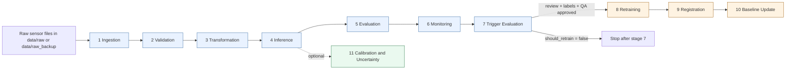

### 1.2 Default execution and optional branches

- Default run (`python run_pipeline.py`) executes stages 1-7.
- Retraining branch (`--retrain`) appends stages 8-10, but model mutation is still governed by Stage 7 plus review, label, and QA requirements.
- Advanced branch (`--advanced`) appends optional Stage 11 calibration/UQ only.

### 1.3 Runtime modes as "views"

- Base view: stages 1-7 for production inference and decisioning.
- Adaptation view: stages 8-10 for conditional model update, registration, and baseline update after governance gates.
- Research view: Stage 11 for optional calibration/UQ. Earlier Stage 12-14 design notes are archive/future-work references, not current runtime evidence.

## 2) Detailed Data Flow

### 2.1 End-to-end sequence (default production cycle)

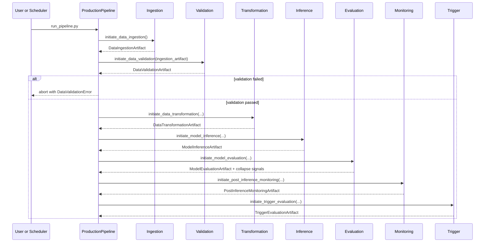

### 2.2 Retraining branch gating and governance

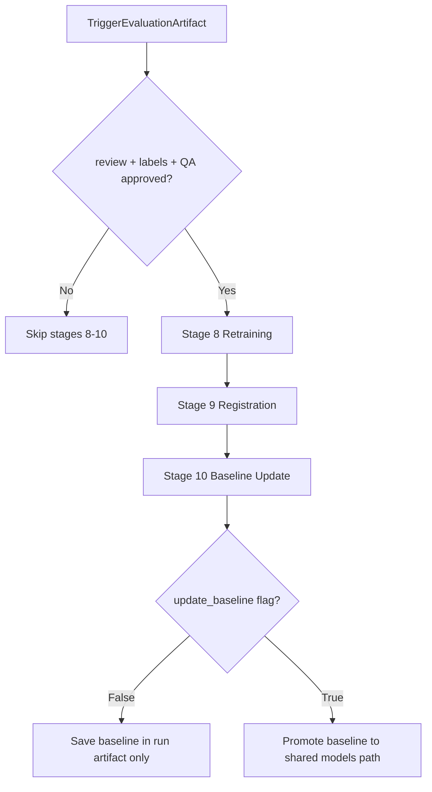

### 2.3 Artifact-level lineage

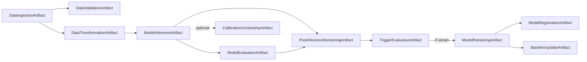

## 3) Stage-by-Stage Deep Map (with graphics)

## Stage 1 - Data Ingestion

- Component: `src/components/data_ingestion.py`
- Input: raw accelerometer and gyroscope files, or direct `--input-csv`
- Core processing: file discovery, accel/gyro pairing, merge, resample to 50Hz, manifest-based skip
- Output data: `data/processed/sensor_fused_50Hz.csv`
- Artifact: `DataIngestionArtifact`

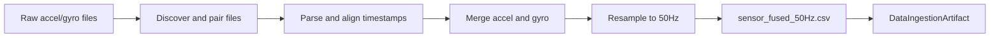

## Stage 2 - Data Validation

- Component: `src/components/data_validation.py`
- Input: fused CSV from stage 1
- Core processing: schema checks, value ranges, missing ratio, sampling checks
- Output data: validation report data in artifacts/logs
- Artifact: `DataValidationArtifact`
- Gate: pipeline aborts if `is_valid` is false

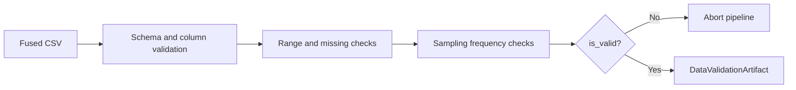

## Stage 3 - Data Transformation

- Component: `src/components/data_transformation.py`
- Input: fused CSV and optional validation artifact
- Core processing: accelerometer unit conversion to m/s^2, gyroscope retained in deg/s, optional gravity/calibration, optional A/B normalization, windowing
- Output data: `data/prepared/production_X.npy`, `data/prepared/production_metadata.json`
- Artifact: `DataTransformationArtifact`
- Important: final production inference keeps `enable_normalization=false`, `enable_gravity_removal=false`, and `enable_calibration=false` in `config/pipeline_config.yaml`.

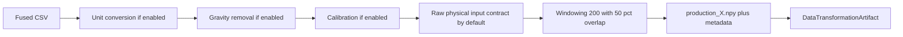

## Stage 4 - Model Inference

- Component: `src/components/model_inference.py`
- Input: `production_X.npy` and model path
- Core processing: load model, batch prediction, confidence extraction
- Output data: predictions csv, predictions npy, probabilities npy
- Artifact: `ModelInferenceArtifact`

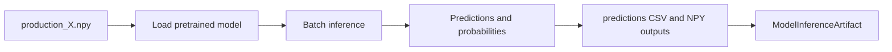

## Stage 5 - Model Evaluation

- Component: `src/components/model_evaluation.py`
- Input: predictions CSV, optional labels
- Core processing: distribution analysis, confidence analysis, optional classification metrics
- Output data: evaluation json and text reports under outputs
- Artifact: `ModelEvaluationArtifact`
- Important: dominant class and dominant percent fields are explicitly preserved for downstream collapse guard logic

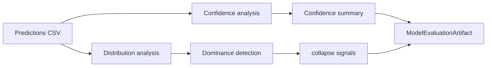

## Stage 6 - Post-Inference Monitoring

- Component: `src/components/post_inference_monitoring.py`
- Input: predictions plus optional production data and baseline stats
- Core processing: layer1 confidence, layer2 temporal, layer3 drift, baseline freshness guard
- Output data: `outputs/evaluation/monitoring_report.json`
- Artifact: `PostInferenceMonitoringArtifact`

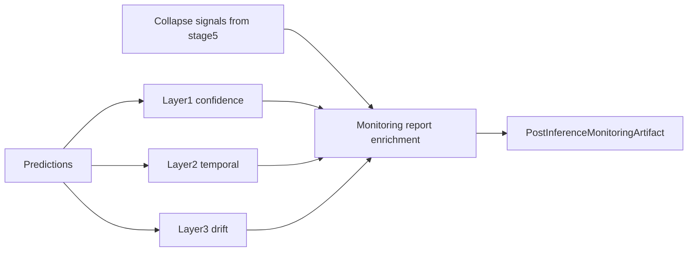

## Stage 7 - Trigger Evaluation

- Component: `src/components/trigger_evaluation.py`
- Engine: `src/trigger_policy.py` (`TriggerPolicyEngine`)
- Input: monitoring report plus collapse signals
- Core processing: confidence/temporal/drift voting, cooldown checks, collapse guard review logic
- Output data: trigger decision json in artifacts and MLflow
- Artifact: `TriggerEvaluationArtifact`

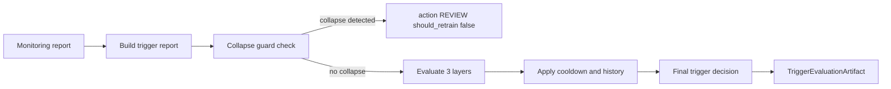

## Stage 8 - Model Retraining (conditional)

- Component: `src/components/model_retraining.py`
- Input: trigger artifact plus reviewed data; supervised retraining requires labels/QA
- Core processing: selected adaptation mode (`none`, `adabn`, `tent`, `adabn_tent`, `pseudo_label`) only when governance permits
- Output data: retrained model file and training report
- Artifact: `ModelRetrainingArtifact`

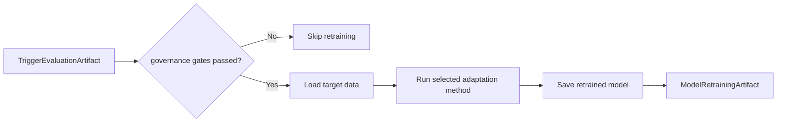

## Stage 9 - Model Registration (conditional)

- Component: `src/components/model_registration.py`
- Input: retrained model artifact and labeled evaluation context
- Core processing: registry versioning and promotion checks; inference finalization does not register model versions
- Output data: registry update, optional deployment
- Artifact: `ModelRegistrationArtifact`

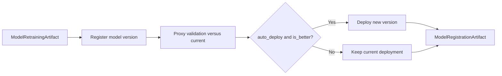

## Stage 10 - Baseline Update (conditional)

- Component: `src/components/baseline_update.py`
- Input: reviewed labeled/QA-approved baseline data and baseline config
- Core processing: rebuild baseline statistics, optional promotion to shared runtime baseline
- Output data: `raw_physical_baseline.json` for final runtime monitoring; normalized baseline artifacts remain legacy/A-B references unless explicitly selected.
- Artifact: `BaselineUpdateArtifact`

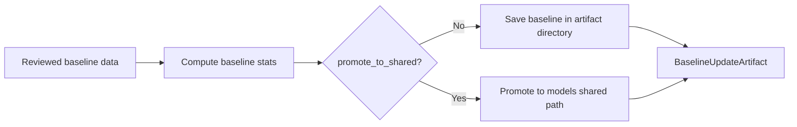

## Stage 11 - Calibration and Uncertainty (advanced)

- Component: `src/components/calibration_uncertainty.py`
- Input: probabilities from inference
- Core processing: temperature scaling, unlabeled calibration diagnostics
- Output data: calibration report and temperature file
- Artifact: `CalibrationUncertaintyArtifact`

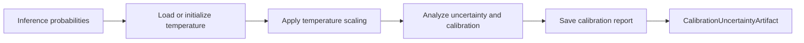

## Stage 12 - Wasserstein Drift (retired/archive)

This was part of the older broader stage framing. Do not claim Stage 12 as current runtime evidence. Treat any Wasserstein/MMD work as offline audit or experiment evidence only when the specific artifact is cited.

## Stage 13 - Curriculum Pseudo-Labeling (retired/archive)

This was part of the older broader stage framing. Do not claim Stage 13 as current runtime evidence. Pseudo-labeling remains an experimental candidate-generation method and must not be treated as automatic production retraining from unlabeled drift.

## Stage 14 - Sensor Placement Robustness (retired/archive)

This was part of the older broader stage framing. Do not claim Stage 14 as current runtime evidence. Sensor-placement robustness belongs in future work unless a specific offline artifact is cited.

## 4) Multi-View Architecture

### 4.1 Executive view

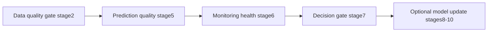

What this view answers:

- Is incoming data valid?
- Is model behavior healthy?
- Should retraining be automatic or manually reviewed?

### 4.2 Engineering operations view

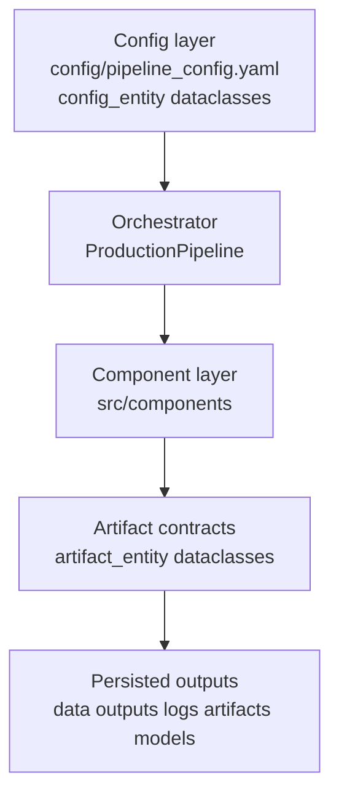

What this view answers:

- Which config controls each stage?
- Which artifact contract binds producer and consumer stages?
- Where do persistent outputs land?

### 4.3 Research and thesis view

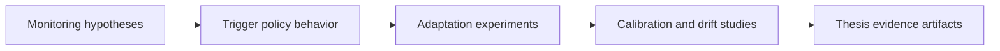

What this view answers:

- Which stage supports each research claim?
- Which outputs become thesis evidence?

## 5) Threshold and Decision Reference

### 5.1 Stage 6 monitoring thresholds

- Mean confidence warning: 0.70
- Uncertain windows warning: 20%
- Transition-rate warning: 35%
- Drift z-score warning: 1.8
- Dominant-class warning/critical: 85% / 95%

These are warning-oriented operating points for monitoring, not automatic retraining criteria.

### 5.2 Trigger thresholds from `TriggerEvaluationConfig`

- Confidence warn: 0.65
- Confidence critical: 0.50
- Drift z-score warn: 2.0
- Drift z-score critical: 3.0
- Temporal flip warn: 0.35
- Temporal flip critical: 0.50
- Cooldown: 24 hours

### 5.3 TriggerPolicyEngine defaults in `src/trigger_policy.py`

- Confidence warn: 0.65
- Confidence critical: 0.50
- Uncertain ratio warn/critical: 0.20 / 0.35
- Flip rate warn/critical: 0.25 / 0.40
- Drift z-score warn/critical: 2.0 / 3.0

### 5.4 Important implementation behavior

- Tiered confidence design is explicit: Stage 6 monitoring warns at 0.70, while Stage 7 trigger governance uses 0.65/0.50 warning/critical confidence thresholds.
- Collapse guard can force `REVIEW` and `should_retrain = false` for collapse-like patterns (for example very high class dominance), avoiding unsafe automatic retraining on unlabeled production batches.
- Cooldown state is propagated into `TriggerEvaluationArtifact.cooldown_active`.
- Baseline update promotion to shared runtime baselines is explicit and controlled by `update_baseline` governance flag.

## 6) Research Questions and Answers from this pipeline

### RQ1. How does the pipeline prevent unsafe retraining when production predictions collapse into one class?

Answer:

- Stage 5 computes distribution dominance signals.
- Stage 6 carries those collapse signals in monitoring report.
- Stage 7 collapse guard in `TriggerPolicyEngine` can return `REVIEW` with `should_retrain = false`.
- Result: human review is required before model update, which reduces catastrophic forgetting risk from single-class unlabeled batches.

### RQ2. Why is gravity removal disabled by default in production preprocessing?

Answer:

- Current final production config uses raw physical units with gravity included.
- Enabling gravity removal can change feature distribution enough to create preprocessing mismatch and confidence degradation.
- Therefore stage 3 keeps gravity removal off unless explicitly enabled for controlled experiments.

### RQ3. Does `--retrain` always execute stage 8?

Answer:

- Not always.
- `--retrain` includes retraining stages in the planned sequence, but Stage 8 can still be skipped if Stage 7/review/label/QA gates are not satisfied.

### RQ4. What is the practical role of stage 10 baseline update in deployment safety?

Answer:

- Stage 10 can rebuild and archive new baseline statistics after retraining.
- Promotion to shared runtime baselines is explicit (`update_baseline`), so monitoring baselines are not silently overwritten.
- This enables auditable baseline governance.

### RQ5. Which stage outputs are most important for thesis evidence?

Answer:

- Stage 4 inference outputs for throughput and confidence behavior.
- Stage 5 evaluation report for distribution and confidence quality.
- Stage 6 monitoring report for confidence, temporal, and drift layers.
- Stage 7 trigger decision for retraining governance evidence.
- Optional Stage 11 outputs for calibration/UQ when explicitly run; deep drift analysis is offline experiment evidence, not a current runtime stage.

## 7) File and Contract Index

### 7.1 Main orchestrator and contracts

- `run_pipeline.py`
- `src/pipeline/production_pipeline.py`
- `src/entity/config_entity.py`
- `src/entity/artifact_entity.py`

### 7.2 Component index by stage

- 1: `src/components/data_ingestion.py`
- 2: `src/components/data_validation.py`
- 3: `src/components/data_transformation.py`
- 4: `src/components/model_inference.py`
- 5: `src/components/model_evaluation.py`
- 6: `src/components/post_inference_monitoring.py`
- 7: `src/components/trigger_evaluation.py`
- 8: `src/components/model_retraining.py`
- 9: `src/components/model_registration.py`
- 10: `src/components/baseline_update.py`
- 11: `src/components/calibration_uncertainty.py`
- 12-14: retired/archive stage framing; do not claim as current runtime evidence

## 8) Suggested usage patterns

### 8.1 Base pipeline

```bash
python run_pipeline.py
```

### 8.2 Explicit default stages

```bash
python run_pipeline.py --stages ingestion validation transformation inference evaluation monitoring trigger
```

### 8.3 Include retraining branch

```bash
python run_pipeline.py --retrain --adapt adabn
```

This includes conditional stages 8-10 in the planned sequence. It does not mean unlabeled production drift automatically retrains or promotes a model.

### 8.4 Include advanced research branch

```bash
python run_pipeline.py --advanced
```

### 8.5 Full evidence-oriented run

```bash
python run_pipeline.py --retrain --advanced
```

Use this only for controlled evidence runs where the governance and optional-stage scope is explicit.

## 9) Notes for future extension

- If you export Mermaid diagrams to image files for thesis figures, place them under `docs/images/pipeline/`.
- Keep this map synchronized with any stage signature or artifact contract changes.
- If threshold values change, update both this file and `docs/TRIGGER_POLICY_EXPLANATION.md`.

## 10) Evidence Update from 26-Session Evaluation (March 2026)

Source evidence:

- `thesis/chapters/before_vs_after_26datasets.md`
- `thesis/tables/before_vs_after_26datasets.csv`

### 10.1 What changed and what did not

| Metric | Baseline | Modified | Interpretation |
| --- | ---: | ---: | --- |
| Sessions compared | 26 | 26 | One pair failed in both modes |
| Successful paired runs | 25/26 | 25/26 | Stability unchanged |
| Mean confidence | 0.8578 | 0.8578 | No confidence improvement |
| Dominance >= 95 percent | 3 | 3 | Extreme collapse count unchanged |
| Mean delta dominant percent (after-before) | -13.8282 | -13.8282 | Dominance dropped mostly via review routing |
| Mean delta review percent (all 26 rows) | +63.5510 | +63.5510 | Review routing increased strongly |
| Mean delta review percent (successful pairs only) | +66.0931 | +66.0931 | Same direction on clean pairs |

### 10.2 Trigger-action shift (successful pairs only)

Before:

- none: 20
- monitor: 1
- review/label queue: 1
- review: 3

After:

- review/label queue: 19
- trigger-surfaced review: 3
- review: 3

Interpretation:

- Modified mode increased operational strictness and review pressure.
- This did not improve mean confidence.
- Therefore these changes are best treated as a negative-result ablation plus governance evidence, not as a direct production-quality gain.

### 10.3 Data-flow implication from this result

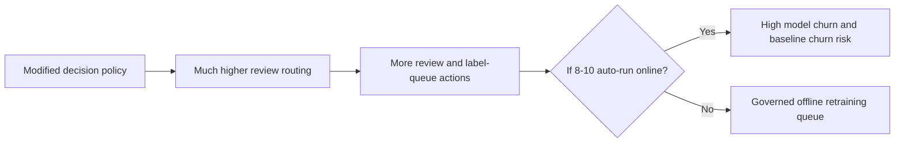

## 11) Why Use the First Path (Stages 1-7) as Primary Production Flow

The first path is the safest default because it is decision-capable but mostly non-mutating:

- Stages 1-7 validate data, score model behavior, and produce a trigger decision.
- It keeps model and baseline updates gated instead of automatic on every batch.
- The 26-session evidence shows decision strictness can rise sharply without confidence gain, so keeping updates gated is important.

In short:

- Use stages 1-7 for day-to-day production health and decisioning.
- Use stages 8-10 only when governance conditions are met.

## 12) Why Not Run Stages 8-10 in Live Server Request Path

Do not run stages 8-10 directly inside per-request API flow.

Reasons:

- Stage 8 can adapt or retrain on unlabeled target data and is compute-heavy.
- Stage 9 mutates model registry/deployment state.
- Stage 10 can mutate baseline state used by monitoring.
- 26-session evidence shows modified logic can push many runs into review/label queues. Auto-running 8-10 in-server would amplify instability.

Recommended placement:

- Server request path: stage 4 inference plus lightweight monitoring; stage 7 may run as read-only decision output.
- Offline governance job: full stages 1-7 and controlled execution of 8-10.

Governance gate before 8-10:

- Confirm repeated degradation across multiple runs, not one noisy batch.
- Confirm data-quality checks and collapse-guard context.
- Require manual approval (or strict policy) before promotion/deployment.

## 13) Where Optional Research Work Should and Should Not Run

### 13.1 Stage 11 (Calibration and Uncertainty)

Should run:

- Offline calibration cycles (for example daily or weekly), or before important releases.

Should not run:

- Per API request path.
- Every tiny batch without enough representative data.

### 13.2 Offline Drift Audit

Should run:

- Offline drift-audit jobs when baseline windows are available.
- Investigation mode after stage 6 or stage 7 warnings.

Should not run:

- Live request path.
- Cases with missing baseline data (`NO_BASELINE` outcome risk).

Do not describe this as current Stage 12 runtime evidence; the defended runtime path ends at Stage 7 unless conditional stages 8-10 or optional Stage 11 are explicitly invoked.

## 14) Better Deployment Views (Serving vs Governance vs Research)

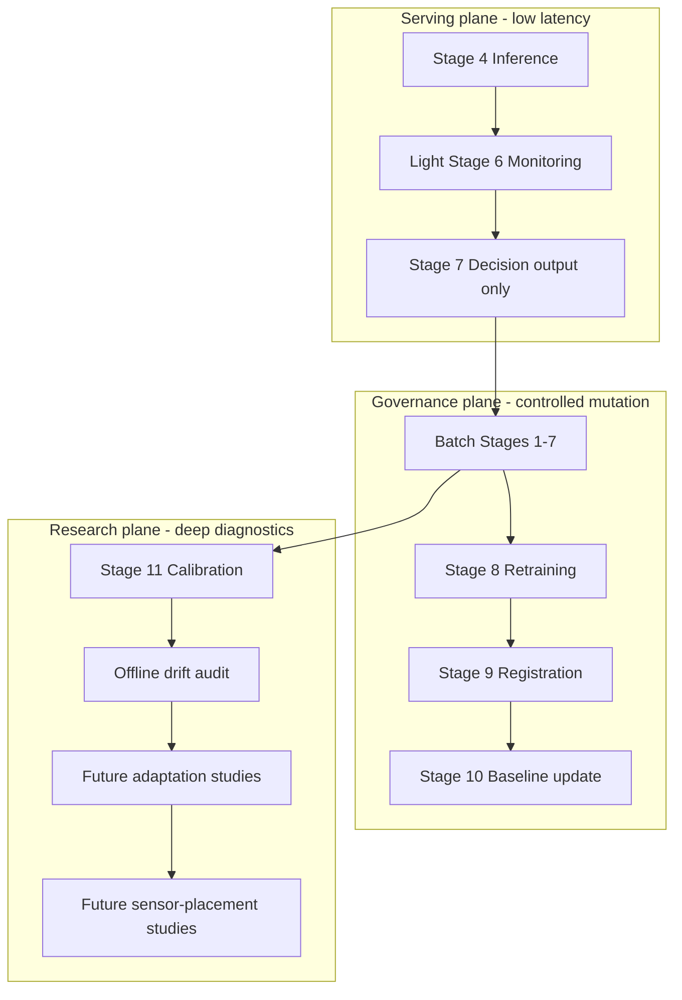

Operational summary:

- Keep serving fast and mostly read-only.
- Keep model mutation in governed batch workflows.
- Keep advanced analytics in periodic research/ops diagnostics.
