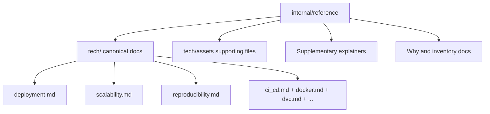

# Internal Reference Hub

This folder is the documentation reference layer for thesis writing, defense prep, and implementation traceability.

## Quick Navigation

| Need | Open |
| --- | --- |
| Canonical technology docs | [internal/reference/tech/README.md](internal/reference/tech/README.md) |
| Workflow and execution docs | [internal/workflow/README.md](internal/workflow/README.md) |
| Defense answer bank | [internal/writing/defense_qa.md](internal/writing/defense_qa.md) |
| Global internal index | [internal/INDEX.md](internal/INDEX.md) |

## Reference Layout

## Canonical vs Supplementary

### Canonical (for thesis writing)

- [internal/reference/tech/README.md](internal/reference/tech/README.md)
- All files under [internal/reference/tech](internal/reference/tech)
- Tech figures and PDFs under [internal/reference/tech/assets](internal/reference/tech/assets)

### Supplementary (background/support)

- [internal/reference/experiment_tracking_explained.md](internal/reference/experiment_tracking_explained.md)
- [internal/reference/thesis-pipeline-why-what-how.md](internal/reference/thesis-pipeline-why-what-how.md)
- Legacy `*_explained.md` files in this folder are compatibility pointers to canonical tech docs.

## Canonical WHY Docs

- [internal/reference/why_book.md](internal/reference/why_book.md)
- [internal/reference/why_by_file.md](internal/reference/why_by_file.md)
- [internal/reference/why_by_stage.md](internal/reference/why_by_stage.md)
- [internal/reference/why_by_tech.md](internal/reference/why_by_tech.md)
- [internal/reference/why_inventory.md](internal/reference/why_inventory.md)

Naming convention: active WHY docs use lowercase filenames for easier discovery.

## Documentation Upgrade Board

| Document area | Status | Upgrade note |
| --- | --- | --- |
| Tech docs | ✅ Green | Already thesis-centric and implementation-aligned. |
| Supplementary explainers | ✅ Green | Keep as background references only. |
| Why/inventory docs | ✅ Green | Canonicalized to lowercase filenames and duplicate `_2` variants removed. |
| Legacy archive docs | ✅ Preserved | Keep for traceability; do not cite as primary thesis source. |

## Usage Rules

1. Cite canonical sections from [internal/reference/tech](internal/reference/tech) in thesis chapters.
2. Use supplementary files only for extra explanation, not as source of truth.
3. When workflow files change, also update [internal/workflow/README.md](internal/workflow/README.md) and [.github/workflows/README.md](.github/workflows/README.md).
