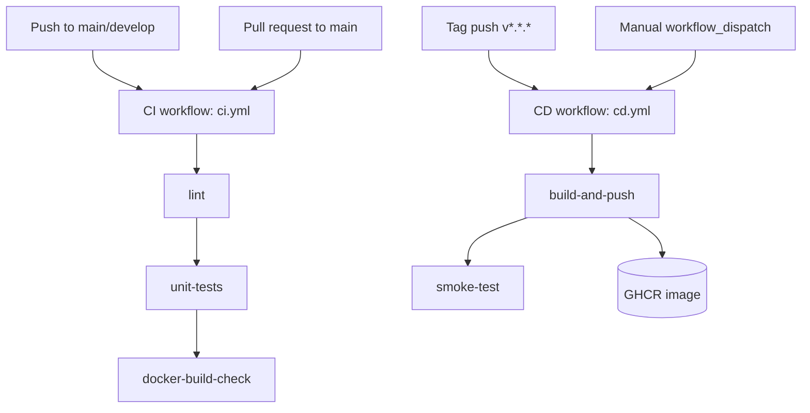
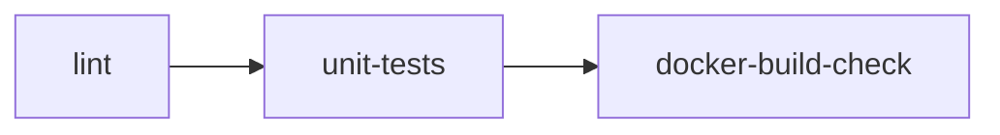
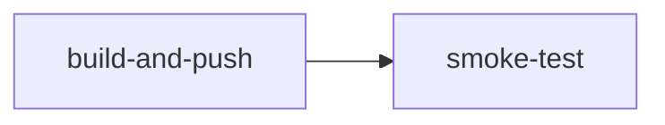
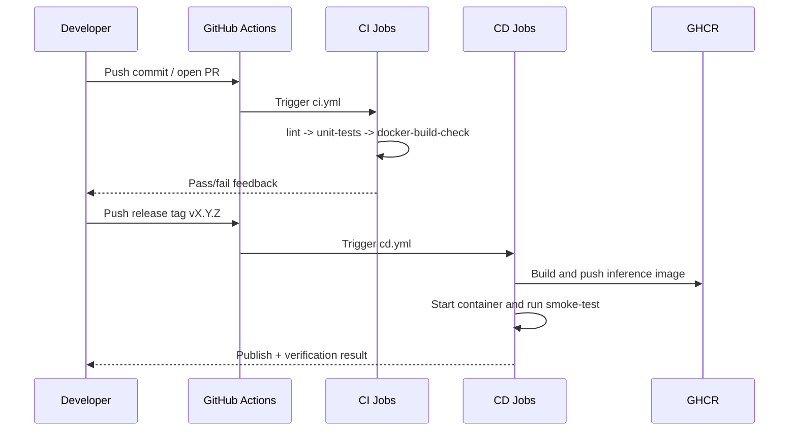

<!-- markdownlint-disable MD060 -->

# CI/CD (GitHub Actions)

This document is the thesis-grade technical reference for automation in this repository.
It explains the general CI/CD idea first, then maps the concept to the exact implementation used in this project.

---

## 1. What CI/CD Means (General Concept)

CI/CD stands for **Continuous Integration** and **Continuous Delivery/Deployment**.

- **Continuous Integration (CI)** means each code change is automatically validated (lint + tests + build checks).
- **Continuous Delivery (CD)** means deployable artifacts are automatically packaged and published after quality gates pass.

In this repository, CD currently means **container image delivery to GHCR + smoke validation**, not full cloud deployment.

---

## 2. General Pseudocode (CI/CD Pattern)

```text
ON code_change_event:
    RUN static_checks
    RUN automated_tests
    IF checks pass:
        BUILD deployable_artifact
    ELSE:
        FAIL pipeline and report

ON release_event:
    BUILD and PUBLISH artifact
    RUN smoke_validation against published artifact
    IF smoke_validation fails:
        MARK release pipeline failed
```

### Explanation

- CI should fail fast on quality and correctness.
- CD should only publish artifacts after CI-style gates pass.
- Smoke checks validate runtime viability of the released artifact.

---

## 3. Why CI/CD Is Used in This Thesis

For a thesis with an MLOps scope, CI/CD is evidence that the system is engineered beyond notebook-only experimentation.

Key thesis value:

- Enforces repeatable quality gates on each change.
- Demonstrates automated packaging of inference service.
- Provides traceable build artifacts for defense and reproducibility.
- Reduces "works on my machine" risk during evaluation.

---

## 4. Repository Locations

- `.github/workflows/ci.yml`
- `.github/workflows/cd.yml`
- `docker/Dockerfile.inference`
- `tests/`
- `config/requirements.txt`

---

## 5. High-Level Automation Topology



---

## 6. CI Workflow (`ci.yml`) in Detail

### 5.1 Triggers

- Pull requests targeting `main`
- Pushes to `main` and `develop`

### 5.2 Global Setup

- Runs on `ubuntu-latest`
- Uses `PYTHON_VERSION=3.11`
- Reads repository contents with `permissions: contents: read`

### 5.3 Job Graph



### 5.4 Job-by-Job Breakdown

| Job | Purpose | Main tools/commands | Output |
|---|---|---|---|
| `lint` | Static quality gate | `flake8`, `black --check`, `isort --check-only` | Fast fail on style/quality issues |
| `unit-tests` | Functional correctness | `pytest tests/ -m "not slow and not integration"` | `test-results.xml` artifact |
| `docker-build-check` | Packaging viability | Docker build of inference image without push | Verifies Dockerfile remains buildable |

### 5.5 Why This CI Design Is Useful

- **Sequential dependencies** (`needs`) ensure cheap checks run first.
- **Test marker filtering** keeps CI runtime practical for frequent pushes.
- **Dedicated Docker build check** catches packaging regressions early.

---

## 7. CD Workflow (`cd.yml`) in Detail

### 6.1 Triggers

- Push to tags matching `v*.*.*`
- Manual `workflow_dispatch` with optional `image_tag`

### 6.2 Permissions and Concurrency

- `packages: write` required for pushing images to GHCR.
- Concurrency group `cd-${{ github.ref }}` prevents conflicting runs per ref.

### 6.3 Job Graph



### 6.4 Build-and-Push Job

Core steps:

1. Resolve output tag (manual input if provided, otherwise current ref name).
2. Authenticate against `ghcr.io` using `GITHUB_TOKEN`.
3. Build image from `docker/Dockerfile.inference`.
4. Push image to:

```text
ghcr.io/shalinvachheta017/masterarbeit_mlops/har-inference:<tag>
```

### 6.5 Smoke-Test Job

After publishing:

1. Pull the pushed image by tag.
2. Start container on `localhost:8000`.
3. Poll `/api/health` until service is ready.
4. Fail with logs if health check does not pass.
5. Cleanup container in `always()` step.

This ensures that the published artifact is not only built but also runnable.

---

## 8. Thesis-Centric Pseudocode (Exact Repository Flow)

```text
CI (ci.yml):
    TRIGGER on push(main/develop) or PR(main)
    JOB lint:
        run flake8 + black --check + isort --check-only
    JOB unit-tests (needs lint):
        install requirements
        run pytest with marker filter: not slow and not integration
        upload junit artifact
    JOB docker-build-check (needs unit-tests):
        docker build Dockerfile.inference (no push)

CD (cd.yml):
    TRIGGER on tag v*.*.* or workflow_dispatch
    JOB build-and-push:
        resolve image tag
        login ghcr
        build and push image
    JOB smoke-test (needs build-and-push):
        pull image
        run container on :8000
        poll /api/health
        fail with logs if unhealthy
```

### Thesis-Centric Explanation

- CI enforces local code quality and packaging viability.
- CD is release-oriented and tied to explicit tag/manual triggers.
- Artifact validation is done after push (not only before push), improving release confidence.

---

## 9. End-to-End Sequence (Conceptual)



---

## 10. Inputs and Outputs

### Inputs (What initiates automation)

| Input event | Workflow | Typical intent |
|---|---|---|
| Push to `main`/`develop` | CI | Validate ongoing development |
| PR to `main` | CI | Gate merges with quality checks |
| Tag `v*.*.*` | CD | Release container artifact |
| Manual dispatch | CD | Controlled ad-hoc delivery/smoke run |

### Outputs (What automation produces)

| Output | Source | Purpose |
|---|---|---|
| Lint/test status | CI | Fast quality feedback |
| Test report artifact (`test-results.xml`) | CI | Evidence for debugging and audit |
| Build verification of Docker image | CI | Packaging confidence |
| Published GHCR image | CD | Deployable inference artifact |
| Smoke-test result | CD | Runtime sanity validation |

---

## 11. Local Repro Commands (Developer View)

The following local commands mirror major CI/CD actions:

```bash
# Lint checks
flake8 src/
black --check src/
isort --check-only src/

# Unit tests (fast subset)
pytest tests/ -m "not slow and not integration"

# Docker build check
docker build -f docker/Dockerfile.inference -t har-inference:local .

# Manual smoke run
docker run --rm -p 8000:8000 har-inference:local
curl -fsS http://localhost:8000/api/health
```

---

## 12. Thesis Interpretation

This CI/CD stack demonstrates an engineering maturity baseline expected in modern ML systems:

- **Research validity support:** consistent, repeatable software checks.
- **Operational readiness support:** packaged and testable inference image.
- **Auditability support:** workflow history, artifacts, and logs.

It is intentionally lightweight and suitable for a thesis repository while still technically robust.

---

## 13. What We Use Here vs Not Used Yet

### What We Use Here

- Triggered CI quality gates (lint, tests, container build check).
- Triggered CD publish workflow to GHCR.
- Smoke-test of released inference image.
- Artifact retention for test result output.

### What Is Not Used Yet

- Multi-stage environment promotion (dev -> staging -> prod).
- Approval gates and protected deployment environments.
- Built-in vulnerability scan/signing/SBOM generation in current workflows.
- Automatic cluster deployment (Kubernetes/App Service) from CD.

---

## 14. Current Boundaries and Future Enhancements

Current boundaries:

- No multi-environment deployment (dev/staging/prod) yet.
- No mandatory slow/integration test gate in CI critical path.
- CD publishes container images but does not deploy to orchestrators.

Potential future work:

- Add environment promotion strategy and protected deployment approvals.
- Add signed images and SBOM generation.
- Add performance regression checks and model-specific validation gates.
- Integrate vulnerability scanning before push.
