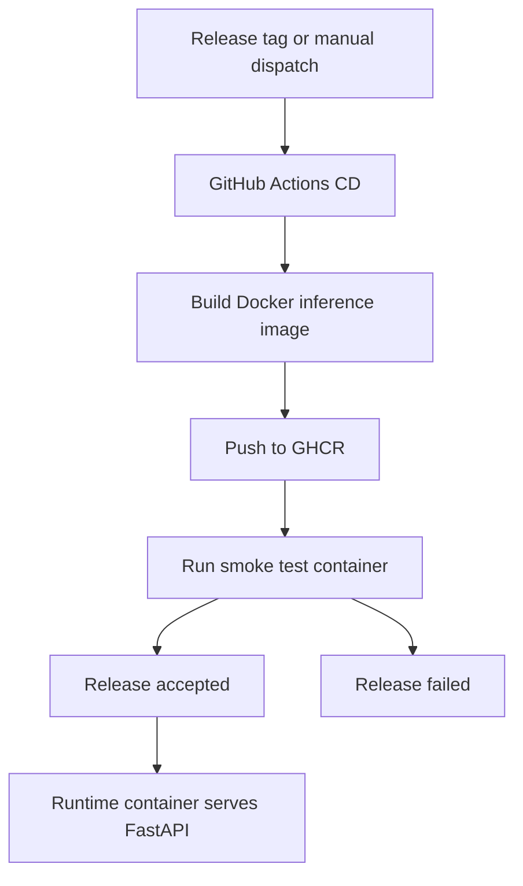

<!-- markdownlint-disable MD060 -->

# Deployment

This standalone deep dive focuses on deployment engineering for this thesis repository.
It describes the general deployment pattern and then maps it to the exact implementation used here.

---

## 1. What Deployment Means (General Concept)

Deployment is the process of taking a built software artifact and making it runnable in a target environment.

For ML systems, deployment usually includes:

- packaging model plus runtime dependencies,
- releasing a versioned artifact,
- validating service health,
- operating rollback for recovery.

---

## 2. General Pseudocode (Deployment Pattern)

```text
ON release_intent:
  BUILD deployable_artifact
  TAG artifact with immutable version
  PUBLISH artifact to registry

  START artifact in runtime target
  RUN health checks and smoke tests

  IF validation fails:
    ROLLBACK to previous stable version
  ELSE:
    MARK release successful
```

### Explanation

- Versioned artifacts make deployments auditable.
- Health and smoke checks are mandatory to validate runtime behavior.
- Rollback protects availability when a new version fails.

---

## 3. Deployment Scope in This Thesis

The repository demonstrates container-first deployment maturity through:

- container image build and release to GHCR,
- runtime serving through FastAPI in Docker,
- smoke validation in CD workflow,
- local rollback support for model version changes.

Current deployment target is release artifact delivery plus validated startup, not full cloud orchestrator rollout.

---

## 4. Repository Deployment Surfaces

- `.github/workflows/cd.yml`
- `.github/workflows/ci.yml`
- `docker/Dockerfile.inference`
- `docker-compose.yml`
- `src/api/app.py`
- `src/model_rollback.py`
- `models/registry/model_registry.json`

---

## 5. Release Deployment Flow in This Repository

### 5.1 Trigger and Build

`cd.yml` starts on:

- tag push `v*.*.*`, or
- manual `workflow_dispatch`.

The workflow builds the inference image from `docker/Dockerfile.inference` and tags it for release.

### 5.2 Publish

The image is pushed to GHCR:

```text
ghcr.io/shalinvachheta017/masterarbeit_mlops/har-inference:<tag>
```

### 5.3 Post-Publish Validation

After push, CD runs smoke validation:

1. Pull image by release tag.
2. Start container on port `8000`.
3. Poll health endpoint until ready.
4. Fail release if health check does not pass.

This confirms that the published artifact is runnable, not only buildable.

---

## 6. Runtime Deployment Topology



---

## 7. Thesis-Centric Pseudocode (Exact Repository Flow)

```text
CD trigger:
  if tag vX.Y.Z pushed or workflow_dispatch called

build-and-push job:
  resolve image tag
  authenticate to ghcr.io
  docker build using docker/Dockerfile.inference
  docker push ghcr.io/.../har-inference:<tag>

smoke-test job:
  docker pull ghcr image
  docker run -p 8000:8000
  poll /api/health until ready or timeout
  if unhealthy: fail and capture logs
  always: stop and remove test container
```

### Thesis-Centric Explanation

- Deployment artifact is the inference container image.
- Promotion criterion is successful smoke run after publish.
- This creates verifiable release evidence for thesis defense.

---

## 8. Rollback and Recovery Path

Application/service deployment and model deployment are treated separately:

- Service artifact rollback: re-run previous stable image tag.
- Model rollback: `src/model_rollback.py` can restore previous model version and update current model pointer.

This two-level rollback strategy reduces recovery time.

---

## 9. What We Use Here

- Versioned container build and push via GitHub Actions.
- Post-publish smoke validation.
- Dockerized inference runtime with health checks.
- Local model registry rollback for deployed model version safety.

---

## 10. Deployment Capabilities Not Used Yet

- Multi-environment promotion chain (dev -> stage -> prod).
- Protected deployment environments with approvals.
- Signed images and SBOM attestation as mandatory release gate.
- Automatic cloud rollout from CD workflow.

---

## 11. Role in This Thesis

- **Core role:** demonstrates deployability beyond local scripts.
- **Evidence role:** provides repeatable release and runtime validation artifacts.
- **Future role:** foundation for full production deployment governance.
