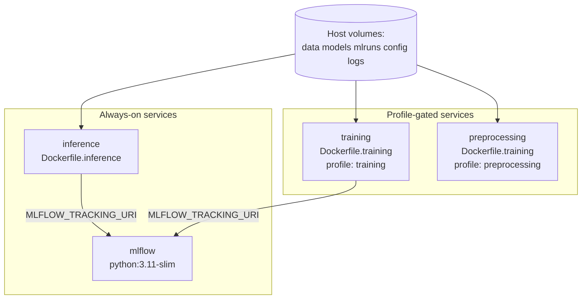
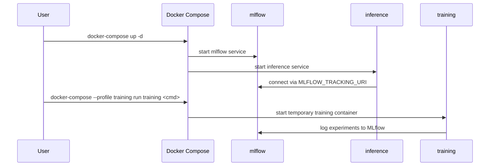

<!-- markdownlint-disable MD060 -->

# Docker

This document is the technical Docker reference for the thesis repository.
It explains Docker fundamentals and then maps them to the exact files and runtime behavior used in this project.

---

## 1. What Docker Means (General Concept)

Docker packages application code, runtime, and dependencies into a **container image**.
The same image can then run consistently on different machines.

Core terms:

- **Dockerfile**: recipe used to build an image.
- **Image**: immutable packaged artifact.
- **Container**: running instance of an image.
- **Docker Compose**: orchestration file for multi-container local systems.

---

## 2. General Pseudocode (Containerization Pattern)

```text
DEFINE Dockerfile:
  choose base image
  set environment
  install dependencies
  copy source code
  define startup command

BUILD image from Dockerfile

RUN container from image:
  mount required volumes
  expose required ports
  run health check

ORCHESTRATE multiple services via compose:
  define services
  define network
  define shared volumes
  start/stop stack
```

### Explanation

- Dockerfile defines a reproducible runtime recipe.
- Image build validates packaging; container run validates runtime behavior.
- Compose coordinates cross-service dependencies in local/system testing.

---

## 3. Why Docker Is Used in This Thesis

Docker supports three thesis-critical goals:

- **Reproducibility:** same Python/runtime stack across devices.
- **Deployability evidence:** model is exposed as a real API service, not only local scripts.
- **System composition:** MLflow + inference + on-demand training/preprocessing in one orchestrated stack.

---

## 4. Repository Locations

- `docker-compose.yml`
- `docker/Dockerfile.inference`
- `docker/Dockerfile.training`
- `.github/workflows/ci.yml`
- `.github/workflows/cd.yml`

---

## 5. Container Architecture in This Project



---

## 6. `Dockerfile.inference` Explained

### 5.1 Purpose

Builds the container that serves the FastAPI inference endpoint (`src/api/app.py`) via Uvicorn.

### 5.2 Technical Design Choices

| Design choice | Why it matters |
|---|---|
| Base image `python:3.11-slim` | Smaller footprint and predictable runtime |
| `PYTHONDONTWRITEBYTECODE`, `PYTHONUNBUFFERED` | Better container behavior and logging |
| Copy `requirements.txt` before source | Better Docker layer caching |
| `pip install -r requirements.txt` + `uvicorn[standard]` | Ensures serving dependencies are installed |
| Healthcheck probes `/health`, `/api/health`, `/openapi.json` | Increases compatibility across API route variants |
| Entrypoint `uvicorn src.api.app:app` | Explicit production-style API startup |

### 5.3 Runtime Interface

- Exposed container port: `8000`
- Primary endpoints checked by health strategy:
  - `/health`
  - `/api/health`
  - `/openapi.json`
- Key env variables:
  - `MODEL_PATH`
  - `CONFIG_PATH`
  - `PYTHONPATH=/app:/app/src`

---

## 7. `Dockerfile.training` Explained

### 6.1 Purpose

Provides a reproducible environment for training and preprocessing workloads.

### 6.2 Technical Design Choices

| Design choice | Why it matters |
|---|---|
| Installs `build-essential`, `git`, `curl` | Supports build-time native deps + tooling |
| Installs requirements + ML stack extras | Ensures training dependencies are present |
| Creates `/app/data`, `/app/models`, `/app/mlruns`, `/app/logs` | Aligns container filesystem with mounted thesis artifacts |
| Default command prints readiness message | Prevents accidental automatic retraining |

### 6.3 Reuse Pattern

The same training image is reused for:

- `training` service (profile `training`)
- `preprocessing` service (profile `preprocessing`, custom command)

This keeps maintenance simpler and avoids duplicate Dockerfiles.

---

## 8. Docker Compose Service Map

### 7.1 Service Inventory

| Service | Type | Start mode | Key responsibility |
|---|---|---|---|
| `mlflow` | Tracking backend | Always-on | Experiment tracking server |
| `inference` | API service | Always-on | Real-time model inference endpoint |
| `training` | Batch compute | Profile-gated | On-demand model training |
| `preprocessing` | Batch compute | Profile-gated | On-demand data preprocessing |

### 7.2 Network Model

- Shared Docker network: `har-network` (`bridge` driver).
- Services communicate internally using service names (for example `http://mlflow:5000`).

### 7.3 Volume Strategy

The compose file uses bind mounts to persist and share thesis artifacts:

- `./data`
- `./models`
- `./mlruns`
- `./config`
- `./logs`

This is important for reproducibility and traceability between local runs and container runs.

---

## 9. Thesis-Centric Pseudocode (Exact Repository Flow)

```text
BUILD inference image (docker/Dockerfile.inference):
  FROM python:3.11-slim
  set MODEL_PATH, CONFIG_PATH, PYTHONPATH
  install OS deps (curl)
  install python deps from config/requirements.txt
  copy src and config
  define HEALTHCHECK on /health and /api/health
  CMD uvicorn src.api.app:app

BUILD training image (docker/Dockerfile.training):
  FROM python:3.11-slim
  install build-essential + git + curl
  install training/deep-learning deps
  copy src and config
  default command prints readiness

COMPOSE runtime (docker-compose.yml):
  start always-on: mlflow, inference
  start on-demand profile: training, preprocessing
  mount host data/models/config/logs/mlruns
  connect services on har-network
```

### Thesis-Centric Explanation

- Inference image is optimized for serving and health checks.
- Training image is designed for reproducible compute workflows.
- Compose distinguishes always-on services from profile-gated batch services.

---

## 10. Compose Runtime Flow



---

## 11. CI/CD Integration Points

Docker is integrated in automation at two levels:

- **CI (`ci.yml`)**: `docker-build-check` validates that inference image builds.
- **CD (`cd.yml`)**: image is built, pushed to GHCR, and smoke-tested.

This creates a direct line from source code to verified, publishable artifact.

---

## 12. Practical Runbook

```bash
# Start always-on local stack
docker-compose up -d

# View logs
docker-compose logs -f

# Run on-demand preprocessing
docker-compose --profile preprocessing run preprocessing

# Run on-demand training command
docker-compose --profile training run training python src/train.py

# Stop stack
docker-compose down
```

---

## 13. What We Use Here vs Not Used Yet

### What We Use Here

- Dockerized inference API serving path.
- Dockerized MLflow service in local stack.
- Profile-gated training/preprocessing containers.
- CI build validation and CD build/push/smoke validation.

### What Is Not Used Yet

- Orchestrator-native deployment manifests (for example Helm/K8s) in the default path.
- Multi-environment compose overlays and secrets vault integration.
- End-to-end zero-downtime deployment patterns.

---

## 14. Thesis Interpretation

From a thesis perspective, Docker demonstrates that the project is not limited to offline experimentation:

- The inference component is service-oriented and deployable.
- Tracking infrastructure (MLflow) is operationally integrated.
- Training/preprocessing workloads can be executed in controlled, reproducible containers.

This supports the research-to-engineering transition central to MLOps.

---

## 15. Current Boundaries and Future Hardening

Current boundaries:

- Single-machine Compose target (no orchestrator-level deployment yet).
- Security hardening is baseline-level (suitable for thesis, not final production).
- No separate compose overlays for environment tiers.

Future improvements:

- Multi-stage image optimization and image size reduction.
- Secrets management integration.
- Environment-specific compose files (dev/stage/prod profiles).
- Container vulnerability scanning in CI/CD.
