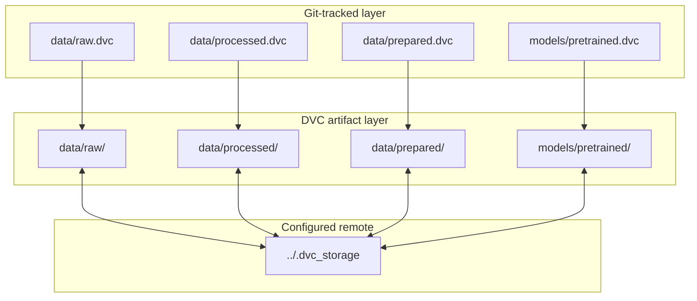
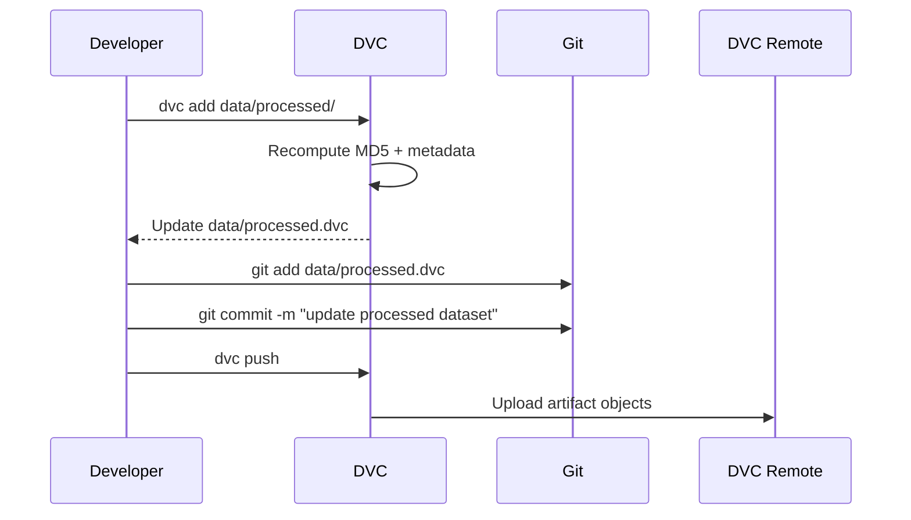

<!-- markdownlint-disable MD060 -->

# DVC (Data Version Control)

This document is the technical DVC reference for the thesis repository.
It explains DVC fundamentals and then maps them to the exact artifact/versioning setup implemented here.

---

## 1. What DVC Means (General Concept)

DVC is a data and model versioning layer for ML projects.
It keeps large artifacts outside normal Git history while storing small metadata pointer files in Git.

Conceptually:

- Git tracks code and metadata (`*.dvc`).
- DVC tracks large binary payloads (datasets, model files).
- Hashes provide deterministic content identity for reproducibility.

---

## 2. General Pseudocode (Data Versioning Pattern)

```text
WHEN artifact changes:
    dvc add <artifact_path>
    update pointer metadata (hash, size, file_count)
    git add <pointer_file>
    git commit "update data/model pointer"

TO share artifacts:
    dvc push

TO reproduce previous state:
    git checkout <commit_with_pointers>
    dvc pull
    dvc checkout
```

### Explanation

- Git stores pointer metadata; DVC stores heavy artifact content.
- Reproducibility comes from matching code commit + pointer hash + remote object data.
- Artifact sharing should happen via `dvc push/pull`, not direct Git blobs.

---

## 3. Why DVC Is Used in This Thesis

The thesis pipeline depends on versioned data artifacts and pretrained models that are too large or too dynamic for direct Git tracking.

DVC supports:

- **Reproducibility:** restore exact dataset/model versions by hash.
- **Traceability:** keep data/model lineage aligned with code commits.
- **Repository hygiene:** avoid bloating Git history with large binaries.

---

## 4. Repository Locations

- `.dvc/config`
- `data/raw.dvc`
- `data/processed.dvc`
- `data/prepared.dvc`
- `models/pretrained.dvc`

---

## 5. Current DVC Configuration

From `.dvc/config`:

- `core.remote = local_storage`
- remote URL points to `../.dvc_storage`

Implication:

- This project currently uses a **local filesystem remote** for artifact storage.
- It is practical for thesis workflows and local reproducibility.

---

## 6. Tracked Artifacts in This Repository

Snapshot from current pointer files:

| Pointer file | Tracked path | Size (bytes) | Files | Hash type |
|---|---|---:|---:|---|
| `data/raw.dvc` | `data/raw/` | 64,817,199 | 3 | MD5 |
| `data/processed.dvc` | `data/processed/` | 109,633,840 | 4 | MD5 |
| `data/prepared.dvc` | `data/prepared/` | 47,389,984 | 18 | MD5 |
| `models/pretrained.dvc` | `models/pretrained/` | 6,095,958 | 2 | MD5 |

Note: size/hash values evolve whenever artifacts are updated.

---

## 7. How DVC Works Here



---

## 8. Thesis-Centric Pseudocode (Exact Repository Flow)

```text
CONFIGURE DVC remote in .dvc/config:
    core.remote = local_storage
    remote.local_storage.url = ../.dvc_storage

TRACK thesis artifacts:
    data/raw.dvc        -> data/raw/
    data/processed.dvc  -> data/processed/
    data/prepared.dvc   -> data/prepared/
    models/pretrained.dvc -> models/pretrained/

WHEN artifact update happens:
    dvc add target_folder
    commit updated *.dvc pointer files in Git
    optional dvc push to configured storage

WHEN reproducing run inputs:
    checkout commit
    dvc pull / dvc checkout
    pipeline reads restored artifacts
```

### Thesis-Centric Explanation

- This repository uses DVC primarily for artifact version control, not pipeline orchestration.
- Current default remote is local filesystem storage, appropriate for thesis reproducibility.
- Pointer files provide transparent evidence of data/model lineage.

---

## 9. Lifecycle and Lineage

### 9.1 Typical Update Flow



### 9.2 Reproducibility Flow

1. Checkout a target Git commit (which includes matching `.dvc` pointers).
2. Run `dvc pull` and/or `dvc checkout`.
3. DVC restores artifact content for that commit's hash references.

---

## 10. Practical Command Reference

```bash
# Track new or updated artifacts
dvc add data/raw/
dvc add data/processed/
dvc add data/prepared/
dvc add models/pretrained/

# Store pointers in Git
git add data/*.dvc models/pretrained.dvc
git commit -m "Update DVC pointers"

# Synchronize artifact data
dvc push
dvc pull

# Restore workspace files to pointer state
dvc checkout

# Inspect changes
dvc status
dvc diff
```

---

## 11. Relationship to Pipeline and CI/CD

DVC in this repository is used as an **artifact versioning layer**, not as a DVC pipeline orchestrator.

- There is no required `dvc.yaml` stage graph in the core thesis execution path.
- Execution orchestration is handled by the Python pipeline code and scripts.
- CI/CD currently focuses on code quality and container packaging; DVC synchronization is primarily a data workflow concern.

---

## 12. What We Use Here vs Not Used Yet

### What We Use Here

- Pointer-based versioning for raw, processed, prepared data and pretrained models.
- Hash/size/file-count metadata tracking in committed `.dvc` files.
- Local DVC remote configured for artifact synchronization.

### What Is Not Used Yet

- Full DVC stage graph orchestration (`dvc.yaml`) as primary pipeline runner.
- Enterprise/shared cloud object storage remote as mandatory default.
- Automated CI/CD artifact promotion policies tightly coupled to DVC state.

---

## 13. Thesis Interpretation

DVC contributes directly to thesis credibility in reproducibility and traceability:

- Data/model versions are explicit and commit-aligned.
- Large artifacts are managed without polluting source-control history.
- Experimental and operational artifacts can be reconstructed for defense or replication.

This is central to an MLOps-oriented research implementation.

---

## 14. Current Boundaries and Future Enhancements

Current boundaries:

- Local filesystem remote is convenient but not collaborative at larger team scale.
- Artifact promotion policies are not fully automated in CI/CD.

Future enhancements:

- Move remote storage to shared object storage for collaboration.
- Add integrity and retention policies for long-term artifact governance.
- Introduce automated artifact validation gates before release tagging.
