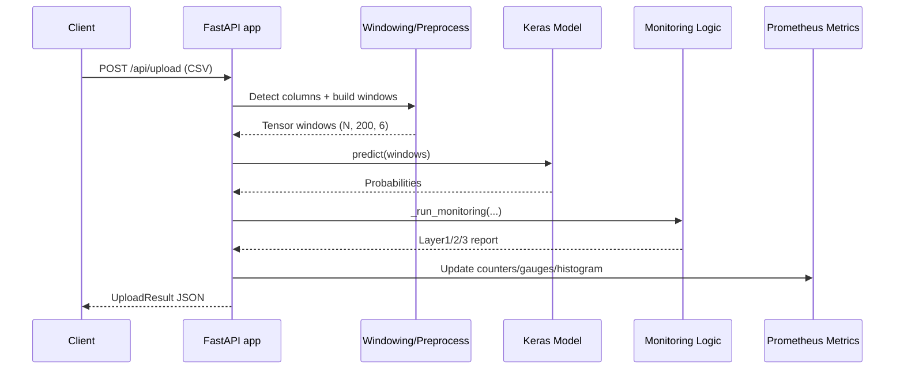

<!-- markdownlint-disable MD060 -->

# FastAPI

This document describes FastAPI in two layers:

1. General API-serving pseudocode and concepts.
2. Thesis-centric pseudocode mapped to the exact implementation in this repository.

---

## 1. What FastAPI Means (General Concept)

FastAPI is a Python framework for HTTP APIs with:

- request/response validation,
- automatic OpenAPI schema generation,
- async endpoint support,
- production-friendly integration with ASGI servers such as Uvicorn.

In MLOps, FastAPI is commonly used to expose model inference as a service.

---

## 2. General Pseudocode (Framework-Agnostic)

```text
INITIALIZE api_app
LOAD model_artifacts
LOAD optional_monitoring_state

DEFINE GET /health:
  RETURN service_status + model_loaded_flag

DEFINE POST /predict(input_payload):
  VALIDATE input_payload schema
  PREPROCESS input_payload into model_features
  probabilities = MODEL.predict(model_features)
  prediction = ARGMAX(probabilities)
  monitoring_report = RUN_POST_INFERENCE_CHECKS(probabilities, model_features)
  RECORD metrics/logs
  RETURN prediction + confidence + monitoring_report
```

### Explanation

- The API process must load model artifacts once at startup.
- Health endpoints are required for orchestration and monitoring systems.
- Prediction endpoints should include validation, preprocessing, inference, and post-inference checks in one flow.
- Observability should be emitted per request (metrics, latency, status).

---

## 3. Thesis-Centric Pseudocode (Exact Repository Flow)

```text
ON APP STARTUP (lifespan in src/api/app.py):
  _load_model() from models/pretrained/fine_tuned_model_1dcnnbilstm.keras
  _load_baseline() from models/normalized_baseline.json (if present)

GET /health and /api/health:
  RETURN model_loaded, baseline_loaded, uptime

GET /metrics:
  RETURN Prometheus metrics if prometheus_client is installed

POST /api/upload(csv_file):
  READ csv into DataFrame
  REQUIRE at least WINDOW_SIZE rows
  sensor_cols = _detect_columns(df)
  windows = _create_windows(df[sensor_cols])
  probabilities = _model.predict(windows, batch_size=64)
  predicted_classes = argmax(probabilities)
  monitoring = _run_monitoring(predicted_classes, probabilities, windows)
  UPDATE Prometheus counters/gauges/histogram
  RETURN UploadResult(
    predictions,
    activity_summary,
    confidence_stats,
    monitoring
  )
```

### Thesis-Centric Explanation

- The endpoint contract is file-based (`UploadFile`) rather than JSON streaming.
- Input schema is dynamic by column-pattern matching (`acc_x`, `ax_w`, etc.), not a fixed single header naming.
- Monitoring is integrated inside inference response generation, so every upload returns model-health context.
- Prometheus export is native (`/metrics`) and tied to per-request inference behavior.

---

## 4. Repository Locations

- `src/api/app.py`
- `docker/Dockerfile.inference`
- `docker-compose.yml`
- `config/alerts/har_alerts.yml`

---

## 5. Endpoint and Runtime Map

| Endpoint | Method | Purpose |
|---|---|---|
| `/health` | GET | Health status alias |
| `/api/health` | GET | Health status for API namespace |
| `/api/model/info` | GET | Loaded model metadata |
| `/metrics` | GET | Prometheus exposition endpoint |
| `/api/upload` | POST | CSV-based inference + monitoring |
| `/` | GET | Embedded dashboard UI |

---

## 6. What We Use Here

- FastAPI application lifecycle (`lifespan`) for startup loading.
- CSV upload-based inference API.
- Automatic schema serialization via Pydantic response models (`UploadResult`, `HealthResponse`).
- CORS middleware.
- Integrated Prometheus instrumentation:
  - `har_api_requests_total`
  - `har_confidence_mean`
  - `har_entropy_mean`
  - `har_flip_rate`
  - `har_drift_detected`
  - `har_baseline_age_days`
  - `har_inference_latency_ms`
- Embedded HTML dashboard for local exploratory usage.

---

## 7. FastAPI Capabilities Not Used Yet (But Relevant)

- Authentication/authorization (OAuth2/JWT/API keys).
- Rate limiting and request quotas.
- WebSocket streaming inference.
- Background task queues for asynchronous heavy jobs.
- Multi-worker production process manager setup in-repo (for example Gunicorn orchestration scripts).

These are optional for a thesis repository but relevant for full production hardening.

---

## 8. Request-to-Result Graph



---

## 9. Role in This Thesis

- **Core role:** API-serving interface for model inference and monitoring export.
- **Optional role:** Offline pipeline (`run_pipeline.py`) can run without API server.
- **Future role:** Add auth, traffic governance, and deployment gateway integration.
