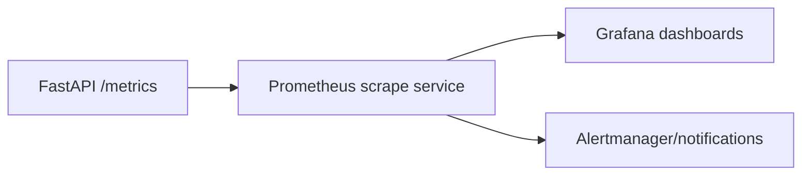

<!-- markdownlint-disable MD060 -->

# Grafana (Visualization Layer)

This file documents Grafana in thesis format, while clearly separating current usage and planned usage.

---

## 1. What Grafana Means (General Concept)

Grafana is a dashboard and visualization tool used to display metrics collected by systems like Prometheus.

Typical output:

- time-series charts,
- gauges/stat panels,
- alert state overlays.

---

## 2. General Pseudocode (Dashboard Pattern)

```text
CONNECT dashboard_tool to metrics_source

FOR each panel:
    define query
    define visualization type
    define thresholds / color mapping

REFRESH dashboard at interval
DISPLAY current and historical health trends
```

### Explanation

- Grafana does not collect metrics itself; it visualizes queried data.
- Panel design should map directly to operational decisions.
- Threshold colors should align with trigger policy thresholds.

---

## 3. Thesis-Centric Pseudocode (Current Repository)

```text
CURRENT STATE:
    API exports metrics via /metrics (src/api/app.py)
    alert logic is defined in config/alerts/har_alerts.yml

GRAFANA STATUS:
    no active Grafana provisioning files in current repository
    no Grafana service in current docker-compose.yml

PLANNED INTEGRATION PATH:
    deploy Prometheus scrape service
    connect Grafana datasource to Prometheus
    build thesis dashboard panels for confidence/drift/latency/trigger state
```

### Thesis-Centric Explanation

- Grafana is conceptually part of the observability architecture.
- In the current repository state, visualization is not provisioned as code yet.
- This keeps the documentation honest while preserving the architecture direction.

---

## 4. Repository Locations (Current)

- `src/api/app.py`
- `config/alerts/har_alerts.yml`
- `config/alerts/har_alerts_pending.yml`
- `docker-compose.yml`

---

## 5. What We Use Here vs Not Used Yet

### What We Use Here

- Metric production from FastAPI.
- Alert-rule governance at configuration level.

### What Is Not Used Yet

- Grafana dashboard JSON/provisioning files.
- Grafana datasource configuration in repo.
- Grafana service in local compose stack.

---

## 6. Visualization Architecture (Target)



---

## 7. Role in This Thesis

- **Current role:** documented target for observability visualization.
- **Optional role:** can be added for demos/defense visuals when full metrics stack is deployed.
- **Future role:** dashboard-driven operational decision support.
