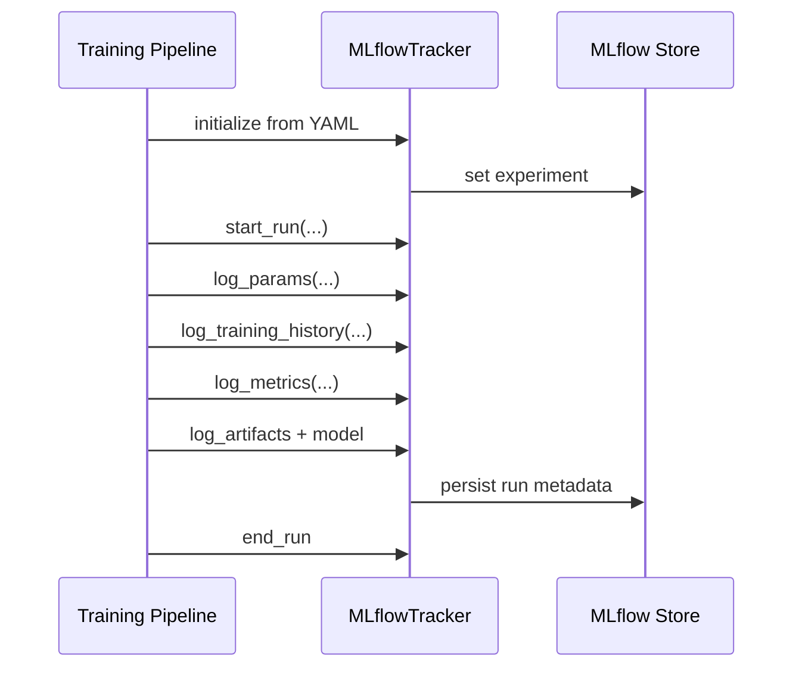

<!-- markdownlint-disable MD060 -->

# MLflow

This document explains MLflow with both:

1. General pseudocode for experiment tracking design.
2. Thesis-centric pseudocode mapped to this repository's MLflow implementation.

---

## 1. What MLflow Means (General Concept)

MLflow is an experiment-tracking and artifact-management platform for machine learning workflows.

Core objects:

- **Experiment**: logical container for runs.
- **Run**: one execution instance (training/evaluation/inference experiment).
- **Artifacts**: files such as models, plots, reports.
- **Metrics/Params/Tags**: structured metadata used for comparison and traceability.

---

## 2. General Pseudocode (Framework-Agnostic)

```text
SET tracking_uri
SET_OR_CREATE experiment

START run(run_name, tags)
    LOG params
    FOR each training epoch:
        LOG metrics(epoch)
    LOG final metrics
    LOG artifacts (model, plots, reports, config)
    OPTIONAL register model
END run

QUERY best runs by metric
COMPARE selected runs
```

### Explanation

- Tracking URI defines where metadata/artifacts are stored.
- Every significant training or adaptation event should be wrapped in a run context.
- Epoch-level logging allows trend analysis, not only end-of-run snapshots.
- Artifact logging preserves reproducible evidence for thesis defense.

---

## 3. Thesis-Centric Pseudocode (Exact Repository Flow)

```text
INITIALIZE MLflowTracker in src/mlflow_tracking.py:
    config = read config/mlflow_config.yaml
    tracking_uri = config.mlflow.tracking_uri (default: mlruns)
    experiment_name = config.mlflow.experiment_name
    set_tracking_uri(tracking_uri)
    set_or_create_experiment(experiment_name)

WITH tracker.start_run(run_name, tags):
    tracker.log_params(training_hyperparameters)
    tracker.log_training_history(history)         # epoch-wise metrics
    tracker.log_metrics(final_metrics)
    tracker.log_confusion_matrix(y_true, y_pred)
    tracker.log_classification_report(y_true, y_pred)
    tracker.log_artifact(files)
    tracker.log_keras_model(model, artifact_path)

OPTIONAL utility paths:
    tracker.get_best_run(metric)
    tracker.compare_runs(run_ids, metrics)
```

### Thesis-Centric Explanation

- The project uses a custom wrapper class (`MLflowTracker`) rather than raw direct MLflow calls everywhere.
- Config-driven setup comes from `config/mlflow_config.yaml`.
- Default local tracking is file-based (`mlruns`), but compose can run an MLflow server endpoint.
- Training/evaluation artifacts (history, confusion matrix, reports) are first-class tracked outputs.

---

## 4. Repository Locations

- `src/mlflow_tracking.py`
- `config/mlflow_config.yaml`
- `mlruns/`
- `docker-compose.yml`

---

## 5. Configuration Snapshot in This Repository

From `config/mlflow_config.yaml`:

- `tracking_uri: "mlruns"`
- `experiment_name: "anxiety-activity-recognition"`
- `registry.model_name: "har-1dcnn-bilstm"`
- default tags include project and model-type context
- explicit lists of logged params/metrics/artifacts are documented in YAML

---

## 6. What We Use Here

- Experiment auto-setup and run lifecycle control.
- Parameter logging.
- Metric logging (single-step and epoch-wise).
- JSON/CSV/file artifact logging.
- Keras model logging through MLflow API.
- Evaluation helpers:
  - confusion matrix logging
  - classification report logging
- Run comparison utilities (`get_best_run`, `compare_runs`) are available for analysis.

---

## 7. MLflow Capabilities Not Used or Not Central Here

- MLflow model serving endpoint (`mlflow models serve`) is not the primary inference path.
- Full production model-governance lifecycle in MLflow Registry is not the main deployment mechanism here (local model registry/rollback logic is used).
- Enterprise backends (remote DB/object-store governance) are not mandatory in default local setup.
- Auto-logging (`mlflow.autolog`) is not the dominant pattern; explicit logging is preferred.

---

## 8. Flow Graph



---

## 9. Role in This Thesis

- **Core role:** reproducibility evidence trail for experiments and model updates.
- **Optional role:** local debug runs can proceed with reduced/disabled tracking.
- **Future role:** stronger retention policy and stricter model-governance integration.
