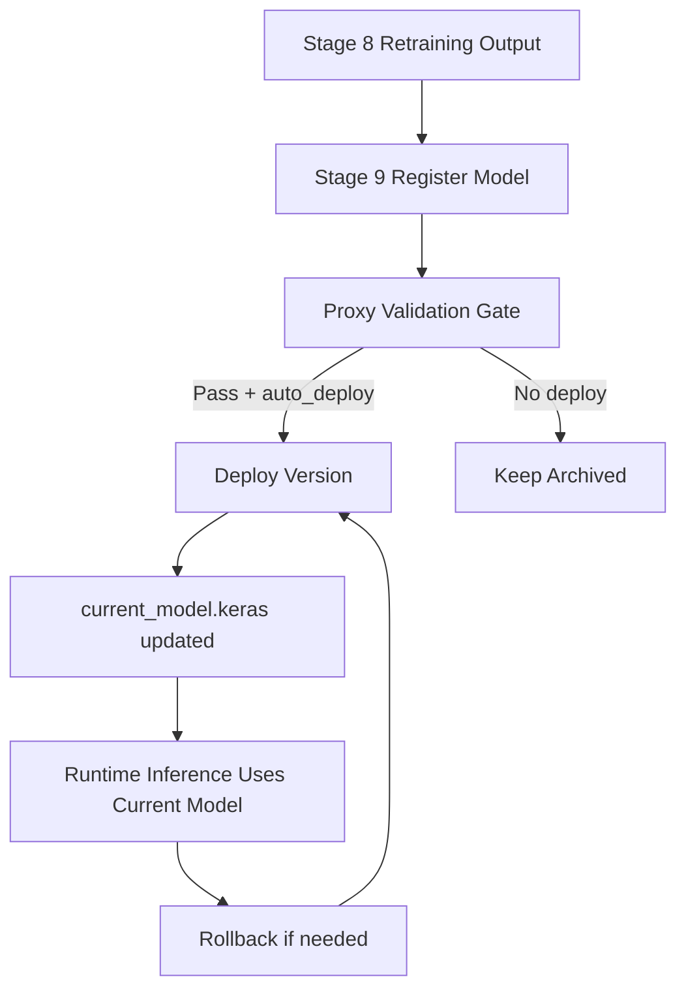

<!-- markdownlint-disable MD060 -->

# Model Registry and Rollback

This document explains model registry behavior with:

1. General pseudocode for versioned model governance.
2. Thesis-centric pseudocode mapped to Stage 9 and local rollback logic.

---

## 1. What a Model Registry Means (General Concept)

A model registry is a controlled catalog of model versions and deployment state.

Typical functions:

- register new model versions with metadata,
- track current deployed version,
- store deployment history,
- rollback to previous stable versions.

---

## 2. General Pseudocode (Framework-Agnostic)

```text
REGISTER_MODEL(model_file, metrics, metadata):
  version_id = CREATE_VERSION_ID()
  STORE model_file under registry/version_id
  WRITE metadata (metrics, hash, timestamps)
  RETURN version_id

DEPLOY_MODEL(version_id):
  VERIFY version exists
  UPDATE active_pointer -> version_id
  APPEND deployment history event

ROLLBACK(target_version=None):
  if target_version is None:
    target_version = RESOLVE_PREVIOUS_STABLE_VERSION()
  DEPLOY_MODEL(target_version)
  APPEND rollback history event
```

### Explanation

- Registry is both storage and governance metadata, not only a folder of files.
- Deployment is pointer/state management, not retraining.
- Rollback must be quick and auditable.

---

## 3. Thesis-Centric Pseudocode (Exact Repository Flow)

```text
STAGE 9 (src/components/model_registration.py):
  registry = ModelRegistry(registry_dir)
  model_path = retraining_artifact.retrained_model_path
  metrics = retraining_artifact.metrics

  model_version = registry.register_model(model_path, version, metrics)

  if proxy_validation enabled:
    current = registry.get_current_version()
    compare new accuracy vs current accuracy with degradation_tolerance
    if metrics missing and block_if_no_metrics=true:
      block deploy

  if auto_deploy and is_better:
    registry.deploy_model(model_version)

MODEL REGISTRY CORE (src/model_rollback.py):
  maintain models/registry/model_registry.json
  maintain models/registry/har_model_v<version>.keras
  deploy by copying selected version to models/pretrained/current_model.keras
  rollback via history or explicit target version
```

### Thesis-Centric Explanation

- The repository uses a **local JSON registry** (`model_registry.json`), not an external SaaS registry.
- Deployment is Windows-safe file copy to `models/pretrained/current_model.keras`.
- Stage 9 includes governance conditions (`degradation_tolerance`, `block_if_no_metrics`, `auto_deploy`) before promotion.

---

## 4. Repository Locations

- `src/components/model_registration.py`
- `src/model_rollback.py`
- `models/registry/model_registry.json`
- `models/registry/har_model_vauto.keras`
- `models/pretrained/current_model.keras`

---

## 5. Data Model Snapshot

The registry JSON tracks:

- `models` dictionary by version id
- `current_version`
- `history` events (`deploy`, `rollback`)

Each model record includes:

- version,
- path,
- timestamps,
- metrics,
- hash (`config_hash`),
- data-version metadata,
- status (`archived`, `deployed`, `rollback`).

---

## 6. What We Use Here

- Local model registration from retraining outputs.
- Proxy validation before deployment decisions.
- Controlled optional auto-deployment.
- Manual rollback CLI and history-based rollback logic.
- File integrity hash generation for version records.
- Validation utilities (`validate_model_file`, `validate_inference`) in rollback workflow.

---

## 7. Capabilities Not Fully Used Yet

- Multi-environment promotion workflow (dev/stage/prod).
- Canary/shadow deployments.
- Approval workflows integrated with PR/release checks.
- External centralized model registry backend.
- Signed model artifacts and policy-as-code deployment gates.

---

## 8. Registry Lifecycle Graph



---

## 9. Role in This Thesis

- **Core role:** Stage 9 governance for safe promotion of retrained/adapted models.
- **Optional role:** not needed for inference-only runs (Stages 1-7).
- **Future role:** richer deployment metadata and stronger policy checks.
