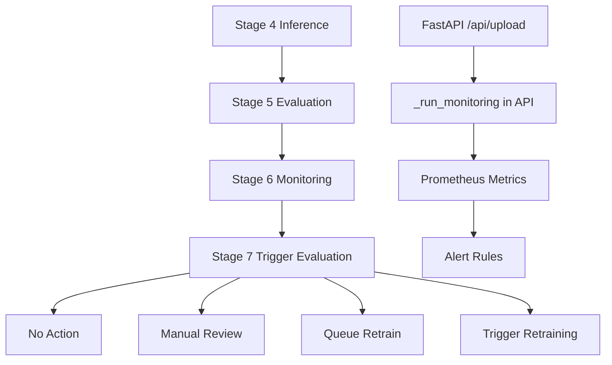

<!-- markdownlint-disable MD060 -->

# Monitoring

This document covers monitoring in two layers:

1. General monitoring pseudocode for ML inference systems.
2. Thesis-centric monitoring pseudocode tied to Stage 6 and Stage 7 implementations.

---

## 1. What Monitoring Means (General Concept)

Post-inference monitoring checks model behavior after predictions are produced.

Typical goals:

- detect confidence degradation,
- detect temporal instability,
- detect data-distribution shift,
- trigger review/retraining policy actions.

---

## 2. General Pseudocode (Framework-Agnostic)

```text
FOR each prediction batch:
  confidence_metrics = ANALYZE_CONFIDENCE(probabilities)
  temporal_metrics = ANALYZE_TEMPORAL_STABILITY(predictions)
  drift_metrics = ANALYZE_DISTRIBUTION_SHIFT(features, baseline)

  layer_status = AGGREGATE_LAYER_STATUSES(
    confidence_metrics,
    temporal_metrics,
    drift_metrics
  )

  decision = APPLY_TRIGGER_POLICY(layer_status, thresholds, cooldown)
  EMIT metrics + alerts + reports
```

### Explanation

- Confidence captures epistemic warning signs from probability outputs.
- Temporal analysis catches oscillation and sequence instability.
- Drift analysis compares incoming feature behavior to baseline reference statistics.
- Trigger policy separates "observe" from "act" to reduce false retraining.

---

## 3. Thesis-Centric Pseudocode (Exact Repository Flow)

```text
STAGE 6 (src/components/post_inference_monitoring.py):
  import PostInferenceMonitor from scripts/post_inference_monitoring.py

  if outputs/calibration/temperature.json exists:
    calibration_temperature <- load from file
  else:
    calibration_temperature <- config default

  baseline_path <- models/normalized_baseline.json (or override)
  if baseline missing:
    skip Layer 3 baseline comparison
  if baseline too old (> max_baseline_age_days):
    log staleness warning
  if is_training_session:
    force skip Layer 3 self-comparison

  report <- monitor.run(predictions_csv, production_npy, baseline_path, model_path)
  write outputs/evaluation/monitoring_report.json

STAGE 7 (src/components/trigger_evaluation.py + src/trigger_policy.py):
  map Stage 6 output to trigger schema
  evaluate confidence / temporal / drift signals
  apply collapse guard (dominant class patterns)
  apply voting + cooldown + consecutive-warning logic
  output action: none | monitor | review | queue_retrain | trigger
```

### Thesis-Centric Explanation

- Monitoring is not one metric; it is a layered governance mechanism.
- Stage 6 computes monitoring evidence, Stage 7 converts evidence to policy action.
- Collapse guard protects against unsafe auto-retraining when model behavior is pathological but unlabeled.

---

## 4. Runtime API Monitoring Path (FastAPI)

The API has an additional per-request monitoring path in `src/api/app.py`:

- `_run_monitoring` computes layer summaries for each upload request.
- Prometheus gauges/counters are updated for observability.
- Result is returned directly in API response.

This gives immediate operational visibility even outside full pipeline runs.

---

## 5. Repository Locations

- `src/components/post_inference_monitoring.py`
- `scripts/post_inference_monitoring.py`
- `src/components/trigger_evaluation.py`
- `src/trigger_policy.py`
- `config/alerts/har_alerts.yml`
- `src/api/app.py`

---

## 6. Signals and Threshold Sources

| Layer | Primary signals | Main thresholds source |
|---|---|---|
| Layer 1 Confidence | mean confidence, uncertain percentage, entropy | `PostInferenceMonitoringConfig`, `TriggerThresholds` |
| Layer 2 Temporal | transition/flip rate, dwell metrics | `PostInferenceMonitoringConfig`, `TriggerThresholds` |
| Layer 3 Drift | per-channel z-score style drift, aggregate drift | `PostInferenceMonitoringConfig`, `TriggerThresholds` |

---

## 7. What We Use Here

- Stage-based monitoring in the production pipeline (Stage 6, Stage 7).
- Thresholds from dataclass configuration and YAML overrides.
- Cooldown and consecutive-warning policy to avoid trigger thrashing.
- Collapse guard policy for dominant-class failure mode.
- Prometheus-facing runtime metrics and alert rules:
  - confidence, entropy, flip-rate,
  - drift-detected flag,
  - baseline age governance,
  - latency and request-rate health.

---

## 8. Monitoring/Trigger Capabilities Not Fully Used Yet

- Fully supervised online monitoring with real-time ground-truth labels.
- Automated end-to-end retraining execution directly from alert manager.
- Full multivariate drift stack with always-on Wasserstein and change-point stage in default path (available as advanced stage, not always-on).
- Rich long-horizon trend anomaly models beyond threshold and voting policies.

---

## 9. Monitoring Governance Graph



---

## 10. Role in This Thesis

- **Core role:** quantitative post-inference governance and retraining decision support.
- **Optional role:** Prometheus/Grafana deployment is optional for offline-only experimentation.
- **Future role:** tighter automation between monitoring outcomes and controlled retraining workflows.
