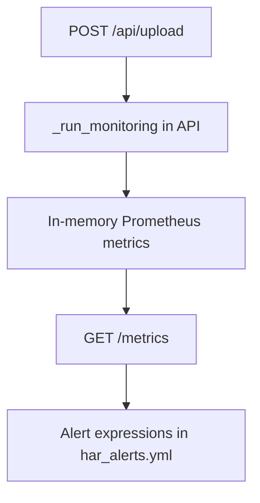

<!-- markdownlint-disable MD060 -->

# Prometheus (Metrics and Alerting)

This reference keeps Prometheus in the same documentation style as the tech set:

1. General concept.
2. General pseudocode.
3. Thesis-centric pseudocode based on current repository reality.
4. Explicit used-vs-not-used coverage.

---

## 1. What Prometheus Means (General Concept)

Prometheus is a metrics system that:

- scrapes numeric measurements from instrumented services,
- stores them as time-series,
- evaluates alert rules over those series.

Prometheus itself is not the model; it is an observability layer around the model service.

---

## 2. General Pseudocode (Metrics + Alerting Pattern)

```text
SERVICE exposes /metrics endpoint

PROMETHEUS LOOP every scrape_interval:
    scrape target /metrics
    store time-series samples

ALERT LOOP every evaluation_interval:
    evaluate alert rules
    if rule condition true for configured duration:
        fire alert notification
```

### Explanation

- Scrape and alert evaluation are separate loops.
- "for" durations in rules reduce noise from short spikes.
- Metric naming and consistency are critical for maintainability.

---

## 3. Thesis-Centric Pseudocode (Current Repository)

```text
IN src/api/app.py:
    initialize Prometheus Counter/Gauge/Histogram metrics
    update metrics inside _run_monitoring(...) and /api/upload flow
    expose GET /metrics endpoint

IN config/alerts/har_alerts.yml:
    define live alert expressions for exported metrics only
    confidence, entropy, flip-rate, drift flag, latency, baseline age

IN config/alerts/har_alerts_pending.yml:
    keep non-exported metric rules as backlog (not active)
```

### Thesis-Centric Explanation

- Metrics are currently exported directly by the FastAPI application.
- Alert rules are already curated to match exported metrics.
- Some advanced rules are intentionally separated as pending until metrics exist.

---

## 4. Repository Locations

- `src/api/app.py`
- `config/alerts/har_alerts.yml`
- `config/alerts/har_alerts_pending.yml`
- `docker-compose.yml`

---

## 5. Exported Metrics Used Today

From `src/api/app.py`:

- `har_api_requests_total` (Counter)
- `har_confidence_mean` (Gauge)
- `har_entropy_mean` (Gauge)
- `har_flip_rate` (Gauge)
- `har_drift_detected` (Gauge)
- `har_baseline_age_days` (Gauge)
- `har_inference_latency_ms` (Histogram)

These are the metric names used by live alerting logic.

---

## 6. Live Alerts Used Today

`config/alerts/har_alerts.yml` includes live rule groups for:

- low confidence,
- high entropy,
- high flip rate,
- drift detected,
- high latency,
- no predictions,
- stale baseline,
- missing baseline.

---

## 7. What We Use Here vs Not Used Yet

### What We Use Here

- Prometheus metric instrumentation in API runtime.
- `/metrics` endpoint exposure.
- Alert rule definitions aligned to exported metrics.

### What Is Not Used Yet

- Dedicated Prometheus server configuration file in this repo.
- Dedicated Prometheus service in current `docker-compose.yml`.
- Full pending rule set activation (`har_alerts_pending.yml`).

These are valid next steps, but not required for the current thesis baseline runtime.

---

## 8. Monitoring Flow



---

## 9. Role in This Thesis

- **Core role:** operational observability signals for confidence, drift proxy, latency, and service activity.
- **Optional role:** external Prometheus server deployment.
- **Future role:** activate pending metric set and full scrape stack automation.
