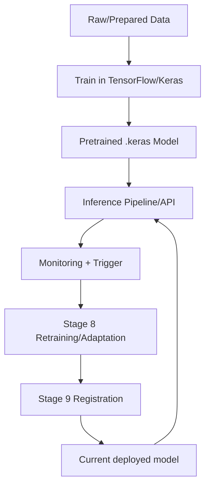

<!-- markdownlint-disable MD060 -->

# TensorFlow / Keras

This document explains TensorFlow/Keras from two perspectives:

1. General pseudocode for deep-learning training and inference workflows.
2. Thesis-centric pseudocode mapped to this repository's HAR model stack.

---

## 1. What TensorFlow/Keras Means (General Concept)

TensorFlow provides tensor computation and training runtime.
Keras (inside TensorFlow) provides high-level APIs for defining, training, saving, and loading neural networks.

In this repository, TensorFlow/Keras is the primary model framework for HAR training and serving.

---

## 2. General Pseudocode (Framework-Agnostic)

```text
DEFINE model_architecture(input_shape, n_classes)
COMPILE model(loss, optimizer, metrics)

TRAIN model on train_data with validation_data:
    FOR epoch in range(max_epochs):
        run forward/backward updates
        compute train/val metrics
        apply callbacks (early stopping, lr scheduler)

SAVE model artifact

INFERENCE(new_batch):
    probabilities = model.predict(new_batch)
    predicted_class = argmax(probabilities)
    confidence = max(probabilities)
    RETURN predicted_class, confidence, probabilities
```

### Explanation

- Model architecture and optimization setup are explicit and reproducible.
- Callback-driven training avoids unnecessary overfitting and stabilizes learning.
- Inference should preserve class probabilities for confidence and calibration analysis.

---

## 3. Thesis-Centric Pseudocode (Exact Repository Flow)

```text
TRAINING (src/train.py):
    cfg = TrainingConfig(...)
    data_loader = DataLoader(cfg)
    df = data_loader.load_training_data()
    X_windows, y_windows = data_loader.prepare_data(df)

    model = HARModelBuilder(cfg).create_1dcnn_bilstm()
    run cross-validation (optional)
    train final model
    save model + scaler + label mapping + reports
    log run via MLflowTracker

INFERENCE (src/run_inference.py and src/api/app.py):
    model = tf.keras.models.load_model(models/pretrained/fine_tuned_model_1dcnnbilstm.keras)
    input windows shape: (N, 200, 6)
    probs = model.predict(windows)
    classes = argmax(probs, axis=1)
    confidence = max(probs, axis=1)

RETRAIN ADAPTATION (src/components/model_retraining.py):
    method in {none, adabn, tent, adabn_tent, pseudo_label}
    if method in {mmd, dann}:
        raise NotImplementedError
```

### Thesis-Centric Explanation

- The deployed model is a 1D-CNN-BiLSTM architecture with softmax output for 11 classes.
- Default production tensor shape is `(window=200, sensors=6)`.
- Training and adaptation are componentized by pipeline stage (primarily Stage 8 for retraining/adaptation).

---

## 4. Architecture Notes in This Repository

`src/train.py` defines two architecture variants:

- `v1` (default): matches deployed pretrained checkpoint (`fine_tuned_model_1dcnnbilstm.keras`).
- `v2`: larger paper-inspired alternative kept for experimentation.

Core building blocks used:

- `Conv1D`
- `BatchNormalization`
- `Bidirectional(LSTM)`
- `Dropout`
- `Dense` + `softmax`

---

## 5. Repository Locations

- `src/train.py`
- `src/run_inference.py`
- `src/api/app.py`
- `src/components/model_retraining.py`
- `src/model_rollback.py`
- `models/pretrained/fine_tuned_model_1dcnnbilstm.keras`
- `pyproject.toml`

---

## 6. What We Use Here

- Keras sequential model construction for HAR architecture.
- TensorFlow model serialization/deserialization (`.keras` format).
- Batch inference for pipeline and API serving.
- Cross-validation and final training routines.
- Adaptation methods integrated into Stage 8:
  - AdaBN
  - TENT
  - AdaBN+TENT
  - pseudo-label adaptation
- Validation of model load/inference behavior in rollback validator.

---

## 7. TensorFlow/Keras-Adjacent Paths Not Used or Not Fully Used

- DANN and MMD adaptation paths are referenced but not implemented in code (explicit `NotImplementedError`).
- Export targets such as TFLite/ONNX are not the default deployment artifacts.
- Distributed training strategies are not central in this thesis implementation.
- Quantization-aware deployment flows are not yet integrated.

---

## 8. Model Lifecycle Graph



---

## 9. Role in This Thesis

- **Core role:** foundational deep-learning framework for model training and inference.
- **Optional role:** adaptation modes are optional research paths beyond baseline inference.
- **Future role:** runtime optimization/export and deployment-oriented acceleration.
