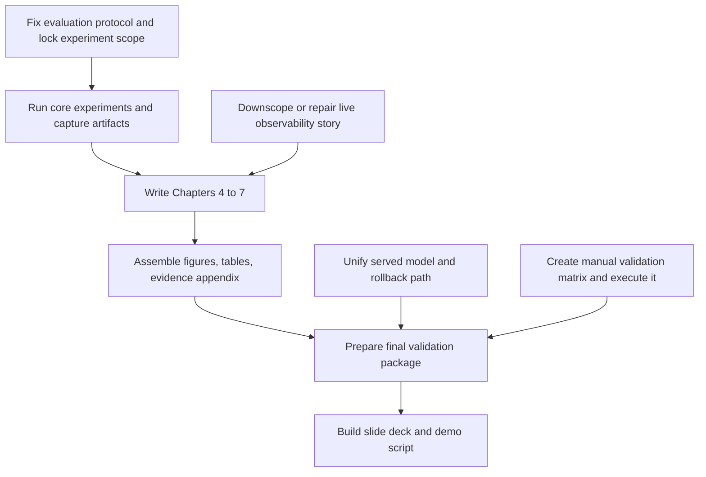
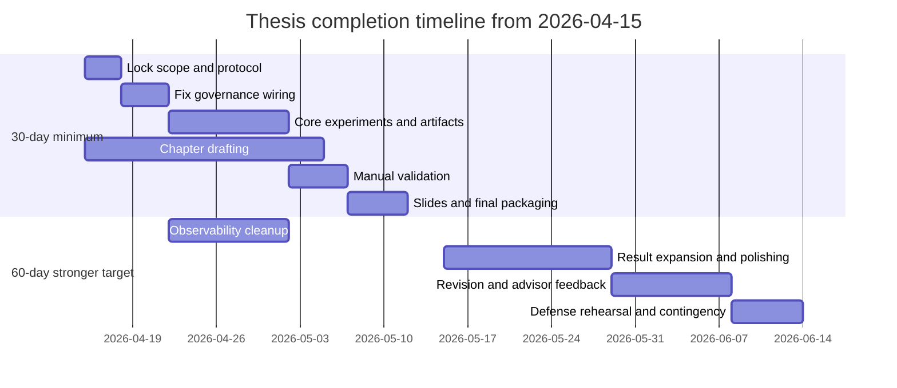

# From April 15: Thesis Completion Audit and Execution Plan

## 1. Executive Verdict

Audit date: 2026-03-18

### Bottom line

This repository is not an empty thesis project. It already contains a real multi-stage HAR MLOps pipeline, real datasets, real model artifacts, MLflow history, monitoring logic, trigger policy code, retraining code, rollback code, Docker assets, and a passing automated test suite.

It is also not thesis-ready.

The main issue is not "missing code everywhere". The main issue is that several high-risk claims are only partially defensible when checked against runtime wiring, artifacts, and thesis material:

- Evaluation methodology is weaker than the repository narrative suggests.
- Observability is only partially operational end-to-end.
- Rollback exists in code and tests, but is not wired to the model actually served by the API.
- Thesis writing is far behind technical implementation.
- Evidence capture is uneven: some areas are well supported, others are still plan-level only.

### Feasibility verdict

| Scenario | Verdict | Confidence | Plain answer |
|---|---|---:|---|
| 30 days, full requested scope | Unrealistic | High | No, not for full technical completion + full manual validation + polished observability + strong thesis writing + PPT alone. |
| 30 days, thesis-minimum scope with aggressive de-scope | Feasible with aggressive scope control | Medium | Yes, but only if you stop expanding scope, fix a small number of critical integrity gaps, and treat several industry-polish items as future work. |
| 60 days, thesis-focused scope | Feasible with strict prioritization | High | Yes, this is the realistic path for one serious researcher working alone. |
| 60 days, full thesis plus significant industry polish | Feasible but still selective | Medium | Yes, but not every advanced or production-grade idea should be implemented. Some should remain documented limitations or future work. |

### Evidence behind the verdict

- `run_pipeline.py` and `src/pipeline/production_pipeline.py` implement a real 14-stage orchestrated flow.
- `pytest -q` passed locally during this audit with `265 passed`.
- `artifacts/20260314_140547/` contains a real end-to-end run with evaluation, monitoring, and trigger outputs.
- `reports/TRIGGER_POLICY_EVAL.csv` contains calibrated trigger-policy results with high precision and low false alarm rate.
- `reports/repo_audit/WAVE2_STAGE6_BASELINE_SPACE_FIX_VALIDATION.md` documents a real monitoring integrity fix.
- `src/api/app.py` exports only a limited Prometheus metric set, while `config/grafana/dashboards/har_dashboard.json` and `config/alerts/har_alerts_pending.yml` expect many metrics that are not exported.
- `src/model_rollback.py` deploys `models/pretrained/current_model.keras`, but `src/api/app.py`, `src/components/model_inference.py`, and `docker-compose.yml` still point to `fine_tuned_model_1dcnnbilstm.keras`.
- `thesis/main.tex` compiles, but `thesis/chapters/ch2_background_related_work.tex` through `thesis/chapters/ch8_discussion_conclusion.tex` are still placeholder-length files, and `thesis/references.bib` contains only one BibTeX entry.

## 2. Repository Understanding Snapshot

### Repository map

| Area | Main paths | Current role | Audit view |
|---|---|---|---|
| Core orchestration | `run_pipeline.py`, `src/pipeline/production_pipeline.py` | Main runtime entrypoint and stage orchestration | Real and central |
| Data and versions | `data/`, `.dvc/`, `data/*.dvc` | Raw, processed, prepared data plus DVC tracking | Present, but DVC remote is local-only |
| Training | `src/train.py`, `models/`, `mlruns/` | Model training, CV, final training, MLflow tracking | Real, but evaluation protocol is academically weak |
| Inference/API | `src/run_inference.py`, `src/components/model_inference.py`, `src/api/app.py` | Batch inference and FastAPI service | Real and working |
| Monitoring and trigger | `scripts/post_inference_monitoring.py`, `src/trigger_policy.py` | Confidence, temporal, drift monitoring and retrain trigger policy | Real and partially validated |
| Retraining and registration | `src/components/model_retraining.py`, `src/components/model_registration.py` | Retraining flow and model gating | Real, but deployment/rollback path is not operationally coherent |
| Rollback | `src/model_rollback.py`, `models/registry/model_registry.json` | Registry and rollback manager | Exists, but not connected to served model |
| Observability stack | `config/prometheus.yml`, `config/alerts/`, `config/grafana/`, `docker-compose.yml` | Prometheus, Alertmanager, Grafana | Partially wired |
| Testing and validation | `tests/` | Unit, integration, governance, monitoring, rollback coverage | Strong automated coverage |
| Thesis assets | `docs/thesis/`, `thesis/`, `reports/`, `outputs/` | Planning, evidence, LaTeX, figures, run outputs | Uneven; writing is the weakest area |

### Actual pipeline flow in code

```mermaid
flowchart LR
    A[Raw accel/gyro files or fused CSV] --> B[Stage 1 Ingestion]
    B --> C[Stage 2 Validation]
    C --> D[Stage 3 Transformation]
    D --> E[Stage 4 Inference]
    E --> F[Stage 5 Evaluation]
    F --> G[Stage 6 Monitoring]
    G --> H[Stage 7 Trigger]
    H --> I[Stage 8 Retraining]
    I --> J[Stage 9 Registration]
    J --> K[Stage 10 Baseline Update]
    K --> L[Stage 11 Calibration]
    L --> M[Stage 12 Wasserstein Drift]
    M --> N[Stage 13 Curriculum Pseudo-Labeling]
    N --> O[Stage 14 Sensor Placement]

    F --> P[Artifacts and reports]
    G --> P
    H --> P
    I --> Q[MLflow + model artifacts]
    O --> R[Thesis figures and analysis]
```

### What is clearly real in the repository

- Raw labeled data exists: `data/all_users_data_labeled.csv`
- Processed fused data exists: `data/processed/sensor_fused_50Hz.csv`
- Prepared inference inputs exist: `data/prepared/production_X.npy`, `data/prepared/production_metadata.json`, `data/prepared/config.json`
- Real model artifacts exist: `models/pretrained/`, `models/retrained/`
- Real MLflow experiments exist: `mlruns/`
- Real audit and repair reports exist: `reports/repo_audit/`
- Real pipeline artifacts exist: `artifacts/20260314_140547/`

### What is real but not fully trustworthy yet

- README status reporting is stale. It still says `225` tests pass, while local audit execution found `265` tests.
- README references a root `THESIS_WORKFLOW_MAR_JUN_2026.md` file, but that file is missing from the repository root.
- Observability assets exist, but dashboard and alert rules overstate what the running API actually exports.
- Rollback tests pass, but rollback does not affect the model file used by the API.

## 3. Evidence-Based Completion Audit

### A. Data foundation

- Status: Partial
- Evidence files:
  - `data/all_users_data_labeled.csv`
  - `data/processed/sensor_fused_50Hz.csv`
  - `data/prepared/config.json`
  - `.dvc/config`
  - `data/raw.dvc`
  - `data/processed.dvc`
  - `data/prepared.dvc`
- What works:
  - Raw, processed, and prepared data are present.
  - A reusable prepared-data config stores label mapping, scaler statistics, and intended user splits.
  - DVC tracking exists for major data directories.
  - Monitoring baseline data exists in `models/normalized_baseline.json`.
- What is incomplete:
  - DVC remote is local-only, so reproducibility is machine-scoped rather than collaborator-ready.
  - Label quality is not comprehensively audited in a thesis-facing artifact.
  - Intended train/val/test user split is stored in `data/prepared/config.json`, but the current training pipeline does not clearly honor it for final evaluation.
  - Production compatibility is only partial: recent production-style runs are dominated by `hand_tapping`, documented in `reports/repo_audit/PREDICTION_DOMINANCE_ROOT_CAUSE.md`.
- What blocks thesis completion:
  - You cannot make strong generalization claims while the final evaluation protocol does not align with the documented split assumptions.
- What can be deferred:
  - Remote DVC improvement and broader dataset curation can be future work.

### B. Preprocessing pipeline

- Status: Mostly complete
- Evidence files:
  - `config/pipeline_config.yaml`
  - `src/preprocess_data.py`
  - `src/components/data_transformation.py`
  - `data/prepared/config.json`
- What works:
  - Preprocessing is config-driven.
  - Unit conversion, normalization, optional gravity removal, and calibration toggles are implemented.
  - Production preprocessing reuses saved scaler values from `data/prepared/config.json`.
  - Prepared production arrays exist, which indicates the path runs in practice.
- What is incomplete:
  - Training and production preprocessing are close but not explained clearly enough in thesis-ready documentation.
  - Windowing and segmentation appear implemented, but the thesis does not yet document the design tradeoff and risks clearly.
- What blocks thesis completion:
  - Not a code blocker. It is a documentation and evidence blocker unless you show train/inference transformation consistency explicitly.
- What can be deferred:
  - Additional preprocessing ablations beyond the already existing windowing and normalization analyses.

### C. Model training

- Status: Partial
- Evidence files:
  - `src/train.py`
  - `models/retrained/training_report_20260219_124914.json`
  - `mlruns/909768134748430965/`
  - `models/pretrained/model_info.json`
- What works:
  - Training script is substantial, configurable, and MLflow-integrated.
  - Cross-validation logging, checkpointing, and model artifact saving are implemented.
  - Real training reports and MLflow metrics exist.
- What is incomplete:
  - `src/train.py` uses `StratifiedKFold` and a random `train_test_split`, not a subject-wise or session-wise evaluation protocol aligned with the stored user split metadata.
  - This weakens any claim about robustness to unseen users or realistic deployment shift.
  - README performance claims are materially stronger than the available final training report.
- What blocks thesis completion:
  - This is a major thesis blocker because the experiments/results chapter depends on defensible evaluation.
- What can be deferred:
  - Extra adaptation methods beyond one defensible retraining pathway.

### D. Evaluation

- Status: Partial
- Evidence files:
  - `outputs/evaluation/`
  - `artifacts/20260314_140547/evaluation/evaluation_summary.json`
  - `reports/ABLATION_WINDOWING.csv`
  - `reports/THRESHOLD_CALIBRATION.csv`
- What works:
  - Offline evaluation outputs exist.
  - Class-level probability summaries and threshold calibration artifacts exist.
  - Some ablation and threshold studies are already present.
- What is incomplete:
  - Confusion matrix, calibration error, robustness checks, and explicit baseline comparison are not assembled into a coherent thesis-ready evidence pack.
  - Error analysis exists only partially through audit notes, not a formal chapter-ready section.
  - Benchmark results promised by plan docs do not exist in a dedicated benchmark report location.
- What blocks thesis completion:
  - Chapter 7 cannot be written strongly until you consolidate results, analysis, and limitations into a defensible experiment matrix.
- What can be deferred:
  - More ambitious robustness suites can be future work if one strong core evaluation is completed well.

### E. Inference pipeline

- Status: Mostly complete
- Evidence files:
  - `src/api/app.py`
  - `src/run_inference.py`
  - `src/components/model_inference.py`
  - `artifacts/20260314_140547/run_info.json`
- What works:
  - Batch-style pipeline inference is real.
  - FastAPI service exists with upload, health, metrics, and HTML dashboard routes.
  - End-to-end artifact evidence shows real inference throughput.
- What is incomplete:
  - The served model path is hardcoded to `fine_tuned_model_1dcnnbilstm.keras`.
  - Runtime reliability is only partially documented.
  - There is no benchmark evidence pack for latency and throughput despite dedicated scripts existing.
- What blocks thesis completion:
  - Not a direct blocker for thesis minimum, but it becomes a blocker if you claim governed deployment/rollback.
- What can be deferred:
  - Streaming or advanced service hardening.

### F. Monitoring

- Status: Partial
- Evidence files:
  - `scripts/post_inference_monitoring.py`
  - `models/normalized_baseline.json`
  - `reports/repo_audit/WAVE2_BASELINE_SPACE_VERIFICATION.md`
  - `reports/repo_audit/WAVE2_STAGE6_BASELINE_SPACE_FIX_VALIDATION.md`
  - `artifacts/20260314_140547/monitoring/monitoring_summary.json`
- What works:
  - Three-layer post-inference monitoring is implemented.
  - The baseline-space defect was identified, fixed, and validated with evidence.
  - Monitoring summaries are produced in real runs.
- What is incomplete:
  - Threshold semantics still contain edge-case ambiguity; the Stage 6 repair report notes drift can be labelled high while overall status remains PASS under threshold.
  - Prometheus/Grafana observability does not mirror the full monitoring internals.
  - Monitoring is stronger in file-based artifacts than in live operational dashboards.
- What blocks thesis completion:
  - You need one clean monitoring narrative with aligned metrics, thresholds, and evidence.
- What can be deferred:
  - Expanded live observability beyond the metrics needed to support thesis claims.

### G. Alerting

- Status: Minimal
- Evidence files:
  - `config/alerts/har_alerts.yml`
  - `config/alerts/har_alerts_pending.yml`
  - `config/alertmanager.yml`
  - `config/prometheus.yml`
  - `src/api/app.py`
- What works:
  - Alert rules, severities, and an Alertmanager config exist.
  - The repository has a clear intended alerting design.
- What is incomplete:
  - `har_alerts_pending.yml` explicitly marks multiple alert rules as dead because required metrics are not exported.
  - Dashboard and alert configurations reference metrics not exposed by the running API.
  - There is no thesis-quality evidence that end-to-end alert delivery works on real or simulated incidents.
- What blocks thesis completion:
  - If you keep "live alerting" in scope as a core contribution, this is a blocker.
  - If you downscope to file-based monitoring plus trigger-policy evidence, it is manageable.
- What can be deferred:
  - Full live notification integration and all nonessential Prometheus rules.

### H. Retraining

- Status: Partial
- Evidence files:
  - `src/components/model_retraining.py`
  - `reports/TRIGGER_POLICY_EVAL.csv`
  - `logs/trigger/trigger_state.json`
  - `models/retrained/`
  - `mlruns/909768134748430965/`
- What works:
  - Trigger criteria and cooldown logic are implemented and evidence-backed.
  - Multiple adaptation modes exist.
  - Retrained models and reports exist.
  - Auditability through MLflow and run artifacts is real.
- What is incomplete:
  - `mmd` and `dann` are declared but not implemented.
  - There is limited thesis-ready evidence for retraining on realistic production-like shifts.
  - The boundary between supervised retraining, TTA, and governed deployment needs clearer framing in the thesis.
- What blocks thesis completion:
  - You need one clear retraining experiment using a defensible held-out or simulated target domain.
- What can be deferred:
  - Additional adaptation methods and broader comparative studies.

### I. Rollback

- Status: Minimal
- Evidence files:
  - `src/model_rollback.py`
  - `models/registry/model_registry.json`
  - `models/pretrained/current_model.keras`
  - `src/api/app.py`
  - `src/components/model_inference.py`
  - `docker-compose.yml`
- What works:
  - Registry and rollback code exist.
  - Automated tests for rollback pass.
- What is incomplete:
  - Deployment writes `current_model.keras`, but the API and inference runtime load `fine_tuned_model_1dcnnbilstm.keras`.
  - `models/pretrained/current_model.keras` is not a real model artifact.
  - Registry state currently has no active deployed version.
- What blocks thesis completion:
  - You cannot honestly claim rollback is operational until the served model path is unified and a full deploy/rollback cycle is demonstrated.
- What can be deferred:
  - Multi-environment deployment sophistication.

### J. Validation framework

- Status: Partial
- Evidence files:
  - `tests/`
  - `tests/test_pipeline_integration.py`
  - `tests/test_stage6_baseline_space_consistency.py`
  - `tests/test_model_rollback.py`
  - `tests/test_model_registration_gate.py`
  - `tests/test_prometheus_metrics.py`
- What works:
  - Automated test coverage is strong across many important components.
  - Local audit execution passed `265` tests.
  - Integrity fixes are backed by dedicated tests.
- What is incomplete:
  - Manual validation across every stage is not documented in a thesis-ready checklist.
  - Failure-path validation is uneven at runtime.
  - Automated tests do not prove that the live observability stack and served model wiring are correct.
- What blocks thesis completion:
  - Manual validation evidence is still missing as a structured package.
- What can be deferred:
  - Extra edge-case testing that does not support a core thesis claim.

### K. Web UI / system UI / dashboard

- Status: Partial
- Evidence files:
  - `src/api/app.py`
  - `config/grafana/dashboards/har_dashboard.json`
- What works:
  - The FastAPI app includes a functional built-in HTML dashboard.
  - A Grafana dashboard JSON exists.
- What is incomplete:
  - The built-in UI is functional but not central to the thesis.
  - The Grafana dashboard expects metrics that are not exported by the runtime app.
- What blocks thesis completion:
  - None, if you explicitly treat UI as optional support material.
- What can be deferred:
  - UI polish and dashboard completeness.

### L. Thesis evidence and documentation

- Status: Partial
- Evidence files:
  - `docs/thesis/THESIS_EVIDENCE.md`
  - `docs/thesis/EXPERIMENT_PLAN.md`
  - `docs/thesis/DEFENSE_PLAN.md`
  - `reports/repo_audit/`
  - `artifacts/20260314_140547/`
  - `outputs/`
- What works:
  - There is a basic evidence mapping document.
  - Several repo audit reports are high signal and reusable.
  - Existing figures and outputs can be reused in thesis chapters.
- What is incomplete:
  - The evidence tracker is too thin for final submission support.
  - Benchmark outputs are not consolidated.
  - Stage-wise documentation is incomplete or stale.
  - README references missing or outdated documentation paths.
- What blocks thesis completion:
  - You need a single evidence index tying claims to commands, run IDs, figures, and tables.
- What can be deferred:
  - Extensive documentation cleanup outside thesis-critical files.

### M. Thesis writing readiness

- Status: Minimal
- Evidence files:
  - `thesis/main.tex`
  - `thesis/chapters/ch1_introduction.tex`
  - `thesis/chapters/ch2_background_related_work.tex`
  - `thesis/chapters/ch3_offline_mlops_architecture.tex`
  - `thesis/chapters/ch4_data_model_development.tex`
  - `thesis/chapters/ch5_pipeline_implementation.tex`
  - `thesis/chapters/ch6_monitoring_drift_retraining.tex`
  - `thesis/chapters/ch7_experiments_evaluation.tex`
  - `thesis/chapters/ch8_discussion_conclusion.tex`
  - `thesis/references.bib`
- What works:
  - The LaTeX project builds.
  - Chapter structure exists.
  - A sizable paper library is stored under `thesis/refs/`.
- What is incomplete:
  - Chapters 2-8 are still placeholder-length.
  - Bibliography management is almost absent relative to the stored literature corpus.
  - Figures, tables, citations, and results narrative are not assembled.
- What blocks thesis completion:
  - This is the single largest schedule risk.
- What can be deferred:
  - Fine-grained prose polishing and typographic cleanup.

### N. PPT / defense readiness

- Status: Minimal
- Evidence files:
  - `docs/thesis/DEFENSE_PLAN.md`
  - repository-wide search found no `.ppt` or `.pptx` files
- What works:
  - A basic defense narrative outline exists.
- What is incomplete:
  - No slide deck exists.
  - No curated figure pack exists.
  - No demo script or Q&A appendix exists.
- What blocks thesis completion:
  - Not a thesis-submission blocker today, but it becomes urgent in the final 10-14 days.
- What can be deferred:
  - Slide design polish until the report and evidence are locked.

### O. Industry-level / thesis-level checkbox review

Overall status: Partial

| Criterion | Current state | Evidence | Thesis stance |
|---|---|---|---|
| Reproducibility | Partial | DVC exists, configs exist, MLflow exists, but DVC remote is local-only | Defensible with limits |
| Modularity | Good | 14-stage componentized pipeline | Defensible |
| Traceability | Good | MLflow, artifacts, decision register, audit reports | Defensible |
| Deployment awareness | Partial | Docker, API, registry, compose stack | Defensible if scoped carefully |
| Monitoring awareness | Good | Stage 6 monitoring plus repair evidence | Defensible |
| Rollback awareness | Partial | Code and tests exist, runtime wiring broken | Do not overclaim |
| Testability | Good | 265 passing tests in local audit | Defensible |
| Maintainability | Partial | Many scripts/docs, some stale references and duplicated concepts | Defensible with caveats |
| Defensible evaluation | Weak to partial | Results exist, protocol is not yet strong enough | Must improve |
| Limitations awareness | Partial | Some audit reports are honest; thesis text not written | Must document explicitly |
| Professional documentation | Partial | README strong but stale; thesis docs thin | Must tighten |

## 4. Critical Gaps Blocking Thesis Completion

### Highest-priority blockers

| Rank | Gap | Why it matters | Evidence |
|---|---|---|---|
| 1 | Evaluation protocol is not thesis-strong yet | Final claims about generalization and deployment realism depend on it | `src/train.py`, `data/prepared/config.json`, `models/retrained/training_report_20260219_124914.json` |
| 2 | Served model path is disconnected from registry/rollback | Rollback cannot be claimed operationally | `src/model_rollback.py`, `src/api/app.py`, `src/components/model_inference.py`, `docker-compose.yml` |
| 3 | Live observability stack is only partially real | Grafana and alert rules overstate runtime capability | `src/api/app.py`, `config/grafana/dashboards/har_dashboard.json`, `config/alerts/har_alerts_pending.yml`, `config/prometheus.yml` |
| 4 | Thesis writing is far behind implementation | The report is the submission artifact; code maturity does not offset missing chapters | `thesis/chapters/`, `thesis/references.bib` |
| 5 | Evidence pack is not consolidated | Manual validation, benchmarks, and experiment outputs are not organized for final use | `docs/thesis/THESIS_EVIDENCE.md`, `docs/thesis/EXPERIMENT_PLAN.md`, missing `reports/benchmark/` |

### Issues that are important but not immediate blockers

- `python run_pipeline.py --help` crashes on this Windows console due to Unicode characters in help text.
- README document links and status statements are partially stale.
- Some advanced stages exist but are not necessary for thesis minimum if the core pipeline is validated properly.

### Dependency / critical path view

## 5. Synthetic / Generated Data Feasibility Review

### Verdict

Generated data is not strictly necessary for a thesis-quality validation story in this repository. A stronger and safer route is:

1. Use held-out users or sessions if available.
2. Use production-style unlabeled recordings already present in the repository.
3. Add controlled perturbation experiments for monitoring and trigger validation.

Synthetic data should support stress testing, not replace real evaluation.

### Option review

| Option | Speed | Academic safety | Usefulness here | Recommendation |
|---|---:|---:|---|---|
| Bootstrap resampling existing windows | Fast | High if honestly described | Good for trigger and pipeline stress tests | Safest short-term option |
| Mild sensor-space augmentation: noise, scaling, jitter, window slicing | Fast | Medium if constrained | Useful for retraining sensitivity checks | Acceptable with strict caveats |
| Interpolation within valid feature ranges | Medium | Medium | Can simulate mild shift, but easy to overclaim | Use cautiously |
| Class-conditional augmentation | Medium | Medium | Can help balance retraining experiments | Secondary option |
| Time-series generative model: VAE, GAN, diffusion, TimeGAN-style | Slow | Low to medium unless deeply validated | High research overhead | Not realistic for current timeline |

### Answers to the required questions

1. Safest academically defensible option for this thesis:
   - Bootstrap resampling of existing training windows plus mild, explicitly bounded perturbation for stress tests.
   - Claim only that it produces controlled synthetic variants for pipeline validation, not new real-world samples.

2. Fastest option:
   - Resample windows and add small Gaussian noise or amplitude scaling within sensor-valid bounds.

3. Strongest option if more time existed:
   - A class-conditional generative time-series approach validated against untouched real holdout data.
   - This is not realistic unless the thesis shifts toward synthetic-data methodology.

4. Statistical checks required before saying "similar distribution":
   - Mean and standard deviation comparison per channel
   - Histogram comparison per channel
   - KS test per feature/channel
   - PSI per feature/channel
   - Class balance comparison
   - Feature correlation comparison
   - Covariance matrix comparison
   - Dimensionality-reduction visualization such as PCA or UMAP, treated as qualitative only
   - Sequence length and window-count distribution comparison
   - Label integrity checks

5. What must not be claimed:
   - Do not claim generated data is equivalent to real production data.
   - Do not claim synthetic retraining improves generalization unless tested on untouched real holdout data.
   - Do not claim clinical or behavioral realism from simple augmentations.
   - Do not mix generated variants of evaluation windows into the test set.

6. How generated data should be used without contaminating evaluation:
   - Keep real train/validation/test partitions fixed first.
   - Generate synthetic data only from the training side.
   - Use it for retraining sensitivity analysis, monitoring stress tests, and trigger-policy rehearsal.
   - Keep the final evaluation on untouched real data or clearly separated production-like recordings.

### Recommendation

For this repository, the best thesis-quality choice is:

- Primary path: held-out domain or production-style split experiments
- Secondary path: controlled perturbation experiments for monitoring and retraining validation
- Future work: richer generative methods

## 6. Manual Validation Blueprint

### Stage-by-stage manual validation plan

| Stage | Objective | Inputs | Command or files to run/check | Expected outputs | Pass criteria | Fail criteria | Evidence to capture | Common failure modes and quick debug |
|---|---|---|---|---|---|---|---|---|
| 1. Data ingestion | Confirm raw sensor ingestion produces fused session data | Raw accel and gyro files or existing raw session folder | `python run_pipeline.py --stages ingestion` or inspect `src/sensor_data_pipeline.py` flow | `data/processed/sensor_fused_50Hz.csv` updated; stage status success in log | File exists, columns are correct, timestamps are monotonic, no silent row collapse | Missing file, schema mismatch, abnormal row count, logged exception | Screenshot of file head, log excerpt, row count table | Raw filename mismatch, timestamp parsing failure, unit confusion. Debug by checking source file names and `logs/` output. |
| 2. Preprocessing | Confirm validation plus transformation produce consistent windowed tensors | `data/processed/sensor_fused_50Hz.csv`, `config/pipeline_config.yaml` | `python run_pipeline.py --stages validation transformation --skip-ingestion` and inspect `data/prepared/production_X.npy`, `data/prepared/config.json` | Prepared arrays and metadata generated | Array shape matches expected channels and windowing; scaler metadata present | Missing arrays, invalid shape, inconsistent label map or scaler info | Numpy shape printout, metadata JSON, transformed feature stats plot | Config mismatch, bad normalization toggle, gravity/calibration conflict. Debug via `src/preprocess_data.py` logs. |
| 3. Training | Confirm training can run, save metrics, and log artifacts | Labeled training CSV and model config | `python src/train.py --skip-cv --epochs 10` for smoke; full run with CV after protocol lock | Model artifact, training report JSON, MLflow run | Run completes, metrics logged, model saved, report generated | Crash, no model file, no MLflow run, unstable metrics logging | MLflow screenshot, training report JSON, saved model path | Memory issues, bad data path, label mismatch. Debug by printing class distribution and verifying input CSV path. |
| 4. Evaluation | Confirm evaluation artifacts match the trained model and prediction outputs | Trained model, predictions, labels if available | `python run_pipeline.py --stages inference evaluation --skip-ingestion` | Evaluation summary JSON/TXT under `outputs/evaluation/` or `artifacts/<run_id>/evaluation/` | Evaluation files created; class probabilities and summary metrics are coherent | Missing evaluation artifact, impossible metrics, inconsistent label names | Evaluation JSON, summary table, class distribution plot | Label map mismatch, stale model path, malformed predictions. Debug with `reports/repo_audit/WAVE1_STAGE5_STAGE7_LABELMAP_FIXES.md`. |
| 5. Inference | Confirm inference loads intended model and produces predictions | Prepared production windows, served model file | `python run_pipeline.py --stages inference --skip-ingestion` and API smoke via `uvicorn src.api.app:app --host 0.0.0.0 --port 8000` | Predictions and latency summary | Model loads, predictions file generated, API `/api/health` returns healthy | Model load failure, empty predictions, API health failure | Prediction sample, health endpoint output, throughput log | Wrong model path, missing model file, schema mismatch. Debug by checking `src/api/app.py` and `src/components/model_inference.py` paths. |
| 6. Monitoring | Confirm three-layer monitoring runs on prediction outputs | Predictions, probabilities, normalized baseline | `python run_pipeline.py --stages monitoring --skip-ingestion` | Monitoring summary JSON and status | Confidence, temporal, and drift outputs are generated; overall status is coherent | Missing report, baseline load failure, invalid drift calculation | Monitoring JSON, threshold summary, drift chart | Baseline-space mismatch, baseline metadata issue. Debug using Wave 2 reports and `models/normalized_baseline.json`. |
| 7. Alerting | Confirm alert conditions are either truly exported or explicitly downscoped | `/metrics` endpoint, Prometheus config, alert rules | Check `GET /metrics`, `config/alerts/har_alerts*.yml`, `config/prometheus.yml`, optionally `docker compose up prometheus alertmanager grafana` | Scrapeable metrics and alert-rule coverage matrix | Every thesis-claimed alert metric exists and scrapes correctly, or thesis states file-based alerting only | Missing metrics, dead dashboard panels, nonfunctional scrape target | Metrics scrape screenshot, Prometheus targets page, alert rule checklist | Config points to nonexisting metrics or endpoints. Debug by comparing `src/api/app.py` metric names to dashboard expressions. |
| 8. Retraining | Confirm trigger-to-retraining path can run and store comparison artifacts | Monitoring output, target domain data, base model | `python run_pipeline.py --retrain --adapt adabn_tent --stages retraining registration baseline_update --skip-ingestion` after protocol lock | Retrained model, training report, registration artifact, baseline update output | Retrained artifact exists, metrics comparison recorded, audit trail preserved | Crash, no artifact, registration without evidence, baseline overwritten unsafely | MLflow run, retraining report, registration decision log | Unsupported method, invalid target data, unclear promotion rule. Debug in `src/components/model_retraining.py`. |
| 9. Rollback | Confirm rollback changes the served model, not just registry metadata | Registered versions and current served model path | `python src/model_rollback.py --list`, `--current`, `--rollback` plus verify API model path | Registry updates and served model changes | Current model pointer and API runtime path are the same file and change together | Registry changes but served model does not change | Before/after model path evidence, registry JSON, API model info output | Current repo state fails this. Fix by unifying model path first. |
| 10. Dashboard / UI | Confirm UI is usable enough for demo support only | Running API service | `uvicorn src.api.app:app --host 0.0.0.0 --port 8000` then open `/` and `/api/health` | HTML dashboard, health JSON | Dashboard loads, key summary values update, no broken route | Broken page, stale route, incorrect health endpoint references | UI screenshots, route checklist | JS calls wrong endpoint, backend not running. Debug using browser console and route logs. |
| 11. End-to-end orchestration | Confirm one full run produces a coherent artifact chain | Existing data, model, baseline, chosen retraining mode | `python run_pipeline.py --skip-ingestion --retrain --adapt adabn_tent --advanced` after critical fixes | Full run log, stage statuses, artifacts across evaluation, monitoring, trigger, retraining | Artifact chain is complete and internally consistent; stage outcomes match narrative | Partial artifact chain, stage order breaks, status contradictions | Run log, run ID table, artifact inventory screenshot | Broken dependencies between stages, stale paths, unsupported advanced stage branch. Debug from `run_pipeline.py` stage sequence and `artifacts/<run_id>/run_info.json`. |

### Integrated validation matrix

| Stage | Owner | Estimated effort | Evidence required | Dependency | Must-have or optional |
|---|---|---:|---|---|---|
| Data ingestion | Single researcher | 2-3 h | CSV schema snapshot, row counts, log | Raw session files | Must-have |
| Preprocessing | Single researcher | 2-3 h | Tensor shape, config JSON, feature stats | Ingestion or existing fused CSV | Must-have |
| Training | Single researcher | 0.5-2 d | MLflow run, model file, training report | Locked split protocol | Must-have |
| Evaluation | Single researcher | 0.5-1 d | Metrics table, confusion matrix, result JSON | Training or existing model | Must-have |
| Inference | Single researcher | 2-4 h | Prediction sample, health output, latency note | Prepared windows and model | Must-have |
| Monitoring | Single researcher | 2-4 h | Monitoring summary JSON, threshold table | Inference outputs, baseline | Must-have |
| Alerting | Single researcher | 0.5-1 d | Metric coverage matrix, scrape proof or explicit de-scope note | API metrics alignment | Optional for thesis minimum, must be honest |
| Retraining | Single researcher | 1-2 d | Retraining report, comparison table, run artifact | Trigger criteria and target data | Must-have if retraining remains in scope |
| Rollback | Single researcher | 0.5-1 d | Before/after served model proof | Model path unification | Must-have if rollback is claimed as implemented |
| Dashboard / UI | Single researcher | 1-2 h | Screenshot and short explanation | Running API | Optional |
| End-to-end orchestration | Single researcher | 0.5-1 d | Full artifact index and run log | All critical stages validated | Must-have |

## 7. 30-Day Feasibility Scenario

### Verdict

Feasible with aggressive scope control for thesis submission minimum.

Full requested scope in 30 days is unrealistic.

### Confidence

Medium

### Exact assumptions

- Start date is `2026-04-15`.
- You work alone and seriously, roughly 6 to 8 focused hours on most days.
- You do not redesign the architecture.
- You do not start a synthetic-data research branch.
- You accept that some industry-polish items become future work.

### What must be dropped or simplified

- Full live Prometheus/Alertmanager/Grafana completeness as a core thesis contribution
- Multiple retraining-method comparisons
- Advanced-stage deep dives for Stages 11-14 beyond brief appendix mention
- Any claim that rollback is production-ready before path unification and one successful demo
- Extensive UI work

### What can still be done well

- One defensible end-to-end offline-first HAR MLOps pipeline
- One strong evaluation protocol and result set
- Monitoring plus trigger-policy evidence
- One retraining experiment on a controlled target-domain scenario
- One honest rollback/governance demonstration after wiring fix
- A clear thesis with explicit limitations

### Biggest risks

- Spending too long on technical polish instead of writing
- Chasing synthetic data or dashboard completeness
- Keeping weak evaluation methodology and then having to rewrite claims late
- Failing to consolidate evidence while runs are fresh

### Biggest time sinks

- Reworking the experiments/results chapter from scratch
- Cleaning up observability scope confusion
- Debugging deployment/rollback wiring
- Bibliography and related-work construction

### Critical path items

1. Lock a defensible evaluation protocol.
2. Fix served-model versus registry path mismatch.
3. Decide whether live alerting is in scope or explicitly downscoped.
4. Run the minimum evidence-generating experiments.
5. Write Chapters 4-7 immediately after each experiment wave.

### Thesis submission minimum versus stronger target

| Level | What it includes |
|---|---|
| Thesis submission minimum | Corrected evaluation story, one end-to-end validated run, monitoring plus trigger evidence, one retraining scenario, honest rollback section, completed report, basic defense slides |
| Strong thesis target | Better result tables, stronger error analysis, cleaner evidence appendix, one repaired observability slice, polished figures |
| Industry-polish extras | Full alert stack parity, richer dashboards, more adaptation methods, production-grade deployment narrative |

### What should go to future work

- Full live alerting ecosystem
- Multiple domain-adaptation methods beyond the chosen one
- Rich synthetic data generation
- Expanded benchmark suite
- Multi-environment deployment and CI/CD hardening

### Direct answer

If you work seriously but alone, you can finish in 30 days only if you target thesis minimum, cut nonessential polish, and write in parallel with technical fixes. You should not promise the full original scope.

## 8. 60-Day Feasibility Scenario

### Verdict

Feasible with strict prioritization.

### Confidence

High

### Exact assumptions

- Start date is `2026-04-15`.
- You remain focused on the current repository rather than starting new architecture work.
- You use the first half for integrity fixes and evidence, and the second half for writing, consolidation, and defense prep.

### What can be done well in 60 days

- Correct evaluation methodology and clear results chapter
- Full manual validation package for all major stages
- Honest monitoring, trigger, retraining, and rollback narrative
- Clean evidence appendix and figure/table pack
- Finished thesis draft with citations
- Practical defense deck and demo rehearsal

### Biggest risks

- Allowing every "nice idea" back into scope
- Re-running too many experiments because the thesis story was not frozen
- Letting the slide deck wait until the last week

### Biggest time sinks

- Chapter writing and citation insertion
- Converting raw outputs into polished figures and tables
- Cleaning up stale docs and inconsistencies

### Critical path items

1. Freeze evaluation and experiment matrix early.
2. Repair model governance wiring.
3. Decide the observability scope that can be defended honestly.
4. Build the evidence appendix as you go.
5. Draft the thesis before polishing anything optional.

### Thesis submission minimum versus stronger target

| Level | What it includes |
|---|---|
| Thesis submission minimum | All 30-day minimum deliverables with less schedule pressure |
| Strong thesis target | Better comparative analysis, better discussion chapter, stronger figure set, clearer limitations, more polished defense narrative |
| Industry-polish extras | A partial but real observability slice, one real rollback demo, one compact benchmark section |

### What should still go to future work in 60 days

- Broad synthetic-data methodology
- Full production deployment maturity
- Comprehensive alert delivery and on-call workflow
- Every advanced stage as an evaluated contribution

### Direct answer

If you work seriously but alone, 60 days is enough to finish the thesis technically, validate it manually, write the report, and prepare the PPT, provided you stay disciplined and avoid scope growth.

## 9. Prioritized Work Breakdown

| Priority | Track | Task | Why it matters | Dependency | Effort | Expected output artifact | Done definition |
|---|---|---|---|---|---:|---|---|
| P0 | A | Lock evaluation protocol | Removes the largest academic risk | Review `src/train.py` and dataset split policy | M | Written protocol note + updated experiment matrix | Final experiment split is fixed and thesis language matches it |
| P0 | A | Unify served model path with registry/rollback | Makes deployment and rollback claims honest | Inspect API, inference, rollback, compose paths | S | Single authoritative model path | API model, inference pipeline, and rollback all reference the same file |
| P0 | A | Decide observability scope: repair or downscope | Prevents overclaiming | Metric-gap audit | S | Scope decision log | Dashboard/alerts only include metrics that truly exist, or thesis says file-based monitoring only |
| P0 | B | Run core experiment set and capture artifacts | Produces the evidence base for Chapters 6 and 7 | Evaluation protocol locked | L | Run IDs, JSON outputs, figures, tables | Every thesis claim has a reproducible artifact |
| P0 | C | Draft Chapters 4-7 | Code without prose will not submit | Core experiment outputs | L | Real chapter drafts | Methods, implementation, monitoring, and results chapters exceed placeholder state |
| P0 | C | Build bibliography from stored papers | Related work is currently not credible | `thesis/refs/` | M | Expanded `references.bib` | Key cited papers are added and compile cleanly |
| P0 | B | Execute manual validation checklist | Converts automation into thesis-ready validation evidence | Core stages stable | M | Validation matrix + captured logs/screenshots | All must-have stages have pass/fail evidence |
| P1 | D | Create figure and table pack | Makes writing and slides faster | Core experiments complete | M | Central figure folder and caption list | Each main chapter has reusable visuals |
| P1 | A | Produce one rollback proof run | Closes governance gap | Model-path unification | M | Before/after rollback evidence | Registry action changes served model and is documented |
| P1 | A | Produce one retraining case study | Strengthens Chapter 6 | Locked target-domain scenario | M | Retraining comparison table | Old versus new model decision is documented honestly |
| P1 | E | Draft slide deck and demo script | Defense prep should not start too late | Chapter draft and figure pack | M | Slide outline, then full deck | 12-15 slides and 1 demo script exist |
| P2 | A | Fill selected Prometheus metrics gap | Nice improvement, not core if downscoped | Observability scope decision | M | Metric exports and matching panels | Only if time remains |
| P2 | A | Run latency/throughput benchmarks | Helpful for polish | Stable inference path | S-M | Benchmark report | Quantified runtime section exists |
| P2 | D | UI/dashboard polish | Demo support only | Running API | S | Updated screenshots | Only if thesis core is already secure |

## 10. April 15 Execution Roadmap

Assumed start date: `2026-04-15`

### First 7 days: daily priority view

| Date | Track | Task | Why it matters | Dependency | Effort | Expected output artifact | Done definition | Priority |
|---|---|---|---|---|---:|---|---|---|
| 2026-04-15 | A | Freeze thesis-minimum scope and evaluation protocol | Prevents wasted work | This audit | 4 h | Scope lock note + experiment matrix | No new feature work outside approved scope | P0 |
| 2026-04-15 | C | Expand thesis outline into section-level bullets | Writing must start immediately | Scope lock | 2 h | Chapter bullet skeleton | Chapters 2-8 each have subsection bullets | P0 |
| 2026-04-16 | A | Fix model-path mismatch across API, inference, rollback, compose | Makes rollback claim testable | Scope lock | 4-6 h | Path-unification patch | One canonical model pointer exists | P0 |
| 2026-04-16 | B | Create evidence index template with command, run ID, artifact, figure, table columns | Prevents artifact chaos | Scope lock | 2 h | Evidence tracker | Every new run can be logged immediately | P0 |
| 2026-04-17 | A | Audit Prometheus metrics versus dashboard and alert configs; decide repair or de-scope | Stops observability overclaim | Path review | 4 h | Metric-gap matrix | Only defendable metrics remain in scope | P0 |
| 2026-04-17 | C | Populate related-work source list from stored PDFs | Writing blocker | None | 3 h | Citation candidate list | 15-25 priority papers selected | P0 |
| 2026-04-18 | B | Run training/evaluation baseline experiment under locked protocol | Generates Chapter 7 core results | Evaluation protocol | 1 day | MLflow run + evaluation outputs | Metrics and artifacts are captured cleanly | P0 |
| 2026-04-18 | D | Start figure pack from existing outputs and new baseline run | Reuses current assets | Baseline results | 2 h | Figure inventory | At least 5 reusable figures are named and stored | P1 |
| 2026-04-19 | B | Run monitoring plus trigger validation on production-style data | Generates Chapter 6 evidence | Baseline model stable | 1 day | Monitoring summary + trigger evidence | One coherent monitoring narrative exists | P0 |
| 2026-04-20 | B | Execute retraining case study on controlled target-domain data | Tests adaptive branch | Monitoring and trigger narrative | 1 day | Retraining report + comparison table | Old/new model outcome is documented | P0 |
| 2026-04-20 | C | Draft Methods and Implementation sections from actual code | Converts repo understanding into thesis prose | Repository audit complete | 3-4 h | Draft chapters 3-5 content | Placeholder text replaced with real prose | P0 |
| 2026-04-21 | B | Execute manual validation checklist for ingestion through monitoring | Builds thesis-ready proof | Stable core pipeline | 1 day | Validation log, screenshots, checklist | Must-have stages each have pass/fail evidence | P0 |
| 2026-04-21 | E | Draft defense storyline and slide skeleton | Keeps presentation work parallel | Figure pack v1 | 2 h | 12-15 slide outline | Slide titles and story arc exist | P1 |

### Next 30 days: weekly view

| Week | Tracks | Main tasks | Expected outputs | Priority |
|---|---|---|---|---|
| Week 2: 2026-04-22 to 2026-04-28 | A, B, C | Finish rollback proof run, clean observability scope, complete baseline/retraining result tables, write Chapters 6 and 7 draft | Chapter drafts, result tables, rollback evidence | P0 |
| Week 3: 2026-04-29 to 2026-05-05 | B, C, D | Complete manual validation across all claimed stages, expand bibliography, draft Chapters 2 and 8, finalize figure captions | Validation matrix, references.bib growth, discussion draft | P0 |
| Week 4: 2026-05-06 to 2026-05-12 | C, D, E | Integrate figures/tables into thesis, tighten claims/limitations, build full slide deck, create demo script | Thesis draft v1, slide deck v1, demo notes | P0 |
| Week 5: 2026-05-13 to 2026-05-14 | C, E | Edit for consistency, finalize appendix and evidence mapping, rehearse narrative | Thesis draft v2, evidence appendix, rehearsal notes | P1 |

### Extended view to 60 days

| Period | Tracks | Main tasks | Expected outputs | Priority |
|---|---|---|---|---|
| Days 31-40: 2026-05-15 to 2026-05-24 | C, D | Improve analysis depth, add benchmark section if time permits, polish figures and tables | Stronger Chapter 7 and appendix | P1 |
| Days 41-50: 2026-05-25 to 2026-06-03 | C, E | Full thesis revision cycle, advisor feedback incorporation, slide refinement, backup demo recording | Thesis near-final, slide deck v2 | P1 |
| Days 51-60: 2026-06-04 to 2026-06-13 | C, E | Final proofreading, defense Q&A prep, contingency checks, archive evidence pack | Submission-ready thesis and defense package | P0 |

### 30-day vs 60-day timeline view

### Decision log recommendations

- Record one decision per file or experiment wave, not one giant retrospective.
- For each decision, include:
  - decision ID
  - date
  - options considered
  - chosen option
  - why chosen
  - evidence artifact
  - risk if wrong
- Reuse `reports/DECISION_REGISTER.csv` rather than inventing a second format.

### Stop-doing list

- Stop adding new methods unless they directly close a thesis blocker.
- Stop polishing dashboards before the evaluation story is fixed.
- Stop treating every implemented stage as a required chapter contribution.
- Stop rerunning experiments without updating the evidence index.
- Stop postponing writing until after all code feels perfect.

### Final 10-day submission countdown strategy

1. Freeze code except for critical correctness fixes.
2. Freeze experiment set and use only evidence already logged.
3. Spend most time on writing, claims, figures, and references.
4. Prepare appendix, artifact map, and defense deck in parallel.
5. Reserve the final 2-3 days for proofreading, build verification, and backup packaging.

## 11. Risk Register

| Risk | Probability | Impact | Evidence | Mitigation |
|---|---|---|---|---|
| Weak evaluation claims remain in final thesis | High | High | `src/train.py` split logic | Lock a defensible protocol immediately |
| Writing effort is underestimated | High | High | Chapters 2-8 are placeholders | Write in parallel with experiments from day 1 |
| Rollback remains non-operational | Medium | High | API and registry model paths differ | Unify path and demonstrate one real cycle |
| Observability scope keeps expanding | High | Medium | Dashboard and alert configs exceed runtime metrics | Repair only critical metrics or explicitly de-scope |
| Evidence becomes fragmented | High | High | Thin evidence tracker, missing benchmark pack | Maintain one evidence index with every run |
| Synthetic-data work consumes schedule | Medium | Medium | Attractive but not necessary branch | Use held-out/perturbed real data instead |
| Last-minute LaTeX or citation cleanup delays submission | Medium | Medium | Sparse bibliography and placeholder chapters | Build references and chapter drafts early |
| Demo breaks near defense time | Medium | Medium | UI and runtime wiring still need consolidation | Create a backup recorded demo and a scripted flow |

## 12. De-scope Recommendations

### Must de-scope for a 30-day finish

- Full Prometheus/Alertmanager/Grafana parity
- Multiple retraining algorithms and broad comparison
- Rich synthetic-data generation research
- Nonessential dashboard/UI work
- Full exploitation of advanced stages 11-14 as core contributions

### Keep in scope because they are thesis-critical

- Defensible evaluation protocol
- One coherent end-to-end pipeline validation
- Monitoring and trigger evidence
- One retraining case study
- Honest rollback/governance section
- Real writing progress across all major chapters

### Keep only if 60-day schedule remains healthy

- Runtime benchmark section
- Partial observability cleanup
- Nicer demo/dashboard packaging
- Additional appendix material

## 13. Thesis Writing and PPT Readiness

### Chapter readiness

| Chapter | Current state | Evidence base available | Required next step |
|---|---|---|---|
| Chapter 1 Introduction | Partial but real | `thesis/chapters/ch1_introduction.tex` | Tighten problem framing after final scope lock |
| Chapter 2 Background / related work | Minimal | `thesis/refs/` paper library | Build literature synthesis and citations |
| Chapter 3 Architecture | Minimal | `run_pipeline.py`, `src/pipeline/production_pipeline.py`, README diagrams | Write architecture narrative and final pipeline figure |
| Chapter 4 Data and model development | Minimal | Data files, configs, training code, ablation artifacts | Write dataset, preprocessing, model, and split protocol sections |
| Chapter 5 Pipeline implementation | Minimal | Component code, tests, Docker assets | Write implementation and governance details |
| Chapter 6 Monitoring, drift, retraining | Minimal | Stage 6 repair docs, trigger eval, retraining code | Turn existing evidence into one coherent chapter |
| Chapter 7 Experiments and evaluation | Minimal | MLflow runs, evaluation outputs, artifact runs | Build tables, figures, limitations, and comparison narrative |
| Chapter 8 Discussion and conclusion | Minimal | Audit findings and limitations | Write limitations, future work, and final conclusion |

### Citation readiness

- Current state is not acceptable for a final thesis.
- `thesis/references.bib` has one entry while `thesis/refs/` stores many relevant papers.
- Minimum recovery action:
  - build a prioritized reading/citation list
  - add 15-25 core references first
  - cite directly in Chapters 2, 3, 6, and 7

### Figure and table readiness

Reusable sources already exist:

- `outputs/` normalization and distribution figures
- `reports/ABLATION_WINDOWING.csv`
- `reports/THRESHOLD_CALIBRATION.csv`
- `reports/TRIGGER_POLICY_EVAL.csv`
- `artifacts/20260314_140547/evaluation/evaluation_summary.json`
- `artifacts/20260314_140547/monitoring/monitoring_summary.json`

Still missing:

- Final confusion matrix
- Final experiment comparison table
- Rollback proof figure or sequence diagram
- Final architecture figure in thesis style
- Defense-ready summary slide visuals

### PPT / defense readiness

Current state: minimal

Minimum slide set should include:

1. Problem and thesis goal
2. Dataset and constraints
3. Offline-first architecture
4. Pipeline stages
5. Model and preprocessing choices
6. Monitoring design
7. Trigger and retraining governance
8. Core experiment results
9. Failure analysis and limitations
10. Rollback / governance story
11. Conclusion
12. Future work

No slide deck file exists yet, so PPT readiness is a scheduling issue, not a technical blocker.

## 14. Final Recommendation

This repository is close enough to finish a strong thesis, but not close enough to finish everything you originally listed without scope control.

The right move is not to redesign. The right move is to convert the current repository into a smaller number of honest, well-evidenced claims:

- one defensible evaluation story
- one coherent monitoring and trigger story
- one retraining case study
- one truthful rollback/governance story
- one complete written thesis supported by a clean evidence appendix

Recommended stance:

- 30 days: pursue thesis minimum only
- 60 days: pursue strong thesis target
- anything beyond that: treat as future work or appendix material

What could not be fully verified from repository evidence alone:

- true end-to-end live alert delivery through Alertmanager
- a real rollback that changes the currently served API model
- a benchmark evidence pack suitable for final reporting
- complete thesis citations and chapter-level readiness beyond what is present in `thesis/`

If execution starts on 2026-04-15 and scope is controlled, the thesis is finishable. If scope keeps expanding, the schedule risk is high even with 60 days.
