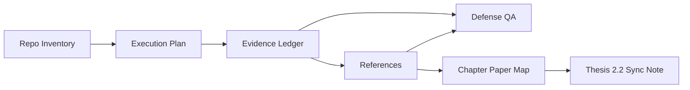

# Workflow Documentation Hub

This folder tracks execution planning, evidence readiness, references, and defense operations for the thesis.

## Folder Purpose

- Keep operational thesis workflow docs in one place.
- Separate active workflow docs from historical archive workflow files.
- Make defense preparation and evidence tracking easy to follow.

## Primary Documents

| Document | Purpose | Use frequency |
| --- | --- | --- |
| [internal/workflow/EVIDENCE_LEDGER.md](internal/workflow/EVIDENCE_LEDGER.md) | Evidence status tracker and known gaps | Daily during chapter writing and defense prep |
| [internal/workflow/REFERENCES.md](internal/workflow/REFERENCES.md) | Citation index for REF IDs | Daily while drafting thesis text |
| [internal/writing/defense_qa.md](internal/writing/defense_qa.md) | Examiner question rehearsal bank | Daily near defense period |
| [internal/workflow/literature/chapter_buckets.md](internal/workflow/literature/chapter_buckets.md) | Chapter-wise paper bifurcation map for writing flow | Daily while writing literature-related sections |
| [thesis/chapters/ch2_2_related_work_paper_map.md](thesis/chapters/ch2_2_related_work_paper_map.md) | Thesis-side 2.2 sync note linked to internal paper mapping | During Chapter 2 drafting/revision |
| [internal/workflow/april_15_completion_audit_and_execution_plan.md](internal/workflow/april_15_completion_audit_and_execution_plan.md) | Completion audit and execution logic | Weekly planning |
| [internal/workflow/repo_inventory.md](internal/workflow/repo_inventory.md) | Repository cleanup and footprint audit | As needed |

## How These Docs Connect

## Workflow Update Policy

1. If a runtime or CI/CD file changes, update evidence references in this folder.
2. If a threshold or metric changes, update both evidence and defense notes.
3. If a doc is historical-only, keep it prefixed with archive_ and do not use it as active source.

## Upgrade Checklist (Current)

| Item | Status | Next action |
| --- | --- | --- |
| CI/CD file references aligned to ci.yml + cd.yml | ✅ | Keep synced with workflow edits |
| Evidence ledger path accuracy | 🟡 | Continue path cleanup when lines are touched |
| Defense Q&A consistency with runtime code | 🟡 | Refresh sections after major code changes |
| Chapter-wise paper bifurcation and thesis 2.2 sync | ✅ | Keep `internal/workflow/literature/` and `thesis/chapters/ch2_2_related_work_paper_map.md` aligned |
| Archive workflow docs separation | ✅ | Keep archive_ prefixed files as historical |

## Related Hubs

- Canonical tech docs: [internal/reference/tech/README.md](internal/reference/tech/README.md)
- Internal root navigation: [internal/INDEX.md](internal/INDEX.md)
- Active defense writing file: [internal/writing/defense_qa.md](internal/writing/defense_qa.md)
